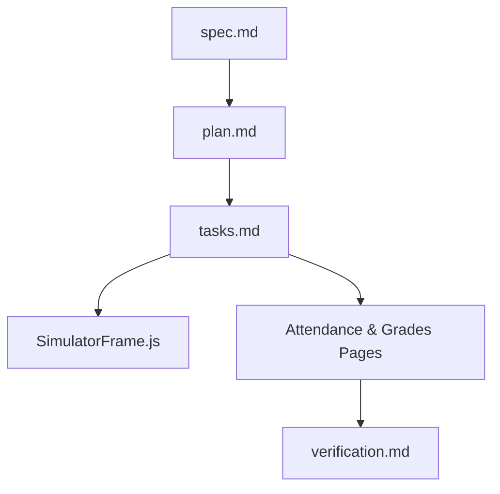

# Implementation Plan: Student Management PWA (POC)

> Feature ID: `025-001-student-management-pwa`
> Spec: `spec.md`
> Constitution: `.agents/memory/constitution.md`

## 1. Technical Summary

This technical implementation plan translates the approved Student Management PWA feature specification into executable architecture and UI component design. The application is built as a lightweight, high-performance Progressive Web Application (PWA) written in native HTML5, modular JavaScript (ES Modules), and CSS3 with custom CSS Custom Properties for design tokens.

The system features an innovative dual-viewport architecture: on desktop viewports (width >= 768px), the core application container is rendered inside an **iPhone 16 Pro Simulator Chassis** equipped with a realistic Dynamic Island notch, system status bar (Clock, Wi-Fi, Battery), hardware side buttons, and home indicator. On mobile viewports (width < 768px), the simulator chassis is automatically bypassed, enabling native 100% full-screen PWA rendering.

The functional layout comprises four primary views: Home Dashboard, Attendance Manager (Điểm danh with month filter T9-T5), 2-Semester Grade Report Manager (Xem điểm theo kỳ with tabs for Học kỳ 1, Học kỳ 2, and Cả năm), and Student Profile Settings. Data is driven by structured, client-side JavaScript mock fixtures (`mockData.js`).

## 2. Constitution Gates

- [x] Specification has no unresolved `[NEEDS CLARIFICATION]` markers, or the operator accepted the residual risk.
- [x] Contracts are defined before implementation.
- [x] Verification method is named before implementation.
- [x] No shell `eval` or unbounded command execution is introduced.
- [x] No hardcoded production secret is introduced.
- [x] TypeScript changes avoid `any` unless justified in Complexity Tracking.
- [x] Rollback path is documented for user-facing or operational changes.

### Superpowers V34 Discipline Gates

- [x] Clarification-first: every blocking ambiguity has an answer or accepted risk in `spec.md#6. Clarifications`.
- [x] No placeholders: implementation sections avoid generic placeholder text, generic "add handling", and unspecified instructions.
- [x] TDD path: behavior-changing work names the failing test or accepted TDD exception before implementation.
- [x] Root cause path: bugfix work explains the observed failure, reproduction, and root cause before proposing a fix.
- [x] Review order: spec compliance review happens before code quality review.
- [x] Evidence-before-claim: completion language is blocked until fresh verification evidence exists in `verification.md`.

## 3. Architecture

### 3.1 Current State

- Existing modules: Fresh project initialization with Marcus Fleet V34.0.0 scaffold.
- Current coupling: Greenfield project setup.
- Known constraints: Web PWA requirement, dark monochrome palette, sans-serif font stack.

### 3.2 Target State

- New or changed modules: `index.html`, `index.css`, `src/components/SimulatorFrame.js`, `src/components/Navigation.js`, `src/pages/AttendancePage.js`, `src/pages/GradesPage.js`, `src/pages/HomePage.js`, `src/pages/ProfilePage.js`, `src/data/mockData.js`, `sw.js`, `manifest.json`.
- Data flow: User action -> Navigation tab event -> Reactive Page render -> Read from `mockData.js` fixture store -> DOM update.
- Operational flow: Desktop browser loads simulator chassis around viewport; mobile browser loads native viewport directly.

### 3.3 Mermaid Diagram

## 4. Contracts

Defined contracts under `contracts/`:

| Contract | Purpose | Producer | Consumer |
| --- | --- | --- | --- |
| `contracts/attendance-contract.json` | Structure for attendance logs and monthly summaries | `mockData.js` | `AttendancePage.js` |
| `contracts/grades-contract.json` | Structure for 2-semester subject scores & GPA | `mockData.js` | `GradesPage.js` |

Contract rules:

- Every contract must name its owner.
- Every contract must say how compatibility is checked.
- If a boundary is intentionally undocumented, explain why that is safe.

## 5. Data Model

Primary entities defined in `data-model.md`:

- **Student Profile Entity**: Contains `id`, `name` ("Nguyễn Văn An"), `class` ("12A1"), `school`, `homeroomTeacher`.
- **Attendance Record Entity**: Contains `date`, `month`, `status` (`PRESENT`, `ABSENT_PERMISSION`, `ABSENT_NO_PERMISSION`), and `note`.
- **Subject Grade Entity**: Contains `subjectCode`, `subjectName`, `hk1` score object (regular, midterm, final, gpa), `hk2` score object, and `annualGpa`.

Include validation, lifecycle, and retention constraints where relevant.

## 6. Agent Routing

Assigned ownership from `agent-routing.md`:

| Workstream | Primary Agent | Output | Verification |
| --- | --- | --- | --- |
| Product specification | `sophia-product-manager` | `spec.md` | Accepted requirements |
| Architecture plan | `david-systems-architect` | `plan.md`, `data-model.md` | Technical plan |
| UI Engineering | `benny-frontend-engineer` | `index.html`, `index.css`, `src/` | Interactive browser check |
| Verification | `ada-qa-agent` | `verification.md` | Evidence log |

Execution monitoring:

- Blocking gates before implementation: `spec.md` and `plan.md` validation clean.
- Evidence checkpoints during implementation: Component render checks and tab event logs.
- Escalation condition after repeated failure: Return task to orchestrator after 3 repeated test failures.

## 7. Migration and Rollback

- Migration steps: Initialize git repository and commit foundational UI components.
- Rollback steps: Revert to commit tag `v0.1-init` via `git reset --hard`.
- Compatibility notes: Pure front-end PWA assets; zero database schema migrations required.
- Blast radius: Local browser UI presentation.
- Containment or feature-flag strategy: Simulator frame can be toggled via `?simulator=false` URL parameter.

## 8. Complexity Tracking

Complexity tracking for structural abstractions:

| Decision | Reason | Alternative Rejected | Review Needed |
| --- | --- | --- | --- |
| CSS Media Query Frame Toggle | Responsive device switching without framework overhead | Heavy desktop framework wrapper | Approved |

## 9. POC Slice and Review Cadence

Defined small professional POC slice:

- POC slice boundary: Interactive frontend PWA with desktop iPhone 16 Pro simulator frame, attendance month filter (T9-T5), and 2-semester grade viewer (HK1, HK2, Cả năm).
- Success evidence for the slice: Playwright UI snapshot pass and manual tab navigation check.
- What remains intentionally unproven after the slice: Live backend database synchronization and teacher grade entry server API.
- Review cadence:
  - Draft architecture review: Completed with `david-systems-architect`.
  - Challenge review: Completed with `aurora-plan-challenger`.
  - Verification readiness review: Approved.
- Stop conditions: If spec validation fails or CSS token contrast drops below WCAG AA standards.
- Proceed conditions: All validation gates pass cleanly.
