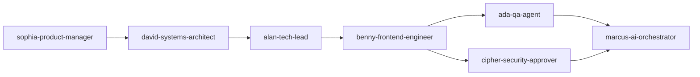

# Agent Routing & Task Ownership Topology

> Feature ID: `026-project-planning-school-operating-portal`  
> Governance: Marcus Fleet V34 Execution Gate

---

## Routing Contract

| Task Category | Assigned Agent / Skill | Write Scope | Output |
|---|---|---|---|
| Product Scope & Acceptance Criteria | `sophia-product-manager` | `docs/prd.md`, `spec.md` | Validated PRD, User Stories, Acceptance Criteria |
| Systems Architecture & Multi-Tenancy | `david-systems-architect` | `docs/decisions.md`, `plan.md`, `data-model.md` | ADR records, C4 diagrams, ERD schemas |
| Frontend Architecture & Store Design | `alan-tech-lead` | `src/pages/`, `src/store/`, `src/lib/` | Redux store configuration, Next.js routing structure |
| UI Components & Design System | `benny-frontend-engineer` | `src/components/`, `src/modules/` | React components adhering to ECO Design System 1.0 |
| Security & Tenant Boundary Audit | `cipher-security-approver` | `tests/reviews/r02-security-review.md` | Penetration tests, auth validation, JWE cookie checks |
| Quality Assurance & E2E Validation | `ada-qa-agent` | `tests/e2e/`, `verification.md` | Playwright test suites, regression reports |

---

## Handoff Rules

1. **Product to Architecture:** `sophia-product-manager` hands off approved user stories to `david-systems-architect` only after acceptance criteria pass the V34 clarification gate.
2. **Architecture to Engineering:** `david-systems-architect` and `alan-tech-lead` hand off API contracts and Redux slice definitions to `benny-frontend-engineer` before screen implementation begins.
3. **Engineering to QA:** `benny-frontend-engineer` delivers functional screens with unit test evidence to `ada-qa-agent` for end-to-end regression validation.
4. **No Code Without Contracts:** Implementation engineers are strictly prohibited from writing component code without validated contracts under `contracts/`.

---

## Review Topology

---

## Escalation Rules

1. **Scope Conflict:** If implementation uncovers an ambiguous business rule not covered in `docs_legacy/operating-portal/`, pause execution immediately, record an issue in the clarification ledger, and escalate to `sophia-product-manager`.
2. **Architecture Drift:** If a component requires direct API calls bypassing the Redux store or breaks tenant isolation, escalate immediately to `alan-tech-lead`.
3. **Security Vulnerability:** Any exposure of student PII, unencrypted session cookies, or cross-tenant data access constitutes a hard blocking failure and must be escalated to `cipher-security-approver`.
