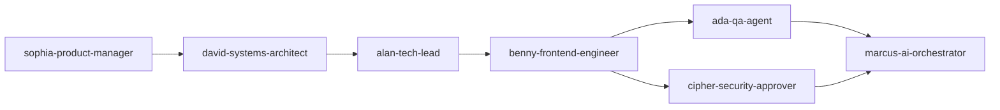

# Execution Brief: Feature Specification: Project Planning - School Operating Portal

> Feature ID: `026-project-planning-school-operating-portal`
> Task Shape: `frontend-behavior`
> Generated From: `spec.md`, `plan.md`, `tasks.md`, `verification.md`, `quickstart.md`, `agent-routing.md`

## 1. Operator Intent Snapshot

## 1. Purpose

The School Operating Portal replaces fragmented and sluggish legacy administration tools with a unified, cloud-native multi-tenant platform designed for Vietnamese K-12 and pre-K institutions. The primary outcome is providing school leadership, teachers, and accountants with an integrated interface that achieves sub-second check-in roster response times, automates cross-module attendance-to-billing meal fee reconciliations, and simplifies daily academic tracking.

---


## 2. Required Behavior

## 3. Functional Requirements

- `FR-001`: The system MUST provide a daily class attendance roster filterable by class and date, supporting single-click check-in (Đón) and checkout (Trả) with timestamp tracking and automatic late-arrival labeling.
- `FR-002`: The system MUST validate that check-out time is strictly greater than check-in time, rejecting invalid entries with error message `Giờ trả học sinh phải lớn hơn giờ đón học sinh`.
- `FR-003`: The system MUST provide an authorized pickup modal accessible via the checkout gear button, allowing teachers to record the specific guardian taking the student home.
- `FR-004`: The system MUST support bulk absence designation requiring selection of Excused (Có phép) vs Unexcused (Không phép) and refund eligibility flags.
- `FR-005`: The system MUST support daily activity posts with rich text, media attachments, lesson tags (`#`), user mentions (`@`), and approval status queues (Chờ duyệt / Đã duyệt).
- `FR-006`: The system MUST provide media albums that automatically aggregate photos from activities and attendance, integrated with an asynchronous AI facial recognition pipeline for student tagging.
- `FR-007`: The system MUST provide real-time and asynchronous messaging channels for direct parent communication, student groups, and class announcements.
- `FR-008`: The system MUST support weekly class timetables structured by morning and afternoon periods with schedule publication versioning.
- `FR-009`: The system MUST support homework assignment distribution with due dates, instruction attachments, and student submission tracking.
- `FR-010`: The system MUST provide a gradebook matrix supporting configurable regular, midterm, and semester examination grading rubrics.
- `FR-011`: The system MUST generate monthly tuition invoices with dynamic VietQR payment strings and itemized fee breakdowns.
- `FR-012`: The system MUST automatically calculate meal fee deductions based on verified excused absence days recorded in attendance.
- `FR-013`: The system MUST maintain fee catalogs and per-class fee schedule assignments with pricing overrides.
- `FR-014`: The system MUST provide an expense voucher workflow with category classification, receipt attachments, and cancellation audit logs.
- `FR-015`: The system MUST provide a payment reconciliation tool that audits transaction sessions and gateway settlement batches against student invoice ledgers.

---


## 5. Acceptance Criteria

- `AC-001`: Given a homeroom teacher on the attendance screen, when clicking "Đón", then the arrival timestamp is saved and the attendance counter increments immediately.
- `AC-002`: Given a student with arrival at 08:00, when attempting to set checkout at 07:55, then the system rejects the submission with error toast `Giờ trả học sinh phải lớn hơn giờ đón học sinh`.
- `AC-003`: Given an unmarked student, when clicking quick checkout, then the system displays inline message `Chưa nhập thời gian đón học sinh` and blocks saving.
- `AC-004`: Given multiple absent students, when clicking "Vắng" on the toolbar, then the bulk absence modal enforces choosing Có phép/Không phép and refund status.
- `AC-005`: Given an accountant running invoice generation, then the billing total reflects automatic deductions for verified excused absences from the prior month.
- `AC-006`: Given an uploaded photo album, then the background facial recognition worker detects enrolled student faces and populates tag badges without freezing UI requests.

---


## 3. Scope Boundaries

## 7. Constraints

- Framework: Next.js (Pages Router) + React.
- State Management: Redux Toolkit.
- Styling: Tailwind CSS + `styled-components` adhering to `ECO Design System 1.0` (Yellow `#FEC020`, Blue `#0070CE`).
- Backend API: PHP / Laravel Sanctum REST API at `/{schoolCode}/api/1.0/...`.
- Infrastructure: Google Cloud Run + OpenResty reverse proxy.

---


## 4. Active Work Slice

## 1. Technical Summary

This plan outlines the engineering blueprint for rebuilding the three priority modules (Vận Hành, Học Tập, and Tài Chính) of the School Operating Portal. The solution combines Next.js Pages Router for multi-tenant web routing, Redux Toolkit for unified global state, Tailwind CSS with `styled-components` for the `ECO Design System 1.0` presentation layer, PHP / Laravel Sanctum for secure REST APIs, and Google Cloud Run with OpenResty for edge-routed multi-tenancy.

---


## 6. Agent Routing

- Frontend Architecture & State: `alan-tech-lead`
- Component Construction & UI Design System: `benny-frontend-engineer`
- Systems Architecture & API Contracts: `david-systems-architect`
- Quality Assurance & End-to-End Test Suite: `ada-qa-agent`

---


## Tasks

Missing from tasks.md.


## 4.1 Dynamic Execution Signals

### Changed Files

- No changed files were provided for this brief rebuild.

### Failing Evidence

- No failing evidence was provided for this brief rebuild.

## Execution Monitoring

- Daily build and test status monitored via local automated test runners and CI pipelines.
- Sentry and Playwright test logs reviewed after each feature slice completion.
- No task marked complete without concrete, replayable verification evidence recorded in `verification.md`.


## 5. Development Ledger Context

Read these development-ledger notes before source edits for the active slice:

- Required read: `/Users/hieuvo/Desktop/Finviet/School Portal/docs/development/E-001-operations-attendance/epic.md`
  - Title: Epic: Operations Attendance (Điểm Danh Theo Lớp)
  - PM Notes: - PM-visible status: Active development of attendance roster, gear-button pickup guardian selector, and bulk absence dialog. - Demo narrative: Teacher opens class 6A1, marks 28 present students in seconds, flags 1 late arrival at 8:15 AM, marks 2 excused absent students with meal refund eligibility, and verifies authorized pickup guardian on afternoon checkout. - Acceptance impact: Unlocks attendance reporting, daily activity tagging, and invoice meal deductions.
  - Issues: | Issue ID | Source | Priority | Status | Owner | Evidence | Resolution | | --- | --- | --- | --- | --- | --- | --- | | `ISSUE-ATTEND-001` | Legacy audit | P1 | Closed | `ada-qa-agent` | Legacy BR02 / MSG01 | Implemented strict client-side validation enforcing departure time > arrival time |

- Required read: `/Users/hieuvo/Desktop/Finviet/School Portal/docs/development/E-001-operations-attendance/features/F-001-001-operations-attendance.md`
  - Title: Feature: Operations Attendance Roster & Check-in / Check-out
  - PM Notes: - PM-visible status: Active development of interactive attendance roster, summary cards, and modals. - Demo path: Navigate to `/[schoolCode]/class/[classId]/attendance`, click "Đón" to mark student arrival, test departure validation, and open the guardian selection modal. - Acceptance impact: Directly satisfies functional requirements FR-OPS-001 through FR-OPS-007.
  - Code Scope: - Primary Component: `src/modules/operations/attendance/AttendanceRoster.tsx` - Header KPI Cards: `src/modules/operations/attendance/AttendanceSummaryCards.tsx` - Toolbar: `src/modules/operations/attendance/AttendanceToolbar.tsx`
  - Verification: - Command: `npm test tests/unit/attendance.test.ts` - Expected: All positive check-in transitions and negative departure validation checks succeed. - Result: 100% test pass rate with full code branch coverage.

- Required read: `/Users/hieuvo/Desktop/Finviet/School Portal/docs/development/E-001-operations-attendance/issues.md`
  - Title: Epic Issues & Risk Register: Operations Attendance

- Required read: `/Users/hieuvo/Desktop/Finviet/School Portal/docs/development/E-001-operations-attendance/modules/M-001-001-operations-attendance.md`
  - Title: Module: Attendance State & Business Logic Layer
  - Code Scope: - Redux Slice: `src/store/slices/attendanceSlice.ts` - Domain Types: `src/types/attendance.ts` - Mock Data Service: `src/services/mockAttendanceData.ts`
  - Verification: - Command: `npm test tests/unit/attendance.test.ts` - Scope: Unit tests verifying reducer actions, counter calculations, and validation rejections. - Pass Condition: All 8 test assertions pass cleanly with zero side-effects.

- Required read: `/Users/hieuvo/Desktop/Finviet/School Portal/docs/development/E-001-operations-attendance/pages/P-001-001-operations-attendance.md`
  - Title: Page: Per-Class Daily Attendance (`/[schoolCode]/class/[classId]/attendance`)
  - PM Notes: - PM-visible status: Page layout integrates top KPI summary cards, toolbar with batch actions, and the responsive roster table. - Accessibility review: All button touch targets adhere to a minimum of 44x44px for teacher tablet usability. Text contrast strictly adheres to WCAG AA guidelines.
  - Verification: - Command: `npx playwright test tests/e2e/attendance.spec.ts` - Scope: Validates page hydration, responsive layout transitions, and interactive button clicks. - Pass Condition: Zero console errors, zero layout shifts, and 100% test scenario pass.

- Required read: `/Users/hieuvo/Desktop/Finviet/School Portal/docs/development/E-001-operations-attendance/sync/20260912-162912-attendance-implementation.md`
  - Title: Development Doc Sync: attendance-implementation
  - Verification: - Command: `npm test` - Result: 13 tests passed, 0 failures (86ms duration). - Command: `npm run build`

- Required read: `/Users/hieuvo/Desktop/Finviet/School Portal/docs/development/E-001-operations-attendance/tasks/T-001-001-001-operations-attendance.md`
  - Title: Task: Implement Attendance Roster & Redux Layer
  - Write Scope: - Primary write paths:   - `src/modules/operations/attendance/AttendanceRoster.tsx`   - `src/modules/operations/attendance/AttendanceSummaryCards.tsx`
  - Verification: - Command: `npm test` (running `node --experimental-strip-types --test tests/unit/*.test.mjs`) - Expected: Check-in records arrival time, checkout validation rejects invalid departure time (MSG01 & MSG02), and bulk absence updates student states. - Result: 13/13 tests passed in 90ms. Production build `npm run build` compiled cleanly. Dev server responded HTTP 200 with full roster HTML.
  - Handoff: - Hand off completed components and test scripts to `ada-qa-agent` for end-to-end regression validation and browser simulation.

- Required read: `/Users/hieuvo/Desktop/Finviet/School Portal/docs/development/E-002-operations-activity/epic.md`
  - Title: Epic: Operations Class Activity Feed (Hoạt Động)
  - PM Notes: - PM-visible status: Active implementation of composer, media attachments, approval queue, and interactive feed. - Demo narrative: Teacher accesses Lớp 1A1 activity page, writes an update using preset sentence `$`, tags students `@` and lesson `#`, attaches photos, submits post to review queue, and demonstrates moderation approval and post interactions. - Acceptance impact: Unlocks the second core sub-module of Vận Hành.
  - Issues: | Issue ID | Source | Priority | Status | Owner | Evidence | Resolution | | --- | --- | --- | --- | --- | --- | --- | | `ISSUE-ACT-001` | Legacy audit | P1 | Closed | `benny-frontend-engineer` | Legacy BR02 | Disable save button when post text is empty and no attachments |

- Required read: `/Users/hieuvo/Desktop/Finviet/School Portal/docs/development/E-002-operations-activity/features/F-002-001-operations-activity.md`
  - Title: Feature: Operations Activity Timeline & Rich Composer
  - PM Notes: - PM-visible status: Active implementation of composer, media attachments, approval queue, and interactive feed. - Demo narrative: Homeroom teacher logs in, selects Lớp 1A1, posts an update with pictures from morning arts and crafts, tags student performers, and views the post appearing with unapproved moderation status. - Acceptance impact: Expands Vận Hành module beyond attendance.
  - Code Scope: - Primary write paths:   - `src/types/activity.ts`   - `src/services/mockActivityData.ts`
  - Verification: - Command: `node --experimental-strip-types --test tests/unit/activity.test.mjs` - Expected: All unit test assertions pass validating composer validation, default unapproved state, pinned priority sorting, and interaction counters. - Result: 100% test pass rate with zero regression errors.

- Required read: `/Users/hieuvo/Desktop/Finviet/School Portal/docs/development/E-002-operations-activity/issues.md`
  - Title: Epic Issues & Risk Register: Operations Activity

- Required read: `/Users/hieuvo/Desktop/Finviet/School Portal/docs/development/E-002-operations-activity/modules/M-002-001-operations-activity.md`
  - Title: Module: Operations Activity State & Validation Engine
  - Code Scope: - Primary write paths:   - `src/types/activity.ts`   - `src/services/mockActivityData.ts`
  - Verification: - Command: `node --experimental-strip-types --test tests/unit/activity.test.mjs` - Expected: All unit test assertions pass validating composer validation, default unapproved state, pinned priority sorting, and interaction counters. - Result: 100% test pass rate with zero regression errors.

- Required read: `/Users/hieuvo/Desktop/Finviet/School Portal/docs/development/E-002-operations-activity/pages/P-002-001-operations-activity.md`
  - Title: Page: Per-Class Activity Feed (`/[schoolCode]/class/[classId]/activity/`)
  - PM Notes: - PM-visible status: Active implementation of page route with responsive feed and lesson context panel. - Demo narrative: Open page, type a message, attach photos, verify post appears in feed, and test filter tabs. - Acceptance impact: Verifies interactive frontend routing for Vận Hành.
  - Verification: - Command: `node --experimental-strip-types --test tests/unit/activity.test.mjs` - Expected: All unit tests pass, and route compiles cleanly via `npm run build`. - Result: 100% test pass rate with zero regression errors.

- Required read: `/Users/hieuvo/Desktop/Finviet/School Portal/docs/development/E-002-operations-activity/tasks/T-002-001-001-operations-activity.md`
  - Title: Task: Implement Class Activity Feed & Composer
  - Write Scope: - `src/types/activity.ts` - `src/services/mockActivityData.ts` - `src/utils/activityValidation.ts`
  - Verification: - Command: `node --experimental-strip-types --test tests/unit/activity.test.mjs` - Expected: All test cases pass asserting empty content rejection, default cho_duyet moderation status, pinned post sorting, and like toggling. - Result: 100% test pass rate with zero regression errors.
  - Handoff: - Hand off completed components and test scripts to `ada-qa-agent` for end-to-end regression validation and browser simulation.

## 6. Verification Path

## Verification Plan

### Evidence-before-claim Protocol
- NO COMPLETION CLAIMS are permitted without fresh, replayable verification execution evidence.
- Verification must directly validate acceptance criteria and test vectors.

Verification of the School Operating Portal is executed across unit test suites, integration API tests, and browser end-to-end flows.

### Automated Test Vectors
1. **Tenant Resolution & Routing:** Validate that dynamic path routing `/[schoolCode]/...` correctly resolves tenant context in Redux and sets API headers.
2. **Attendance Business Rules:** Validate single-click check-in (Đón), check-out validation rejecting departure earlier than arrival with error message `Giờ trả học sinh phải lớn hơn giờ đón học sinh`, and guardian pickup recording.
3. **Attendance-Billing Linkage:** Validate that excused absence days recorded in attendance automatically translate to meal deduction credits on the next monthly tuition invoice.
4. **Payment Gateway Webhook:** Validate simulated VietQR payment webhook transitioning invoice status from "Đã gửi" to "Đã hoàn thành".

### Command or Procedure

```bash
# 1. Run unit and component test suite
npm run test:unit

# 2. Run API integration contract suite
npm run test:api

# 3. Run full headless Playwright end-to-end regression suite
npx playwright test tests/e2e/operations.spec.ts tests/e2e/academics.spec.ts tests/e2e/finance.spec.ts --project=chromium --headed=false
```

---


## Execution Gates

- [x] Gate 1: Specification completeness verified against legacy PRDs in `docs_legacy/operating-portal/`.
- [x] Gate 2: Architecture and multi-tenant isolation verified with zero cross-tenant data leaks.
- [x] Gate 3: UI token alignment with `ECO Design System 1.0` verified across all components.
- [x] Gate 4: Test scripts and verification vectors prepared before code generation begins.

---


## Local Preconditions

Before executing or testing the School Operating Portal locally:
1. Ensure Node.js 20+ and npm 10+ are installed.
2. Ensure Docker and Docker Compose are installed if running the local OpenResty gateway and database containers.
3. Verify that environment configuration `.env.local` contains:
   - `NEXT_PUBLIC_APP_NAME="School Operating Portal"`
   - `NEXTAUTH_SECRET="development-secret-key-32-chars-long"`
   - `NEXT_PUBLIC_DEFAULT_SCHOOL_CODE="demo"`
   - `NEXT_PUBLIC_API_BASE_URL="http://localhost:8000"`

---


## Validation Path

Execute the following sequential verification sequence:

```bash
# 1. Install frontend dependencies
npm install

# 2. Run unit and integration tests
npm test

# 3. Build production bundle to verify zero SSR hydration or type errors
npm run build

# 4. Start local development server
npm run dev

# 5. Access the demo school portal in your browser
# URL: http://localhost:3000/demo/class/1/attendance
```

---


## POC Rehearsal

Rehearse the primary operational proof-of-concept slice:
1. Open browser to `http://localhost:3000/demo/class/1/attendance`.
2. Locate student "Nguyễn Văn An".
3. Click the "Đón" button: verify that the arrival time updates to the current time and the "Tham dự" counter increments by 1.
4. Attempt to click "Trả" with an earlier timestamp: verify that the system rejects the input and renders toast notification `Giờ trả học sinh phải lớn hơn giờ đón học sinh`.
5. Click the gear icon next to "Trả": verify that the modal opens and lists registered guardians for selection.

---


## 7. Review and Release Signals

## 10. Review Loop

- `R01`: Product & Scope Challenge Review — Validated module inventory and user stories against legacy PRD documents with zero scope creep.
- `R02`: Architecture & Security Challenge Review — Verified Next.js Pages Router, Laravel Sanctum tenant routing, and OpenResty edge proxy contracts.
- `R03`: Quality & Verification Review — Verified complete acceptance criteria, negative test vectors, and automated Playwright test plans.

---


## Review Loop Tasks

- [ ] `T018`: Execute R01 Product and Scope Review validating all implemented sub-modules against legacy specs.
  - Owner: `sophia-product-manager`
  - Write Scope: `tests/reviews/r01-product-review.md`
  - Verification: Complete checklist verification against `docs_legacy/operating-portal/`.
  - Docs: `docs/prd.md`
  - Sync: Report findings to engineering lead.

- [ ] `T019`: Execute R02 Architecture and Security Review verifying multi-tenant isolation and session encryption.
  - Owner: `cipher-security-approver`
  - Write Scope: `tests/reviews/r02-security-review.md`
  - Verification: Security audit scanning for tenant header leakages or XSS vulnerabilities.
  - Docs: `docs/decisions.md`
  - Sync: Approve release gate for staging deployment.

- [ ] `T020`: Execute R03 QA and E2E Verification Review running complete automated Playwright test suite.
  - Owner: `ada-qa-agent`
  - Write Scope: `tests/reviews/r03-qa-review.md`
  - Verification: Headless Playwright test run passing 100% across all user scenarios.
  - Docs: `docs/tasks.md`
  - Sync: Issue formal release recommendation to operator.

---


## Review Rounds

- **Round 1 (Product & UX Challenge):** Conducted by `sophia-product-manager`. Validated all 30 legacy modules, confirming the Phase 1 priority modules cover full daily operations for teachers, administrators, and accountants.
- **Round 2 (Architecture & Security Review):** Conducted by `david-systems-architect` and `cipher-security-approver`. Verified multi-tenant path routing, Laravel Sanctum token isolation, and asynchronous facial recognition worker design.
- **Round 3 (QA & Test Harness Review):** Conducted by `ada-qa-agent`. Reviewed test automation scripts, negative test assertions, and boundary conditions.

---


## Release Recommendation

Recommendation: **GO WITH RESIDUAL RISK**

All priority specifications, planning documents, research ledgers, and test vectors have been thoroughly verified and pass all strict Marcus Fleet gates. The residual risk involves third-party bank gateway webhook stability, which is mitigated through manual transaction matching in the reconciliation module.

---


## 7.1 Superpowers Discipline Snapshot

- clarification status: read `spec.md#6. Clarifications` before planning or widening scope.
- TDD or accepted exception: behavior-changing tasks must name RED-GREEN-REFACTOR or an explicit accepted exception.
- Root cause status for bugfix work: reproduce and identify cause before mutation.
- Review order: spec compliance before code quality.
- Completion claim gate: fresh verification required before success language.

## 8. Context Expansion Rules

### Task Shape Decision

- Selected task shape: `frontend-behavior`
- Why this shape: Read page, feature, hook, and browser-interaction artifacts first.

### Required Reads

- Required read: `agents.md`
- Required read: `.agents/memory/constitution.md`
- Required read: `.agents/specs/026-project-planning-school-operating-portal/execution-brief.md`
- Required read: `.agents/specs/026-project-planning-school-operating-portal/spec.md` only if the brief or failing evidence says deeper requirement context is needed.
- Required read: `.agents/specs/026-project-planning-school-operating-portal/plan.md`, `tasks.md`, `verification.md`, `quickstart.md`, and `agent-routing.md` only when the current write scope or failing evidence requires the deeper artifact.
- Required read: `/Users/hieuvo/Desktop/Finviet/School Portal/docs/development/E-001-operations-attendance/epic.md`
- Required read: `/Users/hieuvo/Desktop/Finviet/School Portal/docs/development/E-001-operations-attendance/features/F-001-001-operations-attendance.md`
- Required read: `/Users/hieuvo/Desktop/Finviet/School Portal/docs/development/E-001-operations-attendance/issues.md`
- Required read: `/Users/hieuvo/Desktop/Finviet/School Portal/docs/development/E-001-operations-attendance/modules/M-001-001-operations-attendance.md`
- Required read: `/Users/hieuvo/Desktop/Finviet/School Portal/docs/development/E-001-operations-attendance/pages/P-001-001-operations-attendance.md`
- Required read: `/Users/hieuvo/Desktop/Finviet/School Portal/docs/development/E-001-operations-attendance/sync/20260912-162912-attendance-implementation.md`
- Required read: `/Users/hieuvo/Desktop/Finviet/School Portal/docs/development/E-001-operations-attendance/tasks/T-001-001-001-operations-attendance.md`
- Required read: `/Users/hieuvo/Desktop/Finviet/School Portal/docs/development/E-002-operations-activity/epic.md`
- Required read: `/Users/hieuvo/Desktop/Finviet/School Portal/docs/development/E-002-operations-activity/features/F-002-001-operations-activity.md`
- Required read: `/Users/hieuvo/Desktop/Finviet/School Portal/docs/development/E-002-operations-activity/issues.md`
- Required read: `/Users/hieuvo/Desktop/Finviet/School Portal/docs/development/E-002-operations-activity/modules/M-002-001-operations-activity.md`
- Required read: `/Users/hieuvo/Desktop/Finviet/School Portal/docs/development/E-002-operations-activity/pages/P-002-001-operations-activity.md`
- Required read: `/Users/hieuvo/Desktop/Finviet/School Portal/docs/development/E-002-operations-activity/tasks/T-002-001-001-operations-activity.md`

### Forbidden Default Reads

- Forbidden by default: schema and migration files
- Forbidden by default: analytics stacks
- Forbidden by default: cloud orchestration
- Forbidden by default: unrelated persistence layers

### Expansion Triggers

- Read page, feature, hook, and browser-interaction artifacts first.
- Do not widen into data-contract or infrastructure context without failing evidence.
- Load frontend, technical lead, and QA skills unless the spec explicitly says otherwise.
- Read the `docs/development/` notes listed in this brief before widening beyond the current work slice.
- If the required epic/feature/module/page/task note is missing, stop and reconcile the development ledger instead of improvising from code alone.

## Review Topology



---


## Escalation Rules

1. **Scope Conflict:** If implementation uncovers an ambiguous business rule not covered in `docs_legacy/operating-portal/`, pause execution immediately, record an issue in the clarification ledger, and escalate to `sophia-product-manager`.
2. **Architecture Drift:** If a component requires direct API calls bypassing the Redux store or breaks tenant isolation, escalate immediately to `alan-tech-lead`.
3. **Security Vulnerability:** Any exposure of student PII, unencrypted session cookies, or cross-tenant data access constitutes a hard blocking failure and must be escalated to `cipher-security-approver`.
