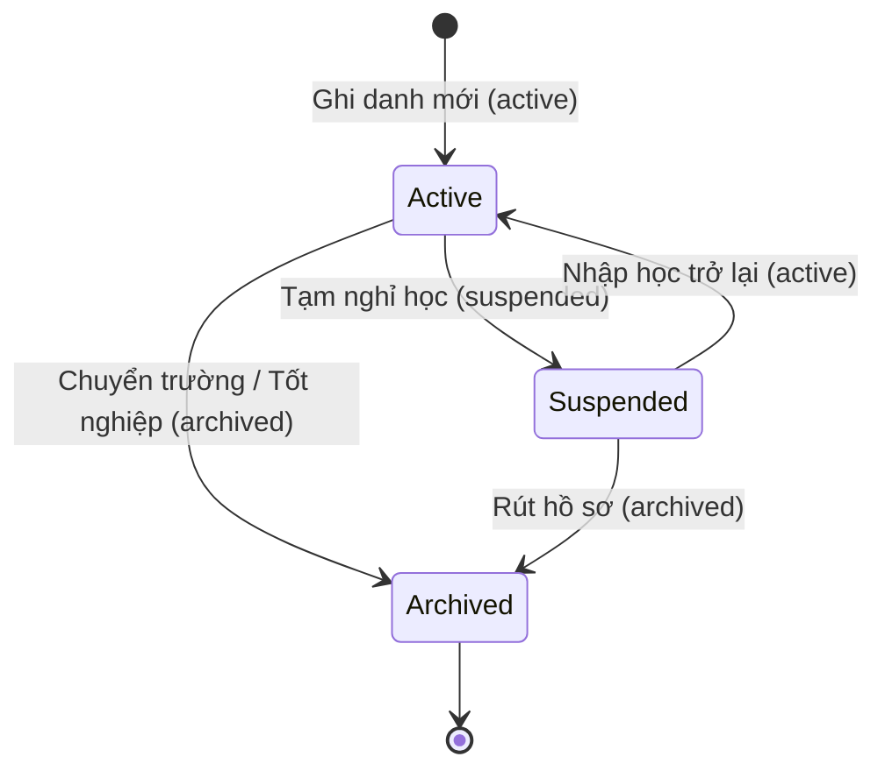
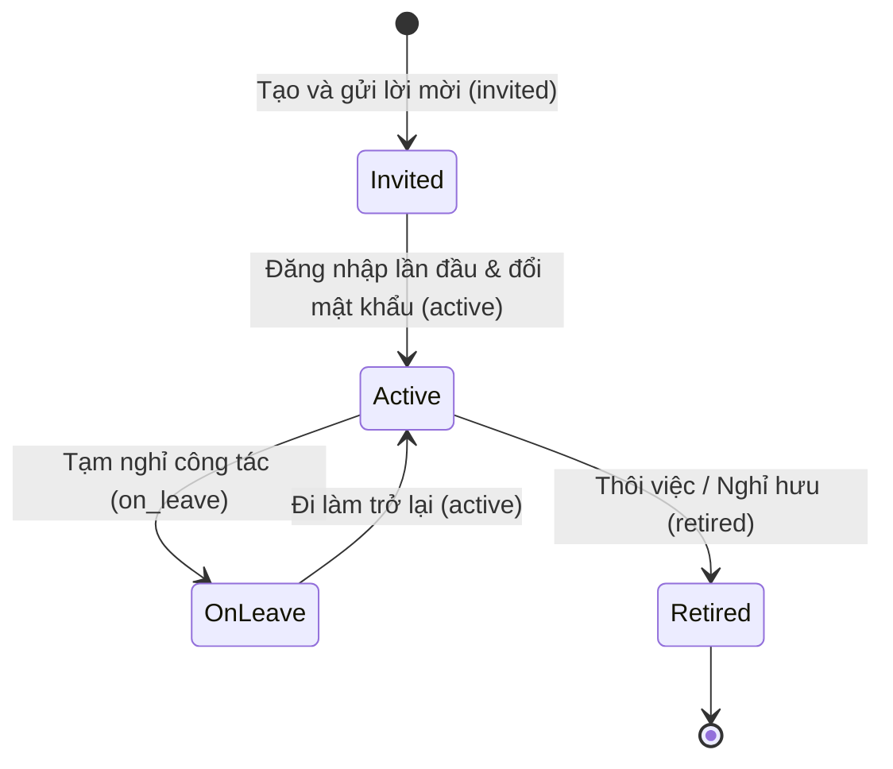

# Data Model: School Administration Module Phase 1

> Feature ID: `027-school-administration-module-phase-1`

## Entities

| Entity | Fields | Owner | Notes |
| --- | --- | --- | --- |
| `Kid` | `id`, `studentCode`, `fullName`, `nickname`, `cccd`, `birthDate`, `gender`, `homeroomClassId`, `extracurricularClassId`, `status`, `internalNotes`, `admissionDate` | `studentSlice` | Central student record; links to exactly 1 homeroom class and optional extracurricular class. |
| `ParentContact` | `id`, `kidId`, `role` (`mother`, `father`, `guardian`, `other`), `fullName`, `phone`, `email`, `cccd`, `address`, `birthDate` | `studentSlice` | Multiple contacts per student; accounts support cross-sibling parent representations. |
| `GrowthRecord` | `id`, `kidId`, `recordedDate`, `heightCm`, `weightKg`, `bmi`, `recorderName`, `note` | `studentSlice` | Append-only growth measurement log with computed BMI: `weight / (height/100)^2`. |
| `StudentTuitionOverride` | `id`, `kidId`, `monthlyTuitionFee`, `dailyMealFee`, `notes` | `studentSlice` | Per-student tuition fee override configured at student enrollment. |
| `Teacher` | `id`, `staffCode`, `fullName`, `email`, `phone`, `address`, `birthDate`, `homeroomClassId`, `assignedClassIds`, `moderationTier`, `status`, `supplementaryInfo` | `teacherSlice` | Faculty record; links homeroom and teaching classes; `moderationTier` governs activity publishing. |
| `Class` | `id`, `code`, `name`, `classType` (`chinh_khoa`, `ngoai_khoa`), `gradeId`, `homeroomTeacherId`, `studentCount`, `description`, `ageGroup` | `classSlice` | Class catalog; extracurricular classes enforce feature degeneration; zero-student delete invariant. |
| `Subject` | `id`, `code`, `name`, `educationLevel` (`TH`, `THCS`, `THPT`, `GDTX`), `subjectType`, `category`, `isSummarized`, `assignedTeacherIds`, `evaluationTerms` | `subjectSlice` | Subject catalog partitioned by educational tier; read-only term evaluation matrix. |
| `Grade` | `id`, `code`, `name`, `educationLevel`, `classCount`, `studentCount` | `gradeSlice` | Educational grade level hierarchy across 4 tiers; aggregate headcount analytics. |

## State Transitions

### Student Lifecycle State Machine

### Teacher Moderation & Onboarding State Machine

## Validation Rules

1. **Student Code & CCCD Uniqueness:** In new student registrations, `studentCode` and `cccd` must be unique across the tenant.
2. **BMI Calculation Formula:** $\text{BMI} = \frac{\text{weight (kg)}}{(\text{height (cm)} / 100)^2}$, rounded to 1 decimal place.
3. **Class Deletion Safety Invariant:** Deletion of any class is allowed if and only if $\text{studentCount} === 0$.
4. **Subject Teacher Deduplication:** In the subject teacher assignment modal, teachers already assigned to the subject cannot be selected again.
5. **Class Transfer Cascades:** Class transfer requires atomic re-mapping of student fee schedules, chat channel memberships, and subject evaluation records.
