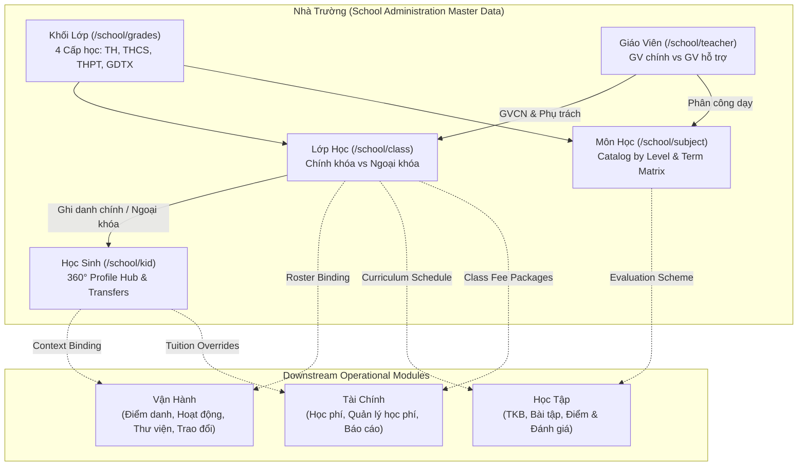

# Implementation Plan: School Administration Module Phase 1

> Feature ID: `027-school-administration-module-phase-1`
> Spec: `spec.md`
> Constitution: `.agents/memory/constitution.md`

## 1. Technical Summary

The School Administration Module ("Nhà Trường") provides core institutional master data across five initial sub-modules:
1. **Học Sinh (`/school/kid/`):** Student directory, 360° profile hub with multi-parent cards, tuition fee overrides, physical development BMI history, class transfers, and bulk academic year promotions.
2. **Giáo Viên (`/school/teacher/`):** Faculty directory, homeroom and subject class assignments, invitation credential dispatch, and a two-tier content moderation pipeline ("Giáo viên chính" vs "Giáo viên hỗ trợ").
3. **Lớp Học (`/school/class/`):** Dual class taxonomy (Curricular vs Extracurricular) with intentional feature degeneration for extracurricular classes, homeroom teacher allocation, and zero-student deletion safety guards.
4. **Môn Học (`/school/subject/`):** Four-tier educational subject catalog (TH, THCS, THPT, GDTX) with 4-term evaluation matrices and deduplicated faculty assignments.
5. **Khối Lớp (`/school/grades/`):** Grade level hierarchy across 4 tiers with aggregate headcounts and client-side reactive search resolution.

The implementation builds on Next.js Pages Router with Redux Toolkit slices (`studentSlice.ts`, `teacherSlice.ts`, `classSlice.ts`, `subjectSlice.ts`, `gradeSlice.ts`), TypeScript contracts, mock datasets, and business validation engines.

## 2. Constitution Gates

- [x] Specification has no unresolved `[NEEDS CLARIFICATION]` markers, or the operator accepted the residual risk.
- [x] Contracts are defined before implementation.
- [x] Verification method is named before implementation.
- [x] No shell `eval` or unbounded command execution is introduced.
- [x] No hardcoded production secret is introduced.
- [x] TypeScript changes avoid `any` unless justified in Complexity Tracking.
- [x] Rollback path is documented for user-facing or operational changes.

### Superpowers V34 Discipline Gates

- [x] Clarification-first: every blocking ambiguity has an answer or accepted risk in `spec.md#6. Clarifications`.
- [x] No placeholders: implementation sections avoid placeholder tokens, generic "add handling", and unspecified "write tests" instructions.
- [x] TDD path: behavior-changing work names the failing test or accepted TDD exception before implementation.
- [x] Root cause path: bugfix work explains the observed failure, reproduction, and root cause before proposing a fix.
- [x] Review order: spec compliance review happens before code quality review.
- [x] Evidence-before-claim: completion language is blocked until fresh verification evidence exists in `verification.md`.

## 3. Architecture

### 3.1 Current State

- Existing modules: Vận Hành (Attendance, Activities, Media, Messaging, Reports), Học Tập (Schedule, Assignment, Gradebook), Tài Chính (Invoicing, Fee Catalog, Tuition Management, Expenses, Reconciliation, Fee Reports).
- Current coupling: Child modules referenced mock student and class lists without centralized school administration master data management interfaces.
- Known constraints: Multi-tenant URL structure `/{schoolCode}/...`, Next.js Pages Router, Redux Toolkit, Tailwind CSS + `styled-components`, ECO Design System 1.0.

### 3.2 Target State

- New modules: `src/modules/school/student/`, `src/modules/school/teacher/`, `src/modules/school/class/`, `src/modules/school/subject/`, `src/modules/school/grades/`.
- Data flow: Redux slices manage local entity collections, filter criteria, and active modal view models. Validation utilities encapsulate invariants (zero-student class deletion, BMI calculations, transition rules).
- Operational flow: Admin provisions teachers and classes $\rightarrow$ enrolls students $\rightarrow$ assigns subjects and fees $\rightarrow$ downstream operational and financial modules ingest standardized entity IDs.

### 3.3 Mermaid Diagram

## 4. Contracts

Contracts are materialized in `src/types/` and detailed in `contracts/`:

| Contract | Purpose | Producer | Consumer |
| --- | --- | --- | --- |
| `src/types/student.ts` | Student profile, guardian contacts, growth records, transfer requests | `studentSlice` | Student module, Attendance, Invoices |
| `src/types/teacher.ts` | Teacher profiles, homeroom/teaching mappings, moderation tiers | `teacherSlice` | Teacher module, Activity, Schedule |
| `src/types/class.ts` | Class master records, taxonomy flags, homeroom bindings | `classSlice` | Class module, all school modules |
| `src/types/subject.ts` | Subject definitions, term evaluation matrix, faculty assignments | `subjectSlice` | Subject module, Gradebook, Schedule |
| `src/types/grade.ts` | Grade level definitions across 4 educational tiers | `gradeSlice` | Grade module, Class module |

## 5. Data Model

- **Kid Entity:** `id`, `studentCode`, `fullName`, `nickname`, `cccd`, `birthDate`, `gender`, `homeroomClassId`, `extracurricularClassId`, `status`, `internalNotes`.
- **ParentContact Entity:** `id`, `kidId`, `role` (`mother` | `father` | `guardian` | `other`), `fullName`, `phone`, `email`, `cccd`, `address`.
- **GrowthRecord Entity:** `id`, `kidId`, `recordedDate`, `heightCm`, `weightKg`, `bmi`, `recorderName`, `note`.
- **Teacher Entity:** `id`, `staffCode`, `fullName`, `email`, `phone`, `address`, `homeroomClassId`, `assignedClassIds`, `moderationTier` (`giao_vien_chinh` | `giao_vien_ho_tro`), `status`.
- **Class Entity:** `id`, `code`, `name`, `classType` (`chinh_khoa` | `ngoai_khoa`), `gradeId`, `homeroomTeacherId`, `studentCount`.
- **Subject Entity:** `id`, `code`, `name`, `educationLevel`, `subjectType`, `category`, `isSummarized`, `assignedTeacherIds`.
- **Grade Entity:** `id`, `code`, `name`, `educationLevel`, `classCount`, `studentCount`.

## 6. Agent Routing

| Workstream | Primary Agent | Output | Verification |
| --- | --- | --- | --- |
| Student Hub (`TASK-SCH-001`) | `benny-frontend-engineer` | `studentSlice`, Student Directory, 360° Profile Hub | Automated unit tests (`tests/unit/students.test.mjs`) |
| Teacher Directory (`TASK-SCH-002`) | `benny-frontend-engineer` | `teacherSlice`, Teacher Directory, Invitation Flow | Automated unit tests (`tests/unit/teachers.test.mjs`) |
| Class Management (`TASK-SCH-003`) | `benny-frontend-engineer` | `classSlice`, Class Catalog, Deletion Safeguard | Automated unit tests (`tests/unit/classes.test.mjs`) |
| Subject Catalog (`TASK-SCH-004`) | `benny-frontend-engineer` | `subjectSlice`, Subject Matrix, Teacher Assignment | Automated unit tests (`tests/unit/subjects.test.mjs`) |
| Grade Levels (`TASK-SCH-005`) | `benny-frontend-engineer` | `gradeSlice`, Grade Hierarchy, Reactive Search | Automated unit tests (`tests/unit/grades.test.mjs`) |
| QA & Regression | `ada-qa-agent` | Test suites, clean build, live HTTP 200 telemetry | `npm test` & `npm run build` |

## 7. Migration and Rollback

- **Migration:** Implementation adds isolated routes under `/school/kid/`, `/school/teacher/`, `/school/class/`, `/school/subject/`, and `/school/grades/` without altering existing operational or billing routes.
- **Rollback:** In the event of regression, route navigation links in the sidebar are easily disabled without affecting existing Attendance or Invoicing data.
- **Compatibility:** Backward-compatible mock datasets are shared with existing Attendance, Invoicing, and Activity modules.

## 8. Complexity Tracking

No unnecessary architectural complexity or third-party dependencies are introduced. Standard Next.js Pages router and Redux Toolkit patterns are strictly followed. TypeScript is strongly typed with zero `any` usage.

---

## 9. POC Slice and Review Cadence

- **POC slice boundary:** Build the Student Directory and Profile Hub (`/school/kid/` and `/school/kid/detail/[id]/`) demonstrating student master listing, homeroom/extracurricular class tagging, notes modal popover, and 5-tab detail navigation with physical growth BMI calculation.
- **Success evidence for the slice:** Automated unit tests verifying student directory rendering, notes modal popover, 360° detail hub tabs, physical height/weight BMI arithmetic, individual class transfers, and bulk academic year promotions.
- **Stop conditions:** If student state hydration causes client layout shifts or BMI calculation formula diverges from standard metric definition.
- **Proceed conditions:** Complete pass of all student unit tests (`tests/unit/students.test.mjs`), clean TypeScript compilation (`npx tsc --noEmit`), and verified HTTP 200 responses.

