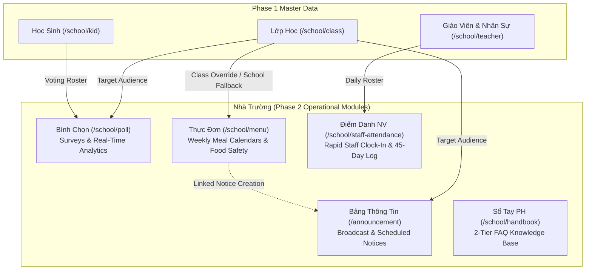

# Implementation Plan: School Administration Module Phase 2

> Feature ID: `028-school-administration-module-phase-2`
> Spec: `spec.md`
> Constitution: `.agents/memory/constitution.md`

## 1. Technical Summary

Phase 2 of the School Administration Module ("Nhà Trường") covers operational communication, nutrition, daily staff oversight, and institutional knowledge management:
1. **Bảng Thông Tin (`/announcement/`):** Multi-channel announcement broadcaster with scheduling, recipient cohort resolution, draft-only editing, and bulk deletion auditing.
2. **Bình Chọn (`/school/poll/`):** Survey and polling instrument with decoupled audience dispatch, live voting progress, dynamic pie charts, and per-student vote revision audit trails.
3. **Thực Đơn (`/school/menu/`):** Weekly meal menu planner up to 8 weeks ahead with class fallback to school-wide menus, dual formats (grid vs file), asymmetric cloning, and GTIN/stamp food provenance.
4. **Điểm Danh NV (`/school/staff-attendance/`):** Rapid daily staff check-in/out roster with single-click recording, 45-day retroactive window, modal absence confirmations, and search-time KPI counter suppression.
5. **Sổ Tay PH (`/school/handbook/`):** Two-tier parent handbook and FAQ knowledge base with sibling accordion expansion, drag-and-drop ordering, rich-text drafting, publishing toggles, and cascading deletion protection.

The implementation builds on Next.js Pages Router with Redux Toolkit slices (`announcementSlice.ts`, `pollSlice.ts`, `menuSlice.ts`, `staffAttendanceSlice.ts`, `handbookSlice.ts`), TypeScript contracts, mock datasets, and business validation engines.

## 2. Constitution Gates

- [x] Specification has no unresolved `[NEEDS CLARIFICATION]` markers, or the operator accepted the residual risk.
- [x] Contracts are defined before implementation.
- [x] Verification method is named before implementation.
- [x] No shell `eval` or unbounded command execution is introduced.
- [x] No hardcoded production secret is introduced.
- [x] TypeScript changes avoid `any` unless justified in Complexity Tracking.
- [x] Rollback path is documented for user-facing or operational changes.

### Superpowers V34 Discipline Gates

- [x] Clarification-first: every blocking ambiguity has an answer or accepted risk in `spec.md#6. Clarifications`.
- [x] No placeholders: implementation sections avoid placeholder tokens, generic "add handling", and unspecified "write tests" instructions.
- [x] TDD path: behavior-changing work names the failing test or accepted TDD exception before implementation.
- [x] Root cause path: bugfix work explains the observed failure, reproduction, and root cause before proposing a fix.
- [x] Review order: spec compliance review happens before code quality review.
- [x] Evidence-before-claim: completion language is blocked until fresh verification evidence exists in `verification.md`.

## 3. Architecture

### 3.1 Current State

- Phase 1 master data established: Student 360° Profile Hub, Faculty Directory, Class Management, Subject Catalog, and Grade Hierarchy.
- Remaining communication, nutrition, staff attendance, and parent FAQ surfaces currently rely on scattered legacy workflows.
- Known constraints: Multi-tenant URL structure `/{schoolCode}/...`, Next.js Pages Router, Redux Toolkit, Tailwind CSS + `styled-components`, ECO Design System 1.0.

### 3.2 Target State

- New module directories: `src/modules/school/announcement/`, `src/modules/school/poll/`, `src/modules/school/menu/`, `src/modules/school/staffAttendance/`, `src/modules/school/handbook/`.
- Data flow: Redux slices manage local entity collections, filter criteria, and active modal view models. Validation utilities encapsulate invariants (45-day limits, 8-week horizon, 2-tier tree depth).
- Operational flow: Admin publishes weekly menus with optional announcement dispatch $\rightarrow$ creates polls and surveys $\rightarrow$ records daily staff clock-in $\rightarrow$ organizes parent handbook articles.

### 3.3 Mermaid Diagram

## 4. Contracts

Contracts are materialized in `src/types/` and detailed in `contracts/`:

| Contract | Purpose | Producer | Consumer |
| --- | --- | --- | --- |
| `src/types/announcement.ts` | Announcement entities, recipient filters, attachments, schedule timestamps | `announcementSlice` | Announcement module, Menu module |
| `src/types/poll.ts` | Poll entities, option arrays, student voting records, revision histories | `pollSlice` | Poll module, Student profile |
| `src/types/menu.ts` | Weekly menu calendars, grid cells, dishes, food traceability items, send history | `menuSlice` | Menu module, Announcement module |
| `src/types/staffAttendance.ts` | Daily staff attendance logs, check-in/out times, absence records, summary counters | `staffAttendanceSlice` | Staff attendance module, Teacher directory |
| `src/types/handbook.ts` | Two-tier category tree nodes, rich-text article documents, attachments | `handbookSlice` | Handbook module, Parent portal |

## 5. Data Model

- **Announcement Entity:** `id`, `title`, `contentHtml`, `category`, `channel`, `audienceType`, `targetClassIds`, `status`, `scheduledAt`, `sentAt`, `viewCount`, `attachments`.
- **Poll Entity:** `id`, `title`, `description`, `deadlineAt`, `options` (`id`, `text`, `voteCount`, `percentage`), `allowMultipleChoices`, `resultsVisibleToParents`, `status`, `totalVotes`, `roster`.
- **WeeklyMenu Entity:** `id`, `weekNumber`, `startDate`, `endDate`, `targetType`, `targetClassIds`, `format` (`grid` | `file`), `status`, `gridCells`, `fileAttachment`, `sendHistory`.
- **StaffAttendance Entity:** `id`, `staffId`, `date`, `checkInTime`, `checkOutTime`, `attendanceStatus`, `absenceNote`, `generalNote`, `recordedBy`.
- **HandbookCategory Entity:** `id`, `name`, `description`, `parentId` (null if Root, string if Sub-category), `sortOrder`, `articles`.
- **HandbookArticle Entity:** `id`, `categoryId`, `title`, `contentHtml`, `status` (`ban_nhap` | `da_phat_hanh`), `sortOrder`, `attachments`.

## 6. Agent Routing

| Workstream | Primary Agent | Output | Verification |
| --- | --- | --- | --- |
| Bảng Thông Tin (`TASK-SCH-006`) | `benny-frontend-engineer` | `announcementSlice`, Announcement Table, Composer, Preview Modal | Automated unit tests (`tests/unit/school-admin-phase2.test.mjs`) |
| Bình Chọn (`TASK-SCH-007`) | `benny-frontend-engineer` | `pollSlice`, Poll Table, Dispatch Modal, Pie Chart Analytics | Automated unit tests (`tests/unit/school-admin-phase2.test.mjs`) |
| Thực Đơn (`TASK-SCH-008`) | `benny-frontend-engineer` | `menuSlice`, 8-Week Menu Grid Editor, Food Traceability Modal | Automated unit tests (`tests/unit/school-admin-phase2.test.mjs`) |
| Điểm Danh NV (`TASK-SCH-009`) | `benny-frontend-engineer` | `staffAttendanceSlice`, Staff Clock-In Roster, Absent Modal | Automated unit tests (`tests/unit/school-admin-phase2.test.mjs`) |
| Sổ Tay PH (`TASK-SCH-010`) | `benny-frontend-engineer` | `handbookSlice`, 2-Tier Accordion Tree, Cascading Delete Modal | Automated unit tests (`tests/unit/school-admin-phase2.test.mjs`) |
| QA & Regression | `ada-qa-agent` | Test suites, clean build, live HTTP 200 telemetry | `npm test` & `npm run build` |

## 7. Migration and Rollback

- **Migration:** Implementation adds isolated routes under `/announcement/`, `/school/poll/`, `/school/menu/`, `/school/staff-attendance/`, and `/school/handbook/` without modifying existing operational or billing routes.
- **Rollback:** In the event of regression, route links in the sidebar are disabled without affecting master data or attendance records.
- **Compatibility:** Mock datasets provide backward compatibility with existing Teacher and Class definitions.

## 8. Complexity Tracking

No unnecessary architectural complexity or third-party dependencies are introduced. Next.js Pages router and Redux Toolkit patterns are strictly followed. TypeScript is strongly typed with zero `any` usage.

---

## 9. POC Slice and Review Cadence

- **POC slice boundary:** Build Bảng Thông Tin (`/announcement/` and `/announcement/create/`) demonstrating multi-channel announcement authoring, draft-only editing, preview modal simulation, and bulk deletion with email non-retraction warnings.
- **Success evidence for the slice:** Automated unit tests verifying announcement state transitions, preview rendering, audience cohort filtering, and bulk deletion dialog alerts.
- **Stop conditions:** If recipient cohort resolution introduces client-side freezing or email scheduling calculations diverge from local timezones.
- **Proceed conditions:** Complete pass of all Phase 2 unit tests (`tests/unit/school-admin-phase2.test.mjs`), clean TypeScript compilation (`npx tsc --noEmit`), and verified HTTP 200 live server responses.
