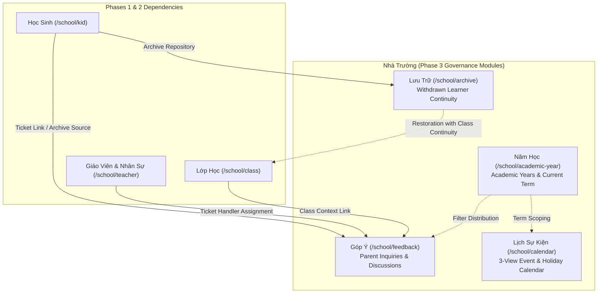

# Implementation Plan: School Administration Module Phase 3

> Feature ID: `029-school-administration-module-phase-3`  
> Spec: `spec.md`  
> Constitution: `.agents/memory/constitution.md`  

---

## 1. Technical Summary

Phase 3 of the School Administration Module ("Nhà Trường") completes the operational and governance capability set:
1. **Góp Ý (`/school/feedback/`):** Parent feedback ticketing inbox supporting 8 functional categories, 4 status cards with independent counters, inline priority editing, handler assignment, and 2-way discussion threads.
2. **Lịch Sự Kiện (`/school/calendar/`):** School event and holiday calendar featuring 3 view topologies (12-month Year, 1-month Month, and chronological Event list with tear-away date cards), semantic category color coding, and multi-year range navigation.
3. **Năm Học (`/school/academic-year/`):** Academic year configuration catalog with minimal 3-field input, automatic system-date current badge derivation, and cross-module filter distribution.
4. **Lưu Trữ (`/school/archive/`):** Withdrawn student archive hub with audit context, warning banners, class continuity restoration, and permanent purge safety guards.

The implementation is built on Next.js Pages Router with Redux Toolkit slices (`feedbackSlice.ts`, `calendarSlice.ts`, `academicYearSlice.ts`, `archiveSlice.ts`), TypeScript contracts, mock datasets, and business validation engines.

---

## 2. Constitution Gates

- [x] Specification has no unresolved `[NEEDS CLARIFICATION]` markers, or the operator accepted the residual risk.
- [x] Contracts are defined before implementation.
- [x] Verification method is named before implementation.
- [x] No shell `eval` or unbounded command execution is introduced.
- [x] No hardcoded production secret is introduced.
- [x] TypeScript changes avoid `any` unless justified in Complexity Tracking.
- [x] Rollback path is documented for user-facing or operational changes.

### Superpowers V34 Discipline Gates

- [x] Clarification-first: every blocking ambiguity has an answer or accepted risk in `spec.md#6. Clarifications`.
- [x] No placeholders: implementation sections avoid placeholder tokens, generic "add handling", and unspecified "write tests" instructions.
- [x] TDD path: behavior-changing work names the failing test or accepted TDD exception before implementation.
- [x] Root cause path: bugfix work explains the observed failure, reproduction, and root cause before proposing a fix.
- [x] Review order: spec compliance review happens before code quality review.
- [x] Evidence-before-claim: completion language is blocked until fresh verification evidence exists in `verification.md`.

---

## 3. Architecture

### 3.1 Current State

- Phase 1 & 2 master data and operational suites established: Student Profile Hub, Faculty Directory, Class Management, Subject Catalog, Grade Hierarchy, Announcements, Polls, Menus, Staff Attendance, and Handbook.
- Remaining parent feedback, institutional calendar, academic year configuration, and student archiving surfaces require dedicated integration into the unified portal.
- Known constraints: Multi-tenant URL structure `/{schoolCode}/...`, Next.js Pages Router, Redux Toolkit, Tailwind CSS + `styled-components`, ECO Design System 1.0.

### 3.2 Target State

- New module directories: `src/modules/school/feedback/`, `src/modules/school/calendar/`, `src/modules/school/academicYear/`, `src/modules/school/archive/`.
- Data flow: Redux slices manage local entity collections, filter criteria, and active modal view models. Validation utilities encapsulate invariants (single-day auto-fill, status card counter persistence, archive class continuity, academic year overlap checks).
- Operational flow: Admin triages feedback tickets $\rightarrow$ configures academic calendar events $\rightarrow$ manages academic year terms $\rightarrow$ reviews and restores archived learners.

### 3.3 Mermaid Diagram

---

## 4. Contracts

Contracts are materialized in `src/types/` and detailed in `contracts/`:

| Contract | Purpose | Producer | Consumer |
| --- | --- | --- | --- |
| `src/types/feedback.ts` | Feedback ticket entities, categories, priorities, discussion messages | `feedbackSlice` | Feedback module, Student profile |
| `src/types/calendar.ts` | School event entities, semantic categories, view modes, date cards | `calendarSlice` | Calendar module, Dashboard |
| `src/types/academicYear.ts` | Academic year records, date intervals, current year status | `academicYearSlice` | Academic year module, All portal modules |
| `src/types/archive.ts` | Archived student records, withdrawal audit context, restore/purge requests | `archiveSlice` | Archive module, Student directory |

---

## 5. Data Model

- **FeedbackTicket Entity:** `id`, `schoolCode`, `academicYearId`, `title`, `content`, `category`, `status` (`yeu_cau_moi` | `dang_xu_ly` | `hoan_tat` | `mo_lai`), `priority` (`thap` | `trung_binh` | `cao` | `khan_cap`), `studentId`, `studentName`, `classId`, `className`, `parentId`, `parentName`, `parentEmail`, `assignedHandlerId`, `assignedHandlerName`, `waitingOn` (`parent` | `school`), `discussions`, `createdAt`, `updatedAt`.
- **DiscussionMessage Entity:** `id`, `authorId`, `authorName`, `authorRole` (`admin` | `parent` | `teacher`), `content`, `imageUrls`, `createdAt`.
- **SchoolEvent Entity:** `id`, `schoolCode`, `title`, `startDate`, `endDate`, `category` (`holiday` | `internal` | `parent_invited`), `location`, `descriptionHtml`, `avatarUrl`, `attachmentUrls`, `createdAt`.
- **AcademicYearRecord Entity:** `id`, `schoolCode`, `name`, `startDate`, `endDate`, `isCurrent`, `createdAt`.
- **ArchivedStudentRecord Entity:** `id`, `studentCode`, `fullName`, `nickname`, `formerClassId`, `formerClassName`, `archivedDate`, `archivedByStaffId`, `archivedByStaffName`, `reason`, `notes`, `avatarUrl`.

---

## 6. Agent Routing

| Workstream | Primary Agent | Output | Verification |
| --- | --- | --- | --- |
| Góp Ý (`TASK-SCH-011`) | `benny-frontend-engineer` | `feedbackSlice`, Feedback Table, Detail View, Close Modal | Automated unit tests (`tests/unit/feedback.test.mjs`) |
| Lịch Sự Kiện (`TASK-SCH-012`) | `benny-frontend-engineer` | `calendarSlice`, 3-Mode Calendar, Date Cards, Event Editor | Automated unit tests (`tests/unit/calendar.test.mjs`) |
| Năm Học (`TASK-SCH-013`) | `benny-frontend-engineer` | `academicYearSlice`, Academic Year Table, Modal Form | Automated unit tests (`tests/unit/academicYears.test.mjs`) |
| Lưu Trữ (`TASK-SCH-014`) | `benny-frontend-engineer` | `archiveSlice`, Archive Table, Restore/Purge Modals | Automated unit tests (`tests/unit/archive.test.mjs`) |
| QA & Regression (`TASK-SCH-015`) | `ada-qa-agent` | Test suites, clean build, live HTTP 200 telemetry | `npm test` & `npm run build` |

---

## 7. Migration and Rollback

- **Migration:** Implementation introduces isolated routes under `/school/feedback/`, `/school/calendar/`, `/school/academic-year/`, and `/school/archive/` without altering established operations or finance schemas.
- **Rollback:** In the event of regression, route links in the sidebar are disabled without affecting active student rosters or invoice registers.
- **Compatibility:** Mock datasets provide backward compatibility with existing Student, Teacher, and Class definitions.

---

## 8. Complexity Tracking

No unnecessary architectural complexity or third-party dependencies are introduced. Next.js Pages router and Redux Toolkit patterns are strictly followed. TypeScript is strongly typed with zero `any` usage.

---

## 9. POC Slice and Review Cadence

- **POC slice boundary:** Build Năm Học (`/school/academic-year/`) and Góp Ý overview cards (`/school/feedback/`) demonstrating minimal 3-field year configuration, dynamic "Hiện tại" badge computation, and status cards with persistent global counter retention.
- **Success evidence for the slice:** Automated unit tests verifying current year resolution, status card filter isolation, and inline priority modifications.
- **Stop conditions:** If status card filtering drops global counters to 0 or academic year intervals fail date validation.
- **Proceed conditions:** Complete pass of all Phase 3 unit tests (`tests/unit/feedback.test.mjs`, `tests/unit/calendar.test.mjs`, `tests/unit/academicYears.test.mjs`, `tests/unit/archive.test.mjs`), clean TypeScript compilation (`npx tsc --noEmit`), and verified HTTP 200 live server responses.
