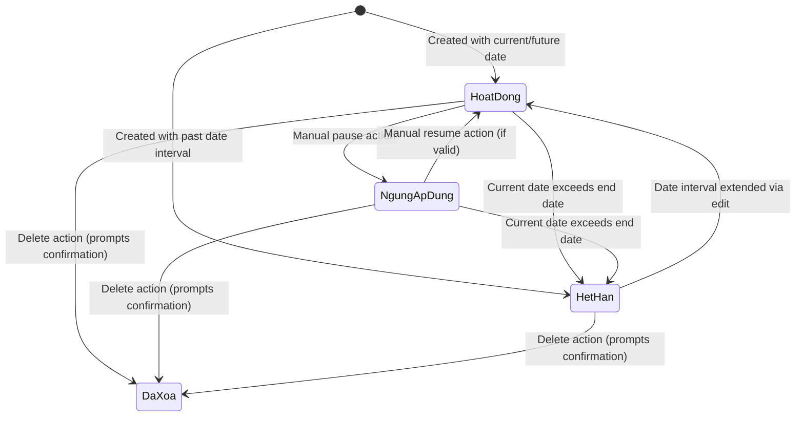

# Data Model: Tuition Exemption & Discount Policy Management

> Feature ID: `031-finance-tuition-exemption-and-discount-management`  
> Spec: `spec.md`  
> Plan: `plan.md`  

---

## Entities

| Entity | Fields | Owner | Notes |
| --- | --- | --- | --- |
| `DiscountPolicy` | `id`, `schoolCode`, `code`, `name`, `discountType`, `discountValue`, `feeItemId`, `feeItemName`, `scopeType`, `validityType`, `academicYearId`, `fromMonth`, `toMonth`, `reason`, `status`, `createdAt`, `updatedAt` | Finance Domain | Master policy definition in catalog |
| `DiscountTarget` | `id`, `discountPolicyId`, `targetType`, `targetId`, `targetName`, `targetClass` | Finance Domain | Beneficiary link (Class or Student) |
| `InvoiceDiscountLine` | `id`, `invoiceId`, `discountPolicyId`, `feeItemId`, `policyCode`, `policyName`, `discountType`, `discountValue`, `deductionAmount`, `appliedAt` | Invoicing Domain | Immutable snapshot line item on invoice |

---

## State Transitions

---

## Validation Rules

1. Policy Name: Required string, minimum length 3 characters, trimmed.
2. Discount Type: Strictly enum `percent` or `fixed_amount`.
3. Discount Value:
   - For `percent`: Integer or float between 1 and 100.
   - For `fixed_amount`: Positive integer greater than 0 representing VND.
4. Fee Item Binding: Required valid `feeItemId` corresponding to an active item in `SchoolFeeCatalog`.
5. Scope Configuration:
   - `class`: Requires at least one valid `classId` in `targetIds` array (or special identifier `all`).
   - `student`: Requires at least one valid `studentId` in `targetIds` array.
6. Validity Interval:
   - `academic_year`: Requires valid `academicYearId`.
   - `month_range`: Requires `fromMonth` and `toMonth` in `YYYY-MM` format with `fromMonth <= toMonth`.
7. Non-Negative Balance Clamping:
   - For any invoice line item, `deductionAmount <= grossItemAmount`. Total invoice net payable cannot be negative.
