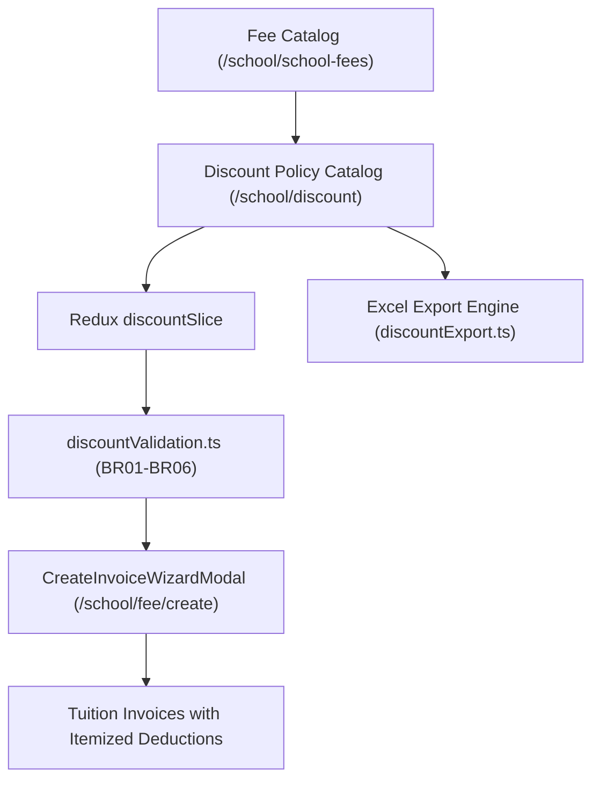

# Implementation Plan: Tuition Exemption & Discount Policy Management

> Feature ID: `031-finance-tuition-exemption-and-discount-management`  
> Spec: `spec.md`  
> Constitution: `.agents/memory/constitution.md`  
> Architecture Decision: `docs/decisions.md` (`ADR-012`)  

---

## 1. Technical Summary

This plan details the implementation architecture for the **Tuition Exemption & Discount Policy Management** sub-module (`/school/discount`). The module introduces a Redux-governed discount policy store, a dedicated business rule engine enforcing highest priority and scope specificity, seamless integration with the tuition invoice creation wizard (`/school/fee/create`), and an Excel export pipeline. All arithmetic operations operate in integer VND dot-separated notation, guaranteeing non-negative net payable balances and historical invoice immutability.

---

## 2. Constitution Gates

- [x] Specification has no unresolved clarification markers; business rules K016, K017, and K018 are formally resolved.
- [x] Contracts and TypeScript data models are defined before implementation.
- [x] Verification methods are documented and tied to automated test suites.
- [x] No shell eval or unbounded command execution is introduced.
- [x] No hardcoded production secret is introduced.
- [x] TypeScript changes avoid any and use strict domain models.
- [x] Rollback path and backward compatibility are documented.

### Superpowers V34 Discipline Gates

- [x] Clarification-first: all ambiguities resolved in `spec.md#6. Clarifications`.
- [x] No placeholders: implementation sections avoid generic or placeholder instructions.
- [x] TDD path: automated unit tests in `tests/unit/discount.test.mjs` verify all calculation rules.
- [x] Review order: spec compliance review occurs before code quality sign-off.
- [x] Evidence-before-claim: completion status blocked until verified by fresh test runs.

---

## 3. Architecture

### 3.1 Current State

- Existing modules: Finance Invoices (`/school/fee`), Fee Catalog (`/school/school-fees`), Tuition Management (`/school/tuition-management`), Expenses (`/school/expenses`), Reconciliation (`/school/reconciliation`), Fee Reports (`/reports/fee/overview`).
- Current coupling: Invoice creation wizard evaluates gross fees from fee catalog and applies excused absence meal deductions from Attendance module.
- Constraints: Invoices must remain immutable once issued; calculations must prevent negative line items.

### 3.2 Target State

- New module: `/school/discount` managed by `discountSlice.ts` and `discountValidation.ts`.
- Data flow: Invoice wizard reads active discount policies for the billing month and student/class cohort, calculates itemized deductions, and records immutable discount snapshots on generated invoices.
- Operational flow: Accountants configure policies with dual scopes (`class` vs `student`) and validity periods. When creating invoices, an administrative toggle allows overriding discount auto-application.

### 3.3 Mermaid Architecture Diagram

---

## 4. Contracts

The boundary contracts governing policy data structures and calculation parameters:

| Contract | Purpose | Producer | Consumer | Compatibility Check |
| --- | --- | --- | --- | --- |
| `src/types/discount.ts` | Data models for policies and targets | Alan (Tech Lead) | Benny (Frontend), Redux | TypeScript strict compilation |
| `src/utils/discountValidation.ts` | Conflict resolution and deduction math | Alan (Tech Lead) | Invoice Wizard, Unit Tests | Automated unit test suite |
| `src/store/slices/discountSlice.ts` | State machine for policies and filters | Benny (Frontend) | Discount UI, Invoice Wizard | Redux state shape assertions |
| `src/types/invoice.ts` | Extended invoice line items with discounts | Alan (Tech Lead) | Invoice Slice, Invoice PDF | Unit tests and UI snapshot tests |

---

## 5. Data Model

The data models encompass three primary entities defined in `data-model.md`:
1. `DiscountPolicy`: Primary policy entity containing code, name, discountType (`percent` | `fixed_amount`), discountValue, feeItemId, feeItemName, scopeType (`class` | `student`), validityType (`academic_year` | `month_range`), academicYearId, fromMonth, toMonth, reason, status (`active` | `paused` | `expired`), and audit timestamps.
2. `DiscountTarget`: Polymorphic association linking a policy to target class IDs or student IDs with cached denormalized names.
3. `InvoiceDiscountLine`: Embedded immutable deduction snapshot within an invoice recording policyCode, policyName, feeItemId, deductionAmount, and calculation timestamp.

---

## 6. Agent Routing

Ownership and responsibilities across the feature development lifecycle:

| Workstream | Primary Agent | Output | Verification |
| --- | --- | --- | --- |
| Architecture & Contracts | `alan-tech-lead` | `src/types/discount.ts`, `discountValidation.ts` | Typecheck and validation unit tests |
| UI & State Implementation | `benny-frontend-engineer` | `discountSlice.ts`, UI Components, Pages | Interactive UI rendering and Redux actions |
| Invoicing Integration | `benny-frontend-engineer` | Wizard toggle, Line-item injection | Invoice creation test cases |
| Verification & Quality Gates | `ada-qa-agent` | `tests/unit/discount.test.mjs`, Quality Reports | 100% test pass rate across all suites |

---

## 7. Migration and Rollback

- Migration steps:
  1. Add `src/types/discount.ts` and `src/utils/discountValidation.ts`.
  2. Register `discountSlice` in the root Redux store.
  3. Deploy UI components under `src/modules/finance/discount/` and page route `src/pages/[schoolCode]/school/discount/index.tsx`.
  4. Integrate the discount toggle and deduction calculations into `CreateInvoiceWizardModal.tsx`.
- Rollback steps:
  1. If issues arise in invoice generation, disabling the invoice wizard toggle immediately bypasses discount calculations without affecting existing data.
  2. Redux state can safely fall back to previous invoice generation logic without schema migration errors.
- Compatibility notes: Historical invoices generated prior to this module remain completely unaffected because invoices store frozen line items.

---

## 8. Complexity Tracking

- No unjustified `any` types: all payloads, targets, and policy parameters are strictly typed.
- Conflict resolution logic is encapsulated in pure, deterministic utility functions in `discountValidation.ts` to maximize testability and eliminate side-effects.

---

## 9. POC Slice and Review Cadence

- POC slice boundary: Implement `discountValidation.ts` with BR01-BR06 (conflict resolution, highest priority, scope specificity, non-negative clamping) and verify with comprehensive automated unit tests.
- Success evidence for the slice: Automated test suite `tests/unit/discount.test.mjs` executes and passes all test assertions covering both percentage and fixed deductions.
- Stop conditions: Any discrepancy in deduction calculations or failure to respect historical invoice immutability.
- Proceed conditions: 100% test pass rate on unit tests and clean TypeScript compilation.
