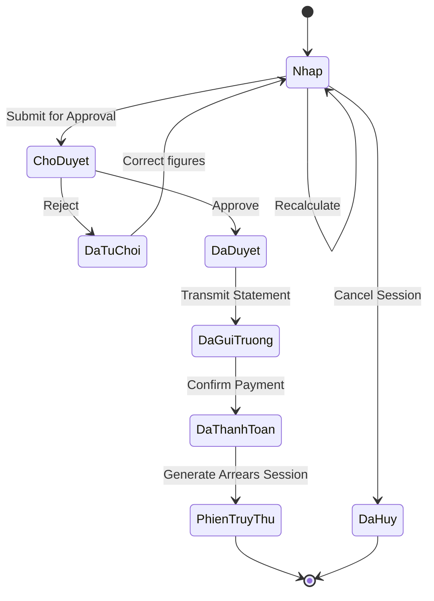

# Data Model: ECO Card Portal Module M6 (Đối soát)

> Feature ID: `032-project-planning-eco-card-portal-module-m6-reconciliation`

## Entities

| Entity | Fields | Owner | Notes |
| --- | --- | --- | --- |
| `SchoolGroup` | `group_code`, `group_name`, `tax_code`, `contract_number`, `settlement_unit`, `recipient_emails`, `threshold_months`, `round_days_threshold`, `is_active` | `david-systems-architect` | Legal entity root representing school group |
| `SchoolBranch` | `branch_code`, `group_code`, `branch_name`, `start_date`, `contract_date`, `registered_students`, `recipient_emails`, `is_active` | `david-systems-architect` | School campus belonging to a group |
| `PeriodSchedule` | `period_id`, `group_code`, `period_name`, `start_date`, `end_date`, `is_fee_collected` | `david-systems-architect` | Annual service calendar period |
| `BranchServiceTariff` | `tariff_id`, `branch_code`, `period_id`, `service_code`, `unit_price` | `david-systems-architect` | Service pricing matrix per period |
| `ReconciliationSession` | `session_code`, `parent_session_id`, `group_code`, `period_id`, `settlement_unit`, `cutoff_date`, `status`, `total_students`, `period_fee`, `arrears_fee`, `total_fee`, `snapshot_config` | `alan-tech-lead` | Master settlement session record |

## State Transitions

## Validation Rules

- `group_code` must be unique alphanumeric and permanently locked after creation.
- `recipient_emails` allows maximum 3 valid RFC 5322 email addresses separated by commas.
- Total branch payable fee cannot be 0 VND when creating a session (MSG-01).
- `snapshot_config` must be fully serialized JSON and immutable once written.
