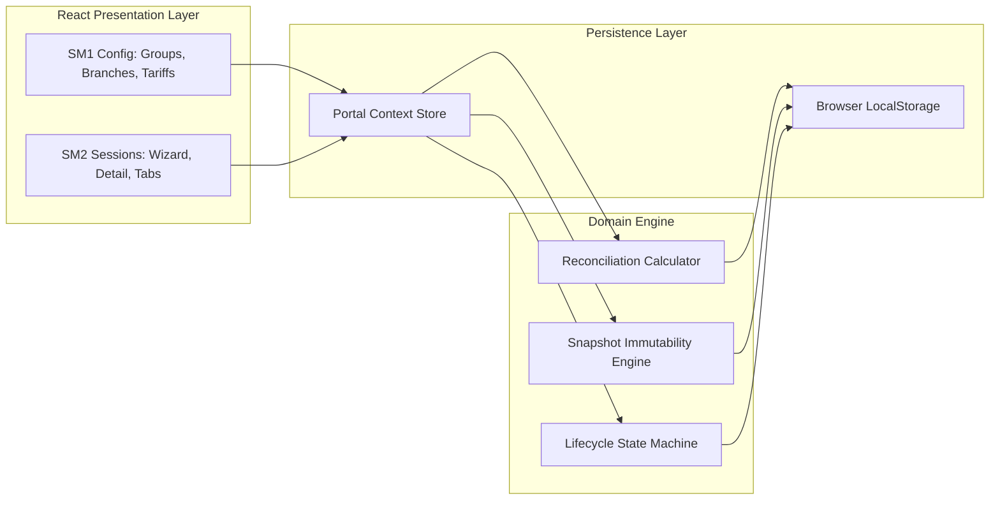

# Technical Implementation Plan: ECO Card Portal Module M6 (Đối soát)

## 1. Technical Summary
This plan outlines the architecture, component hierarchy, state flow, and verification methods to rebuild Module M6 (Đối soát). The implementation leverages React 18, TailwindCSS customized with ECO Design System 1.0 CSS tokens, a reactive Context state store with localStorage persistence, and mathematical simulation engines for active student calculations and locked configuration snapshots.

## 2. Constitution Gates
- [x] Article I: Specification is the single source of truth under .agents/specs/.
- [x] Article II: Clarifications completed and documented before implementation.
- [x] Article III: Data models and contract boundaries defined before code.
- [x] Article IV: Verification plan and executable commands defined upfront.
- [x] Article V: Security boundaries respected with sandboxed execution.
- [x] Article VI: Explicit task ownership assigned across agent skills.
- [x] Article VII: Architecture adheres to simplicity and direct framework patterns.
- [x] Article VIII: Durable memory recorded in agents.md and spec ledgers.

### Superpowers V34 Discipline Gates
- [x] Clarification-first: every blocking ambiguity has an answer or accepted risk in `spec.md#6. Clarifications`.
- [x] No placeholders: implementation sections avoid generic or unspecified instructions.
- [x] TDD path: behavior-changing work names the failing test or accepted TDD exception before implementation.
- [x] Root cause path: bugfix work explains the observed failure, reproduction, and root cause before proposing a fix.
- [x] Review order: spec compliance review happens before code quality review.
- [x] Evidence-before-claim: completion language is blocked until fresh verification evidence exists in `verification.md`.

## 3. Architecture

The architecture comprises three cohesive layers: presentation, domain calculation, and reactive persistence.

## 4. Contracts
- Calculation Input Contract: School branch ID, period schedule ID, cut-off date, and active student roster.
- Calculation Output Contract: Billable student count, period fee, arrears fee, total payable amount, and zero-fee flag.
- Snapshot Contract: Deep clone of active tariffs, service codes, period dates, and threshold rules serialized into session JSON.
- State Transition Contract: Guarded state machine validating permissible user roles and prerequisites before advancing session status.

## 5. Data Model
Detailed relational data schemas are defined in `docs/planning/diagrams.md` and `data-model.md`, connecting `SchoolGroup`, `SchoolBranch`, `PeriodSchedule`, `BranchServiceTariff`, and `ReconciliationSession`.

## 6. Agent Routing
- UI Layout & Screens: `benny-frontend-engineer`
- Domain Models & State Store: `david-systems-architect`
- Calculation & Lifecycle Engine: `alan-tech-lead`
- Quality Assurance & Visual Audit: `ada-qa-agent`

## 7. Migration and Rollback
- Configuration edits in SM1 do not mutate existing sessions due to locked snapshots.
- Erroneous draft sessions can be cancelled via `Hủy phiên`, which releases student holds.
- Discrepancies in paid sessions are resolved through child `Phiên truy thu` sessions rather than destructive edits.

## 8. Complexity Tracking
- Minimal external dependencies: standard React runtime with utility styling.
- Zero server infrastructure required for frontend client validation.
- Calculation engine isolated from UI rendering components.

## 9. POC Slice and Review Cadence
- POC slice boundary: Rehearse SM1 Group Table with expand row, SM2 3-step creation wizard with live preview, and the 0 VND validation alert guard.
- Success evidence for the slice: Automated calculation test passes, live modal scan displays student counts, and zero-fee alert successfully blocks session submission.
- Stop conditions: Mathematical calculation formula discrepancies, missing design tokens, or unhandled zero-fee branches.
- Proceed conditions: All acceptance criteria met, snapshot serialized into session record, and visual match verified by QA.
