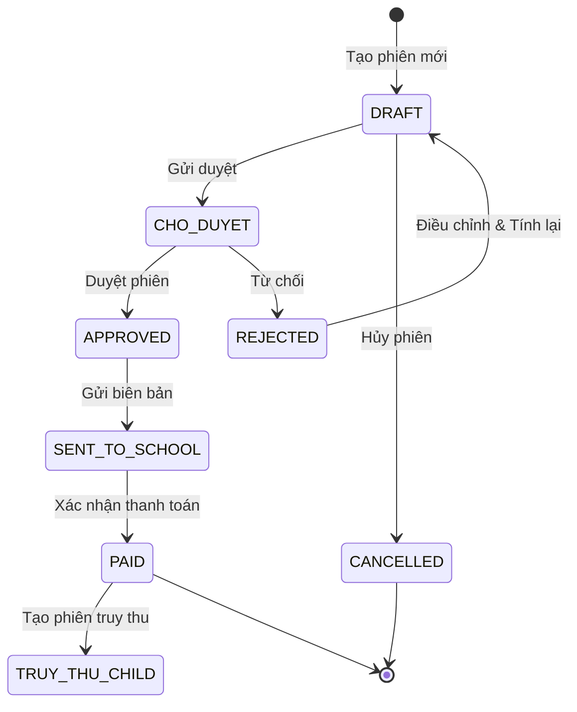

# Tài Liệu Yêu Cầu Sản Phẩm (PRD) — Phân Hệ Đối Soát & Quyết Toán Dịch Vụ Trường Học (Module M6)

> **Dự án:** Cổng Quản Trị & Vận Hành Thẻ Học Đường (ECO Card Portal — FINVIET Technology)  
> **Phân hệ trung tâm:** Phân Hệ M6: Quản Trị Đối Soát & Quyết Toán Dịch Vụ (`/reconciliation`)  
> **Phân hệ thành phần:**  
> • **SM1: Cấu hình đối soát** (Reconciliation Configurations: Nhóm trường, Chi nhánh, Dịch vụ & Biểu phí, Lịch kỳ & Ngưỡng tính phí)  
> • **SM2: Phiên đối soát** (Reconciliation Sessions: Vòng đời phiên, Quét học sinh, Chốt an toàn 0đ, Khóa Snapshot bất biến, Kiểm toán Log & Truy thu)  
> **Phân hệ liên thông:** Quản trị Trường học (`/schools`), Hồ sơ & Hoạt động Thẻ Học sinh (`/students`), Quản trị Dịch vụ số (`/services`)  
> **Phiên bản:** 2.0 (Chuẩn hóa Biểu phí Đa chu kỳ Năm/Tháng, Quản trị Mật khẩu File Đối soát, Kiểm toán Log Song song & Bảo vệ Bất biến Snapshot)  
> **Trạng thái:** Đã phê duyệt & Đã nghiệm thu kiểm thử toàn diện (Approved & Verified 100%)

---

## 1. Tổng Quan Phân Hệ & Mục Tiêu Nghiệp Vụ

### 1.1 Bối cảnh thực tế tại các trường học & bài toán của Finviet
Trong hệ sinh thái chuyển đổi số giáo dục và thẻ học sinh thông minh của **Finviet Technology**, dịch vụ thẻ ECO và các giải pháp tiện ích trường học (Điểm danh thông minh, Camera AI, Căn tin học đường, Phần mềm quản lý nhà trường) được triển khai trên diện rộng tại hàng trăm cơ sở giáo dục trên toàn quốc:
1. **Mô hình tổ chức phức tạp:** Khách hàng của Finviet bao gồm các Tập đoàn giáo dục, Hệ thống trường liên cấp (K-12) với nhiều cơ sở/chi nhánh trực thuộc (ví dụ: *Hệ thống Trường Hieutest*, *VinaSchool*, *Trường Liên cấp Thuận Test*). Mỗi chi nhánh có thể áp dụng số lượng học sinh, danh mục dịch vụ đăng ký và đơn giá thỏa thuận theo hợp đồng hoàn toàn khác nhau.
2. **Quy định chu kỳ thu phí linh hoạt:** Một số hệ thống trường thu học phí và phí dịch vụ theo **Năm học trọn gói** (1 năm/kỳ), trong khi các trường khác thu phí định kỳ theo **Kỳ học / Tháng** (từ 2 đến 10 kỳ/năm).
3. **Biến động học sinh liên tục trong năm học:** Học sinh nhập học muộn, chuyển trường, nghỉ ốm dài hạn hoặc kích hoạt thẻ giữa kỳ đòi hỏi thuật toán tính phí phải căn cứ chính xác trên **tổng số ngày hoạt động thực tế** của học sinh đối chiếu với **ngưỡng thu phí tối thiểu** và **quy tắc làm tròn ngày dư** được ký kết trong hợp đồng.
4. **Rủi ro vận hành thủ công trước đây:**
   - **Xung đột giá khi điều chỉnh hợp đồng:** Việc chỉnh sửa biểu phí giữa năm học dễ làm thay đổi hoặc sai lệch số liệu của các kỳ đối soát cũ trong quá khứ nếu không có cơ chế đóng băng cấu hình (Snapshot).
   - **Lập hóa đơn rỗng (0 VNĐ):** Tình trạng tạo phiên cho trường/chi nhánh chưa có học sinh kích hoạt hoặc không phát sinh phí gây lãng phí tài nguyên và sai sót chứng từ kế toán.
   - **Mâu thuẫn số liệu giữa Finviet và Nhà trường:** Thiếu công cụ kiểm toán trực quan để giải trình chi tiết từng ngày hoạt động của từng học sinh, lịch sử quẹt thẻ và nguyên nhân chênh lệch dẫn đến quá trình chốt công nợ kéo dài nhiều tuần.

### 1.2 Mục tiêu của phân hệ Đối Soát (Module M6)
Xây dựng phân hệ **Quản Trị Đối Soát & Quyết Toán (Module M6)** tự động, chuẩn hóa, bảo mật và minh bạch 100%:
- **Quản trị cấu hình tập trung & linh hoạt (SM1):** Thiết lập pháp nhân nhóm trường, quản lý chi nhánh phân cấp, hỗ trợ 2 mô hình đối soát (*Theo nhóm trường* vs *Theo từng trường*), sinh lịch kỳ tự động, biểu phí đa chu kỳ (*Học phí theo năm* vs *Học phí theo tháng*) và quản trị mật khẩu mã hóa file đối soát an toàn.
- **Tự động hóa tính toán & Bảo vệ dữ liệu phiên (SM2):** Động cơ quét dữ liệu học sinh thời gian thực, tự động tính toán số tháng thu phí dựa trên ngưỡng 30 ngày/tháng và làm tròn ngày dư, áp dụng chốt chặn an toàn ngăn chặn phiên 0 VNĐ (`MSG-01`), và đóng băng toàn bộ biểu phí vào Snapshot bất biến (`ADR-M6-001`).
- **Minh bạch hóa & Giải trình kiểm toán chuyên sâu:** Cung cấp giao diện kiểm toán song song (Side-by-Side Audit View) đối chiếu trực tiếp giữa danh sách học sinh tính phí và nhật ký hoạt động thẻ (Log), tự động chỉ rõ nguyên nhân chênh lệch ngày, cuộn đồng bộ và xuất báo cáo Excel đa trang tính (2 Sheet) phục vụ công tác thanh kiểm tra tài chính.

---

## 2. Kiến Trúc Vận Hành Nghiệp Vụ & Luồng Dữ Liệu Liên Thông

Phân hệ Đối Soát vận hành theo mô hình khép kín giữa **Cấu hình (SM1)**, **Động cơ Tính toán (Calculation Engine)**, **Phiên Đối Soát (SM2)** và **Công cụ Kiểm toán (Audit Hub)**:

```
                      ┌───────────────────────────────────────────────┐
                      │        SM1: CẤU HÌNH ĐỐI SOÁT                │
                      │  • Nhóm trường & Chi nhánh phân cấp           │
                      │  • Đơn vị đối soát (GROUP vs BRANCH)          │
                      │  • Chu kỳ: Theo năm (1 kỳ) / Theo kỳ (N kỳ)   │
                      │  • Biểu phí: đ/HS/năm vs đ/HS/tháng           │
                      │  • Ngưỡng thu phí (tháng) & Ngày dư làm tròn  │
                      │  • Mật khẩu file đối soát & Email To/Cc       │
                      └───────────────────────┬───────────────────────┘
                                              │ Snapshot cấu hình
                                              │ (ADR-M6-001)
                                              ▼
┌─────────────────────────────────────────────────────────────────────────────┐
│                       ĐỘNG CƠ QUÉT & TÍNH PHÍ (ENGINE)                      │
│ • Quét hồ sơ học sinh hoạt động đến Ngày chốt (Cut-off Date)                │
│ • Chuẩn hóa: 1 tháng = 30 ngày                                              │
│ • Kiểm tra ngưỡng: Ngày active <= Ngưỡng*30 -> Miễn phí (0đ)                │
│ • Làm tròn ngày dư: Dư >= Ngưỡng dư -> +1 tháng                             │
│ • Chốt chặn an toàn: Tổng phí = 0đ -> Chặn tạo phiên (MSG-01 / ADR-M6-002)   │
└─────────────────────────────────────┬───────────────────────────────────────┘
                                      │
                 ┌────────────────────┴────────────────────┐
                 │                                         │
                 ▼                                         ▼
┌──────────────────────────────────┐      ┌──────────────────────────────────┐
│      SM2: PHIÊN ĐỐI SOÁT         │      │     KIỂM TOÁN & SO SÁNH LOG      │
│ • State Machine 6 trạng thái:    │◄────►│ • Danh sách học sinh chi tiết    │
│   Nháp -> Chờ duyệt -> Đã duyệt  │      │ • Side-by-Side Log Comparison    │
│   -> Đã gửi trường -> Thanh toán │      │ • Cảnh báo lệch ngày (⚠️ Lệch)   │
│ • Gửi email biên bản & mật khẩu  │      │ • Cuộn đồng bộ (Sync-Scroll)     │
│ • Phiên truy thu con (Arrears)   │      │ • Xuất Excel 2 Sheet (.xls/.xlsx)│
└──────────────────────────────────┘      └──────────────────────────────────┘
```

1. **Từ Cấu hình (SM1) $\rightarrow$ Phiên đối soát (SM2):** Khi tạo phiên, toàn bộ đơn vị đối soát, danh sách chi nhánh, dịch vụ và đơn giá hiệu lực được sao chép vào một **Snapshot JSON bất biến**. Mọi thay đổi về sau trong SM1 không làm sai lệch số liệu của các phiên đã tạo.
2. **Từ Động cơ tính phí $\rightarrow$ Chốt chặn an toàn (0đ Guard):** Trong bước xem trước số liệu, nếu có chi nhánh phát sinh tổng tiền thanh toán bằng 0 VNĐ, hệ thống khóa nút tạo phiên và hiển thị cảnh báo `MSG-01`.
3. **Từ Phiên đối soát (SM2) $\rightarrow$ Kiểm toán & Đối chiếu (Audit Hub):** Kế toán viên có thể mở trực tiếp bảng chi tiết từng học sinh theo chi nhánh, bật chế độ đối chiếu Log hoạt động song song để giải trình với nhà trường trước khi thực hiện phê duyệt hoặc xuất biên bản.

---

## 3. Câu Chuyện Người Dùng (User Stories)

### Nhóm Quản Trị Vận Hành (Operations Administrator - Ops Admin)
- **US-REC-01 (Quản lý danh sách nhóm trường):** Là Chuyên viên Vận hành, tôi muốn theo dõi danh sách tất cả các nhóm trường trên giao diện bảng trực quan, hỗ trợ tìm kiếm nhanh theo mã nhóm, tên trường, MST hoặc số hợp đồng, có thể mở rộng/thu gọn danh sách chi nhánh trực thuộc bằng nút `[+]` / `[-]`.
- **US-REC-02 (Khai báo nhóm trường & Đơn vị đối soát):** Là Chuyên viên Vận hành, tôi muốn khai báo thông tin pháp nhân trường mới, lựa chọn đơn vị đối soát là "Theo nhóm trường" (gộp chung một biên bản) hoặc "Theo từng trường" (tách riêng từng chi nhánh), để cấu trúc dữ liệu thanh quyết toán được phân định rõ ràng ngay từ đầu.
- **US-REC-03 (Thiết lập chu kỳ đối soát linh hoạt):** Là Chuyên viên Vận hành, khi thiết lập lịch kỳ:
  - Nếu trường chọn **"Đối soát theo năm"**: Hệ thống tự động cố định số kỳ là `1`, khóa không cho sửa số kỳ và tự động sinh lịch kỳ trọn gói cho cả năm học (01/09 đến 31/05).
  - Nếu trường chọn **"Đối soát theo kỳ"**: Hệ thống cho phép tôi nhập số kỳ tùy ý (ví dụ: 4 kỳ), tự động chia đều khoảng thời gian và khi tôi sửa ngày kết thúc của Kỳ $i$, ngày bắt đầu của Kỳ $i+1$ tự động nhảy nối tiếp ($EndDate + 1\text{ ngày}$).
- **US-REC-04 (Cấu hình dịch vụ & Biểu phí chi nhánh chuẩn xác):** Là Chuyên viên Vận hành, khi cấu hình chi nhánh trường, tôi muốn hệ thống tự động mở đúng tab biểu phí tương ứng với chu kỳ của nhóm (*Học phí theo năm* đơn vị `đ/học sinh/năm` hoặc *Học phí theo tháng* đơn vị `đ/học sinh/tháng`). Nếu tôi nhấp vào tab không áp dụng, hệ thống hiển thị thông báo hướng dẫn và nút `[Điều chỉnh ngay]` để chuyển nhanh về cấu hình nhóm trường.
- **US-REC-05 (Cấp phát & Quản lý mật khẩu file đối soát an toàn):** Là Chuyên viên Vận hành, tại menu thao tác `•••` của nhóm trường, tôi muốn có chức năng "Gửi mật khẩu" (hoặc "Cập nhật mật khẩu" nếu đã gửi trước đó). Khi mở Right-Sheet, tôi có thể nhập mật khẩu tùy ý theo yêu cầu của trường, xem trước nội dung email (To, Cc, Tiêu đề, Nội dung) và xác nhận qua pop-up nổi bật ngay trên Right-Sheet trước khi phát hành.

### Nhóm Kế Toán & Tài Chính (Finance Officer / Billing Specialist)
- **US-REC-06 (Khởi tạo phiên đối soát bằng Wizard 3 bước):** Là Kế toán viên Finviet, tôi muốn tạo phiên đối soát định kỳ thông qua quy trình Wizard trực quan: Chọn nhóm trường/chi nhánh $\rightarrow$ Chọn kỳ đối soát & Ngày chốt số liệu $\rightarrow$ Quét dữ liệu học sinh & Xem trước bảng kê tổng hợp chi phí.
- **US-REC-07 (Chốt chặn ngăn chặn hóa đơn 0 VNĐ):** Là Kế toán viên, tôi muốn hệ thống tự động kiểm tra và ngăn chặn việc tạo phiên nếu có bất kỳ chi nhánh nào có tổng tiền phát sinh bằng 0 VNĐ, hiển thị thông báo cảnh báo rõ ràng `MSG-01` để tôi điều chỉnh ngày chốt hoặc cấu hình trước khi phát hành chứng từ.
- **US-REC-08 (Bảo vệ bất biến dữ liệu quá khứ):** Là Kế toán viên và Kiểm toán viên, tôi muốn toàn bộ biểu phí, dịch vụ và ngưỡng tính phí tại thời điểm tạo phiên được đóng băng vĩnh viễn (Locked Snapshot), đảm bảo các điều chỉnh biểu phí trong tương lai không bao giờ làm méo mó số liệu quyết toán đã chốt.
- **US-REC-09 (Vận hành vòng đời phiên đối soát chặt chẽ):** Là Kế toán viên, tôi muốn theo dõi và điều chuyển trạng thái phiên đối soát theo đúng quy trình tài chính: Nháp $\rightarrow$ Gửi duyệt $\rightarrow$ Đã duyệt $\rightarrow$ Gửi biên bản cho trường $\rightarrow$ Xác nhận thanh toán, hoặc Hủy phiên khi phát hiện sai sót dữ liệu nguồn.
- **US-REC-10 (Quyết toán truy thu bổ sung):** Là Kế toán viên, từ một phiên đối soát đã hoàn tất thanh toán (`Đã thanh toán`), tôi muốn có nút "Tạo phiên truy thu" để tính toán bổ sung chi phí cho các học sinh mới phát sinh theo đúng chính sách truy thu đã cấu hình (*Gồm truy thu ngược đợt sau* hoặc *Truy thu liền vào tháng tiếp theo*).

### Nhóm Kiểm Toán & Hợp Tác Nhà Trường (School Auditor & Accountant)
- **US-REC-11 (Xem chi tiết bảng kê học sinh & dịch vụ):** Là Kế toán trường học, tôi muốn nhấp vào menu `•••` trên từng dòng chi nhánh để xem danh sách chi tiết toàn bộ học sinh, mã UID thẻ, lớp, dịch vụ áp dụng, số ngày hoạt động thực tế, số tháng quy đổi và thành tiền chi tiết.
- **US-REC-12 (Đối chiếu kiểm toán Log song song):** Là Kế toán trường hoặc Chuyên viên Finviet, tôi muốn mở giao diện đối chiếu song song (Side-by-Side View) để so sánh trực tiếp giữa số liệu chốt của phiên và nhật ký hoạt động thực tế của thẻ học sinh, có đánh dấu cảnh báo lệch ngày (ví dụ `⚠️ Lệch +15 ngày`) và giải trình rõ lý do (học sinh chuyển lớp, bảo lưu, thẻ lỗi...).
- **US-REC-13 (Cuộn đồng bộ khi chọn học sinh):** Khi kiểm toán danh sách hàng nghìn học sinh, tôi muốn khi nhấp chọn bất kỳ học sinh nào ở bảng bên trái, bảng Log bên phải tự động cuộn mượt đến đúng vị trí bản ghi của học sinh đó và làm mờ các dòng khác để tập trung đối chiếu.
- **US-REC-14 (Xuất báo cáo Excel 2 Sheet chuyên nghiệp):** Là Kế toán viên, tôi muốn xuất dữ liệu đối soát ra file Excel định dạng chuẩn gồm 2 Sheet (*Sheet 1: Danh sách học sinh tính phí* và *Sheet 2: Đối chiếu lịch sử trạng thái log*), có định dạng màu sắc, số tiền ngăn cách hàng nghìn rõ ràng để phục vụ lưu trữ kế toán và ký biên bản song phương.

---

## 4. Các Quy Tắc Nghiệp Vụ Cốt Lõi (Core Business Rules)

### BR01: Cấu trúc phân cấp Nhóm trường (School Group) và Chi nhánh (Branch)
1. **Pháp nhân Nhóm trường (`SchoolGroup`):** Đại diện cho một tổ chức giáo dục, tập đoàn hoặc trường độc lập ký hợp đồng đối tác với Finviet.
   - **Mã nhóm (`code`):** Là khóa định danh duy nhất trong toàn hệ thống, tự động viết hoa (ví dụ: `HIEUTEST`, `VINASCHOOL`), bắt buộc không trùng lặp và **khóa cứng vĩnh viễn không thể chỉnh sửa** sau khi tạo mới thành công.
   - **Thông tin pháp lý:** Bao gồm Tên nhóm trường, Mã số thuế (MST), Số hợp đồng, Người đại diện, Số điện thoại và Email liên hệ.
2. **Chi nhánh trường trực thuộc (`SchoolBranch`):** Mỗi nhóm trường quản lý một hoặc nhiều chi nhánh trường cơ sở:
   - Chi nhánh sở hữu Mã trường riêng (ví dụ: `TDN2042`, `VNS-01`), Tên cơ sở, Địa chỉ và Sĩ số học sinh đăng ký dịch vụ.
   - Mỗi chi nhánh có thể chọn danh mục dịch vụ độc lập và đơn giá riêng biệt theo từng kỳ đối soát.
3. **Quản trị trạng thái độc lập (Switch):** Nhóm trường và từng Chi nhánh có nút gạt trạng thái Bật/Tắt hoạt động (`isActive`) hoàn toàn độc lập. Khi một chi nhánh bị Tắt, chi nhánh đó sẽ không được nạp vào danh sách tính phí của các phiên đối soát mới.

---

### BR02: Đơn vị đối soát & Cơ chế trường Email nhận biên bản động
1. **Hai chế độ Đơn vị đối soát (`settlementScope`):**
   - **Theo nhóm trường (`GROUP`):** Gộp toàn bộ chi nhánh trực thuộc thành DUY NHẤT một biên bản đối soát và một khoản thanh toán chung cho cả pháp nhân.
   - **Theo từng trường (`BRANCH`):** Tạo độc lập từng phiên đối soát và phát hành biên bản riêng biệt cho mỗi chi nhánh trường.
2. **Cơ chế hiển thị Email động dựa trên Đơn vị đối soát:**
   - **Khi cấu hình Nhóm trường (`GroupDrawer`):**
     - Nếu chọn *Theo nhóm trường*: Trường nhập **"Email nhận biên bản của nhóm (Tối đa 3 email)"** bắt buộc hiển thị và yêu cầu nhập tối thiểu 1 email hợp lệ.
     - Nếu chọn *Theo từng trường*: Trường nhập email ở cấp nhóm **tự động ẩn hoàn toàn** khỏi form và không tham gia quá trình xác thực dữ liệu.
   - **Khi cấu hình Chi nhánh (`BranchDrawer`):**
     - Nếu nhóm trường có cấu hình *Theo nhóm trường*: Trường "Email nhận biên bản" ở chi nhánh tự động được điền sẵn danh sách email của nhóm trường, **khóa không cho chỉnh sửa (`disabled={true}`)**, hiển thị huy hiệu đồng bộ màu xanh và thông báo: *"Được đồng bộ tự động từ email của nhóm trường do nhóm đang cấu hình đối soát 'Theo nhóm trường'"*.
     - Nếu nhóm trường cấu hình *Theo từng trường*: Trường "Email nhận biên bản" ở chi nhánh **cho phép chỉnh sửa tự do**, kế toán viên nhập tối đa 3 địa chỉ email riêng của cơ sở đó (phân tách bằng dấu phẩy hoặc chấm phẩy).

---

### BR03: Chu kỳ đối soát & Lịch sinh kỳ tự động
1. **Hai chế độ Chu kỳ đối soát (`cycleMode`):**
   - **Chế độ 1 — Đối soát theo năm (`YEARLY`):** Áp dụng cho các trường quyết toán trọn gói cả năm học.
     - Số kỳ đối soát được **cố định là `1`**, trường nhập liệu bị khóa (`disabled`).
     - Khi bấm *"Sinh lịch kỳ"*, hệ thống tạo duy nhất 1 kỳ trọn năm học: Từ `01/09/YYYY` đến `31/05/YYYY+1`.
   - **Chế độ 2 — Đối soát theo kỳ (`PERIODIC`):** Áp dụng cho các trường quyết toán nhiều đợt trong năm (học kỳ, quý, tháng).
     - Cho phép người dùng nhập số lượng kỳ tùy ý ($N$ kỳ, từ 2 đến 12 kỳ).
     - Khi bấm *"Sinh lịch kỳ"*, hệ thống tự động tính toán chia đều khoảng thời gian năm học thành $N$ kỳ đối soát liên tục.
2. **Thuật toán nối tiếp ngày liên tục khi chỉnh sửa lịch kỳ (Continuous Cascading Dates):**
   - Khi người dùng điều chỉnh trường *Đến ngày* của Kỳ $i$ thành ngày $D$:
     $$\text{Từ ngày (Kỳ } i+1) = D + 1\text{ ngày}$$
   - *Ví dụ thực tế:* Nếu sửa *Đến ngày* của Kỳ 1 thành `01/03/2027`, thì *Từ ngày* của Kỳ 2 tự động cập nhật ngay lập tức thành `02/03/2027`, đảm bảo giữa các kỳ đối soát không bao giờ có khoảng trống thời gian hoặc bị chồng lấn ngày tính phí.
3. **Cờ thu phí độc lập (`hasFee`):** Mỗi kỳ trong danh sách có checkbox "Thu phí". Nếu bỏ tích chọn, kỳ đó sẽ không phát sinh phí dịch vụ.

---

### BR04: Biểu phí đa chu kỳ theo dịch vụ & Cơ chế chuyển tab cảnh báo
1. **Phân loại Tab Biểu phí tại Chi nhánh (`BranchDrawer`):**
   - **Tab 1: "Học phí theo năm":** Đơn giá được thiết lập trọn gói cho toàn bộ năm học. Hậu tố hiển thị đơn vị tiền tệ trên các ô nhập liệu là: **`đ/học sinh/ năm`**.
   - **Tab 2: "Học phí theo tháng":** Đơn giá được thiết lập chi tiết theo từng kỳ đối soát. Hậu tố hiển thị đơn vị tiền tệ trên các ô nhập liệu là: **`đ/học sinh/ tháng`**.
2. **Quy tắc hiển thị Tab mặc định & Chặn cấu hình sai:**
   - Khi mở ngăn kéo chi nhánh, hệ thống tự động kích hoạt tab biểu phí khớp với cấu hình chu kỳ của nhóm trường:
     - Nhóm chọn *Đối soát theo năm* $\longrightarrow$ Mặc định mở Tab *Học phí theo năm*.
     - Nhóm chọn *Đối soát theo kỳ* $\longrightarrow$ Mặc định mở Tab *Học phí theo tháng*.
   - **Khi người dùng nhấp sang Tab không áp dụng:**
     - Toàn bộ bảng giá và các ô nhập liệu thừa bị ẩn hoàn toàn để tránh gây nhầm lẫn.
     - Hiển thị khung cảnh báo màu vàng chuyên nghiệp giải thích rõ lý do không khả dụng.
     - Tích hợp nút hành động **`[Điều chỉnh ngay]`**: Khi bấm, hệ thống đóng ngăn kéo chi nhánh và tự động mở ngay ngăn kéo cấu hình nhóm trường (`GroupDrawer`), hỗ trợ người dùng chuyển đổi chu kỳ tức thì mà không cần tìm kiếm thủ công.
3. **Danh mục 4 dịch vụ cốt lõi:** Mỗi chi nhánh có thể kích hoạt độc lập 4 dịch vụ:
   - Dịch vụ 1: *Phần mềm quản lý nhà trường*
   - Dịch vụ 2: *Camera AI*
   - Dịch vụ 3: *Thẻ học sinh*
   - Dịch vụ 4: *Căn tin học đường*

---

### BR05: Cơ chế Quản trị Mật khẩu File Đối Soát Bảo Mật
1. **Trạng thái hành động tại Menu `•••` Nhóm trường:**
   - Nhóm trường chưa từng gửi mật khẩu: Menu hiển thị hành động **"Gửi mật khẩu"**.
   - Sau khi gửi mật khẩu thành công lần đầu tiên: Hành động vĩnh viễn chuyển sang **"Cập nhật mật khẩu"**.
2. **Quy tắc nhập liệu mật khẩu tại Right-Sheet (`PasswordDrawer`):**
   - Hai trường nhập liệu: **Mật khẩu mới (Add password)** và **Xác nhận mật khẩu (Confirm password)**.
   - **Không áp đặt bất kỳ quy tắc ràng buộc định dạng nào:** Người dùng được phép đặt mật khẩu tùy ý theo quy định nội bộ hoặc thỏa thuận riêng của nhà trường (chữ, số, ký tự đặc biệt, ngắn hay dài).
   - Tích hợp biểu tượng con mắt bật/tắt hiển thị mật khẩu trực quan trên cả 2 trường.
3. **Xem trước nội dung email phát hành (Live Preview):**
   - Người nhận (To): Email của nhà trường theo cấu hình (nhóm hoặc chi nhánh).
   - Đồng kính gửi (Cc): `edu@finviet.com.vn; phongketoan@finviet.com.vn` (Cố định chuẩn tài chính Finviet).
   - Tiêu đề thư: `[FINVIET] Mật khẩu file đối soát`.
   - Nội dung thư chuẩn hóa:
     ```text
     Kính gửi Quý nhà trường,
     FINVIET gửi Quý nhà trường mật khẩu mở file đối soát.
     Mật khẩu: [MẬT KHẨU THỰC TẾ]
     Quý nhà trường vui lòng sử dụng mật khẩu trên để mở file đối soát.
     Trân trọng,
     FINVIET Reconciliation Team
     ```
4. **Pop-up xác nhận trực tiếp trong Right-Sheet:**
   - Khi bấm "Gửi" / "Cập nhật & Gửi", một Pop-up xác nhận (`max-w-[460px]`) xuất hiện ở **lớp trên cùng ngay giữa Right-Sheet** (`absolute inset-0 z-50 bg-black/60`), hiển thị đầy đủ thông tin tóm tắt (Nhóm trường, To, Cc, Mật khẩu thực tế) và 2 nút "Hủy" / "Xác nhận gửi".

---

### BR06: Ngưỡng tính phí theo số ngày hoạt động của học sinh
1. **Quy chuẩn tháng tiêu chuẩn:** Hệ thống quy ước tiêu chuẩn **1 tháng = 30 ngày hoạt động**.
2. **Công thức xác định điều kiện thu phí (`isStudentActive`):**
   - Căn cứ vào tham số cấu hình: **Ngưỡng thu (tháng)** ($M_{\text{threshold}}$).
   - Số ngày hoạt động tối thiểu để bắt đầu tính phí:
     $$D_{\text{min}} = M_{\text{threshold}} \times 30 + 1\text{ ngày}$$
   - **Quy tắc phân loại:**
     - Nếu $\text{Số ngày hoạt động} \le M_{\text{threshold}} \times 30\text{ ngày}$: Học sinh được phân loại là **"Không tính phí"**, số tháng tính phí bằng `0`, thành tiền bằng `0đ`, hiển thị huy hiệu màu xám trung tính.
     - Nếu $\text{Số ngày hoạt động} \ge D_{\text{min}}$: Học sinh được phân loại là **"Có tính phí"**, tiến hành tính số tháng thu phí theo quy tắc làm tròn ngày dư, hiển thị huy hiệu màu xanh lá.
   - *Ví dụ chuẩn với $M_{\text{threshold}} = 1$ tháng (30 ngày):*
     - Học sinh có 25 ngày hoạt động $\le 30$ ngày $\longrightarrow$ **Không tính phí (0đ)**.
     - Học sinh có 31 ngày hoạt động $\ge 31$ ngày $\longrightarrow$ **Có tính phí**.

---

### BR07: Quy tắc làm tròn ngày dư thành tháng (Surplus Day Threshold)
1. **Tham số cấu hình:** **Ngày dư làm tròn lên 1 tháng** ($D_{\text{surplus}}$), mặc định là 10 ngày hoặc 15 ngày.
2. **Thuật toán quy đổi số tháng tính phí (`convertDaysToMonths`):**
   - Phân tích số ngày hoạt động $D$ của học sinh thành số tháng nguyên và số ngày lẻ dư:
     $$\text{Số tháng nguyên } (M_{\text{base}}) = \lfloor D / 30 \rfloor$$
     $$\text{Số ngày dư } (D_{\text{rem}}) = D \pmod{30}$$
   - **Quy tắc làm tròn:**
     $$\text{Số tháng tính phí } (M_{\text{billed}}) = \begin{cases} 
     0 & \text{nếu } D \le M_{\text{threshold}} \times 30 \\
     M_{\text{base}} + 1 & \text{nếu } D > M_{\text{threshold}} \times 30 \text{ và } D_{\text{rem}} \ge D_{\text{surplus}} \\
     M_{\text{base}} & \text{nếu } D > M_{\text{threshold}} \times 30 \text{ và } D_{\text{rem}} < D_{\text{surplus}}
     \end{cases}$$
3. **Bảng trường hợp kiểm thử thực tế ($M_{\text{threshold}} = 1\text{ tháng}$, $D_{\text{surplus}} = 10\text{ ngày}$, đơn giá 5.000đ/tháng):**
   - **Học sinh A (132 ngày):** $132 = 4 \times 30 + 12\text{ ngày}$. Vì 12 ngày dư $\ge 10$ ngày làm tròn $\longrightarrow$ Tính **5 tháng** $\longrightarrow$ Thành tiền: $5 \times 5.000\text{đ} = \mathbf{25.000\text{đ}}$.
   - **Học sinh B (128 ngày):** $128 = 4 \times 30 + 8\text{ ngày}$. Vì 8 ngày dư $< 10$ ngày làm tròn $\longrightarrow$ Tính **4 tháng** $\longrightarrow$ Thành tiền: $4 \times 5.000\text{đ} = \mathbf{20.000\text{đ}}$.
   - **Học sinh C (25 ngày):** $25 \le 30$ ngày ngưỡng $\longrightarrow$ Tính **0 tháng** $\longrightarrow$ **Không tính phí (0đ)**.

---

### BR08: Hình thức xử lý truy thu & Quyết toán số dư
Tại cấu hình nhóm trường (SM1), quản trị viên lựa chọn 1 trong 2 chính sách truy thu:
1. **Option 1 — Gồm truy thu ngược đợt sau (`ROLL_FORWARD`):**
   - Khoản phí chưa thu của các học sinh phát sinh trước ngày bắt đầu kỳ hiện tại sẽ được tổng hợp và đưa vào quyết toán ở đợt đối soát kế tiếp.
2. **Option 2 — Truy thu liền vào tháng tiếp theo (`IMMEDIATE_T1`):**
   - Mọi khoản phát sinh chưa thu của tháng $T$ được tự động hạch toán ngay vào kỳ đối soát của tháng liền kề tiếp theo ($T+1$).
3. **Không truy thu (`NONE`):**
   - Kỳ đối soát chỉ chốt đúng chi phí phát sinh trong phạm vi từ ngày - đến ngày của kỳ đó, không truy đòi các ngày hoạt động trước kỳ.

---

### BR09: Tính Bất Biến Của Dữ Liệu Phiên Đối Soát (ADR-M6-001)
1. **Nguyên tắc đóng băng cấu hình (Snapshot Immutability):**
   - Tại thời điểm người dùng nhấn "Tạo phiên" thành công ở SM2, hệ thống tự động chụp lại toàn bộ: Danh sách chi nhánh, dịch vụ được chọn, ma trận đơn giá của từng kỳ, ngưỡng thu phí và quy tắc làm tròn ngày dư, sau đó lưu trữ dưới dạng JSON Snapshot bất biến gắn liền với phiên đối soát.
2. **Miễn nhiễm với thay đổi cấu hình tương lai:**
   - Mọi thao tác chỉnh sửa đơn giá, thay đổi dịch vụ hoặc điều chỉnh ngưỡng thu ở SM1 sau ngày tạo phiên **tuyệt đối không làm thay đổi số liệu tài chính** của các phiên đối soát đã lập.
   - Khi vào xem chi tiết phiên đối soát, người dùng có thể chuyển sang Tab **"Cấu hình đã khóa"** để xem lại chính xác 100% biểu phí gốc đã áp dụng để tính tiền cho phiên đó.

---

### BR10: Bộ Chốt An Toàn Ngăn Chặn Phiên 0 VNĐ (ADR-M6-002 & MSG-01)
1. **Rào chắn nghiệp vụ bắt buộc:**
   - Hệ thống nghiêm cấm phát hành phiên đối soát có tổng số tiền bằng 0 VNĐ hoặc có chi nhánh trong lô đối soát không phát sinh chi phí.
2. **Cơ chế kích hoạt:**
   - Trong Bước 3 (Xem số liệu) của Wizard tạo phiên, hệ thống thực hiện quét tự động. Nếu phát hiện bất kỳ chi nhánh nào có tổng tiền phải thu $= 0\text{ VNĐ}$:
     - Khóa vô hiệu hóa nút **"Tạo phiên"** (`disabled={true}`).
     - Hiển thị banner cảnh báo đỏ nổi bật kèm thông điệp chuẩn hóa:
       > **Thông báo `MSG-01`:** *"Không thể tạo phiên có tổng phí 0đ. Chi nhánh [Tên Chi Nhánh] chưa phát sinh phí. Vui lòng kiểm tra ngày chốt, ngưỡng thu phí hoặc chọn lại chi nhánh."*

---

### BR11: Máy Trạng Thái Vòng Đời Phiên Đối Soát (State Machine Lifecycle)
Vòng đời của một phiên đối soát trải qua 6 trạng thái được kiểm soát nghiêm ngặt:



1. **Nháp (`DRAFT`):** Phiên mới tạo. Cho phép bấm *"Tính lại các nhánh"* nếu dữ liệu quẹt thẻ có cập nhật, cho phép *"Hủy phiên"*, hoặc bấm *"Gửi duyệt"*.
2. **Chờ duyệt (`CHO_DUYET`):** Chờ cấp quản lý phê duyệt. Người có thẩm quyền có thể chọn *"Duyệt phiên"* hoặc *"Từ chối"* (kèm lý do).
3. **Đã duyệt (`APPROVED`):** Phiên đã được phê duyệt tài chính. Kế toán viên có thể tải file biên bản đối soát hoặc bấm *"Gửi biên bản"* qua email cho trường.
4. **Đã gửi trường (`SENT_TO_SCHOOL`):** Biên bản đối soát đã được gửi tới email của trường học. Chờ nhà trường thanh toán công nợ.
5. **Đã thanh toán (`PAID`):** Trường đã hoàn tất chuyển khoản thanh toán. Chỉ khi ở trạng thái này, hệ thống mới mở hành động **"Tạo phiên truy thu"** để tạo phiên con bổ sung nếu phát sinh học sinh mới.
6. **Đã hủy (`CANCELLED`):** Phiên đã bị hủy bỏ, toàn bộ dữ liệu bị khóa chỉ cho phép xem lịch sử.

---

### BR12: Bảng Kiểm Toán Học Sinh & So Sánh Log Hoạt Động Song Song (Side-by-Side Audit)
1. **Kiểm toán chi tiết theo học sinh:** Tại chi tiết phiên, nhấp vào menu `•••` trên từng dòng chi nhánh để mở modal **"Danh sách học sinh"**.
2. **Chế độ So sánh Log (`[So sánh log]`):**
   - Bảng hiển thị chia đôi màn hình (Side-by-Side):
     - **Bên trái (Danh sách học sinh tính phí):** Tên học sinh, Mã UID, Lớp, Dịch vụ, Số ngày hoạt động, Số tháng tính phí, Đơn giá, Thành tiền và Huy hiệu trạng thái (*Có tính phí* / *Không tính phí*).
     - **Bên phải (Đối chiếu nhật ký log):** Tên học sinh, Mã UID, Lịch sử hoạt động thẻ, Tổng số ngày thực tế từ máy quét, Người cập nhật trạng thái và Cảnh báo chênh lệch ngày (ví dụ: `⚠️ Lệch +15 ngày`, `⚠️ Lệch -35 ngày`).
3. **Tương tác tập trung & Cuộn đồng bộ thông minh (Focus & Sync-Scroll):**
   - Khi nhấp chọn một học sinh bất kỳ ở bảng bên trái: Học sinh đó được tô sáng viền xanh; toàn bộ các dòng khác tự động làm mờ (`opacity-25 blur-[0.6px]`); đồng thời bảng Log bên phải **tự động cuộn mượt đến đúng vị trí của học sinh đó** (`scrollIntoView({ behavior: 'smooth', block: 'center' })`).
4. **Xuất Excel đa trang tính (2 Sheet):** Nút *"Xuất Excel / CSV"* tự động xuất file Excel hoàn chỉnh gồm:
   - **Sheet 1:** Bảng kê danh sách học sinh tính tiền, chi tiết từng dịch vụ, phân cách hàng nghìn rõ ràng.
   - **Sheet 2:** Bảng đối chiếu lịch sử trạng thái hoạt động thẻ và giải trình lý do lệch ngày.

---

## 5. Yêu Cầu Chức Năng Chi Tiết (Functional Requirements)

### Nhóm A: Quản Lý Cấu Hình Đối Soát (SM1)
- `FR-SM1-01`: Cung cấp giao diện danh sách nhóm trường dạng bảng Master-Detail, mặc định thu gọn các chi nhánh, mở rộng/thu gọn bằng nút `[+]` / `[-]`.
- `FR-SM1-02`: Thanh công cụ tìm kiếm và lọc đa điều kiện: Tên nhóm, Mã nhóm, Mã số thuế, Số hợp đồng, Mã trường học và Trạng thái Bật/Tắt.
- `FR-SM1-03`: Ngăn kéo tạo mới/chỉnh sửa nhóm trường (`GroupDrawer`) với trường Mã nhóm trường tự động viết hoa và khóa cứng khi chỉnh sửa (BR01).
- `FR-SM1-04`: Lựa chọn Đơn vị đối soát: Hiển thị trường Email nhận biên bản của nhóm khi chọn *Theo nhóm trường*; tự động ẩn khi chọn *Theo từng trường* (BR02).
- `FR-SM1-05`: Thiết lập Chu kỳ đối soát: Khóa cố định số kỳ $= 1$ khi chọn *Đối soát theo năm*; cho phép sửa số kỳ và tự động nối tiếp ngày liên tục giữa các kỳ khi chọn *Đối soát theo kỳ* (BR03).
- `FR-SM1-06`: Ngăn kéo cấu hình chi nhánh (`BranchDrawer`): Tự động mở đúng tab biểu phí (*Học phí theo năm* vs *Học phí theo tháng*); hiển thị nút `[Điều chỉnh ngay]` khi mở tab không áp dụng (BR04).
- `FR-SM1-07`: Quản lý Email chi nhánh: Khóa đồng bộ từ email nhóm trường khi đơn vị là *Theo nhóm trường*; mở cho phép sửa tự do khi đơn vị là *Theo từng trường* (BR02).
- `FR-SM1-08`: Quản lý Mật khẩu file đối soát (`PasswordDrawer`): Mở từ menu `•••` nhóm trường, hỗ trợ đặt mật khẩu tự do, xem trước email To/Cc và xác nhận qua pop-up lớp trên cùng (BR05).
- `FR-SM1-09`: Menu thao tác dòng nhóm trường: Tự động định vị mở ngược lên trên (`bottom-10`) khi ở các dòng cuối bảng để không bị che khuất bởi khung bảng.
- `FR-SM1-10`: Bật/Tắt trạng thái hoạt động độc lập giữa Nhóm trường và từng Chi nhánh thông qua Switch trực quan.

### Nhóm B: Quản Lý Phiên Đối Soát (SM2)
- `FR-SM2-01`: Cung cấp danh sách phiên đối soát với 6 thẻ KPI thống kê trạng thái: Tất cả, Nháp, Chờ duyệt, Đã duyệt, Đã gửi trường, Đã thanh toán.
- `FR-SM2-02`: Bộ lọc phiên đối soát theo Nhóm trường, Chi nhánh trường, Kỳ đối soát, Trạng thái phiên, Trạng thái truy thu và Khoảng thời gian ngày chốt.
- `FR-SM2-03`: Quy trình Wizard tạo phiên 3 bước:
  - Bước 1: Chọn nhóm trường & chi nhánh tham gia.
  - Bước 2: Chọn kỳ đối soát (đánh dấu nhãn `Đã có phiên` cho các kỳ đã tồn tại phiên), thiết lập ngày chốt số liệu và chọn hình thức truy thu.
  - Bước 3: Động cơ quét số liệu học sinh và xem trước bảng tính chi phí.
- `FR-SM2-04`: Thực thi bộ chốt an toàn ngăn chặn phiên 0 VNĐ, hiển thị thông báo lỗi `MSG-01` và khóa nút tạo phiên nếu có chi nhánh tổng tiền bằng 0đ (BR10).
- `FR-SM2-05`: Tự động sao chép và đóng băng biểu phí vào Snapshot JSON bất biến ngay khi tạo phiên (BR09).
- `FR-SM2-06`: Tính toán chi phí dịch vụ theo từng học sinh: Áp dụng chuẩn 30 ngày/tháng, kiểm tra ngưỡng thu tối thiểu (BR06) và quy tắc làm tròn ngày dư (BR07).
- `FR-SM2-07`: Một học sinh sử dụng nhiều dịch vụ được tính toán và thể hiện thành nhiều dòng dịch vụ riêng biệt trong bảng kê chi tiết.
- `FR-SM2-08`: Quản lý vòng đời trạng thái phiên đối soát theo State Machine: Hỗ trợ các hành động Tính lại, Gửi duyệt, Duyệt, Từ chối, Hủy phiên, Gửi biên bản và Xác nhận thanh toán (BR11).
- `FR-SM2-09`: Hỗ trợ hành động "Tạo phiên truy thu" độc quyền cho các phiên ở trạng thái `Đã thanh toán`, sinh phiên con phân cấp gắn với chi nhánh cụ thể (BR08, BR11).
- `FR-SM2-10`: Tab "Cấu hình đã khóa" trong trang chi tiết phiên cho phép tra cứu lại toàn bộ biểu phí và tham số tính toán gốc của phiên đối soát.

### Nhóm C: Kiểm Toán Học Sinh, So Sánh Log & Báo Cáo
- `FR-AUD-01`: Pop-up "Danh sách học sinh" hiển thị danh sách toàn bộ học sinh của chi nhánh kèm phân trang, tìm kiếm theo tên/mã UID và lọc theo trạng thái tính phí.
- `FR-AUD-02`: Chế độ xem song song "So sánh log" (Side-by-Side View) đối chiếu trực tiếp giữa dòng tính phí và nhật ký quẹt thẻ thực tế (BR12).
- `FR-AUD-03`: Tự động nhận diện và gắn huy hiệu cảnh báo lệch ngày (ví dụ: `⚠️ Lệch +15 ngày`) kèm giải trình lý do chênh lệch chi tiết.
- `FR-AUD-04`: Tính năng chọn học sinh tập trung: Tự động làm mờ các dòng không liên quan (`dimming`) và cuộn mượt bảng bên phải đến đúng học sinh được chọn (`sync-scroll`).
- `FR-AUD-05`: Xuất file Excel đa trang tính (2 Sheet: Danh sách học sinh & Đối chiếu lịch sử log) định dạng đẹp mắt, chuẩn font tiếng Việt UTF-8 và số tiền có dấu phân cách hàng nghìn.
- `FR-AUD-06`: Xuất khẩu dữ liệu tổng hợp phiên đối soát ra file bảng tính Excel phục vụ công tác thanh quyết toán và báo cáo thuế.

---

## 6. Mô Hình Dữ Liệu & Hợp Đồng Giao Tiếp (Data Contracts)

### 6.1 Mô hình Nhóm Trường (`SchoolGroup`) & Chi Nhánh (`SchoolBranch`)
```typescript
export type SettlementScope = 'GROUP' | 'BRANCH';
export type CycleMode = 'YEARLY' | 'PERIODIC';
export type ArrearsPolicy = 'ROLL_FORWARD' | 'IMMEDIATE_T1' | 'NONE';

export interface PeriodSchedule {
  periodNumber: number;          // Kỳ 1, Kỳ 2...
  name: string;                  // "Kỳ 1 (01/09/2026 - 31/05/2027)"
  startDate: string;             // Định dạng "YYYY-MM-DD"
  endDate: string;               // Định dạng "YYYY-MM-DD"
  hasFee: boolean;               // Có tính phí trong kỳ này hay không
}

export interface ServiceTariff {
  serviceId: string;             // 'srv-mgmt', 'srv-cam', 'srv-card', 'srv-canteen'
  serviceName: string;
  tariffType: 'YEARLY' | 'MONTHLY';
  unitPrice: number;             // VNĐ / học sinh / chu kỳ
  periodPrices?: Record<number, number>; // Biểu phí riêng cho từng kỳ (nếu MONTHLY)
}

export interface SchoolBranch {
  id: string;
  code: string;                  // Ví dụ: "TDN2042"
  name: string;                  // Ví dụ: "THCS Trần Đại Nghĩa"
  enrolledStudents: number;      // Sĩ số học sinh đăng ký
  emails: string[];              // Tối đa 3 email nhận biên bản
  services: string[];            // Danh sách mã dịch vụ áp dụng
  tariffs: ServiceTariff[];      // Ma trận đơn giá dịch vụ
  isActive: boolean;
}

export interface SchoolGroup {
  id: string;
  code: string;                  // Khóa duy nhất, ví dụ: "HIEUTEST" (Bất biến)
  name: string;                  // Tên nhóm trường / pháp nhân
  taxCode: string;               // Mã số thuế
  contractNumber: string;        // Số hợp đồng
  representative: string;        // Người đại diện
  phone: string;
  emails: string[];              // Email nhận biên bản của nhóm (nếu GROUP scope)
  settlementScope: SettlementScope; // 'GROUP' hoặc 'BRANCH'
  cycleMode: CycleMode;          // 'YEARLY' hoặc 'PERIODIC'
  arrearsPolicy: ArrearsPolicy;  // 'ROLL_FORWARD' hoặc 'IMMEDIATE_T1'
  serviceYearStart: string;      // "2026-09-01"
  serviceYearEnd: string;        // "2027-05-31"
  periods: PeriodSchedule[];     // Lịch các kỳ đối soát
  thresholds: {
    minActiveMonths: number;     // Ngưỡng thu phí tối thiểu (tháng, mặc định: 1)
    surplusDayThreshold: number; // Ngày dư làm tròn thành 1 tháng (mặc định: 10 hoặc 15)
  };
  password?: string;             // Mật khẩu file đối soát đã cấu hình
  passwordSent?: boolean;        // Đã gửi mật khẩu lần đầu hay chưa
  passwordSentAt?: string;       // Thời điểm gửi mật khẩu gần nhất
  branches: SchoolBranch[];      // Danh sách chi nhánh trực thuộc
  isActive: boolean;
}
```

### 6.2 Mô hình Phiên Đối Soát (`ReconciliationSession`) & Snapshot Bất Biến
```typescript
export type SessionStatus = 
  | 'DRAFT'           // Nháp
  | 'CHO_DUYET'       // Chờ duyệt
  | 'APPROVED'        // Đã duyệt
  | 'SENT_TO_SCHOOL'  // Đã gửi trường
  | 'PAID'            // Đã thanh toán
  | 'CANCELLED'       // Đã hủy
  | 'REJECTED';       // Đã từ chối

export interface SessionBranchCalculation {
  branchId: string;
  branchCode: string;
  branchName: string;
  activeStudentCount: number;
  periodFee: number;             // Phí phát sinh trong kỳ hiện tại (VNĐ)
  arrearsFee: number;            // Phí truy thu các kỳ trước (VNĐ)
  totalPayable: number;          // Tổng tiền phải thu = periodFee + arrearsFee (VNĐ)
}

export interface ReconciliationSession {
  id: string;
  sessionCode: string;           // Ví dụ: "REC-2026-HIEU-001"
  groupId: string;
  groupCode: string;
  groupName: string;
  settlementScope: SettlementScope;
  targetBranchId?: string;       // Có giá trị nếu phiên lập cho 1 chi nhánh riêng lẻ
  periodNumber: number;          // Kỳ đối soát số mấy
  periodName: string;
  cutOffDate: string;            // Ngày chốt số liệu quét học sinh
  status: SessionStatus;
  arrearsPolicy: ArrearsPolicy;
  isTruyThuSession: boolean;     // Cờ đánh dấu phiên truy thu con
  parentSessionId?: string;      // Mã phiên gốc (nếu là phiên truy thu)
  branchCalculations: SessionBranchCalculation[];
  totalAmount: number;           // Tổng số tiền toàn phiên (VNĐ)
  // Snapshot bất biến đóng băng cấu hình (ADR-M6-001)
  configSnapshot: {
    capturedAt: string;
    thresholds: {
      minActiveMonths: number;
      surplusDayThreshold: number;
    };
    tariffs: Record<string, ServiceTariff[]>; // Ma trận giá của các chi nhánh tại thời điểm tạo
    periods: PeriodSchedule[];
  };
  createdAt: string;
  createdBy: string;
  approvedAt?: string;
  approvedBy?: string;
  paidAt?: string;
}
```

### 6.3 Mô hình Học Sinh & Kiểm Toán Đối Chiếu Log (`StudentAuditRecord`)
```typescript
export interface StudentReconciliationRecord {
  id: string;
  studentCode: string;           // Mã học sinh, ví dụ: "HS-100234"
  studentName: string;           // Tên học sinh
  uid: string;                   // Mã thẻ UID
  className: string;             // Lớp học
  serviceName: string;           // Dịch vụ áp dụng
  activeDays: number;            // Số ngày hoạt động thực tế
  isCharged: boolean;            // Có tính phí hay không (dựa trên BR06)
  billedMonths: number;          // Số tháng quy đổi tính phí (dựa trên BR07)
  unitPrice: number;             // Đơn giá / tháng (hoặc / năm)
  totalAmount: number;           // Thành tiền = billedMonths * unitPrice
  hasDiscrepancy?: boolean;      // Có chênh lệch ngày so với Log máy quét hay không
  discrepancyDays?: number;      // Số ngày lệch (+15, -35...)
  discrepancyReason?: string;    // Lý do chênh lệch (ví dụ: "Chuyển lớp giữa kỳ")
}
```

---

## 7. Tiêu Chí Nghiệm Thu Chi Tiết (Acceptance Criteria - AC)

| Mã AC | Nghiệp vụ kiểm tra | Điều kiện tiên quyết | Hành động kiểm thử | Kết quả kỳ vọng đạt chuẩn |
|---|---|---|---|---|
| **AC-REC-01** | Khóa bất biến Mã nhóm trường | Đang mở form Chỉnh sửa một nhóm trường có sẵn | Kiểm tra ô "Mã nhóm trường" | Trường mã nhóm bị khóa (`disabled={true}`), không thể thay đổi giá trị; các trường tên, MST, hợp đồng sửa bình thường. |
| **AC-REC-02** | Ẩn/Hiện Email nhóm theo Đơn vị đối soát | Mở form Tạo mới nhóm trường (`GroupDrawer`) | Chuyển đổi giữa "Theo nhóm trường" và "Theo từng trường" | Chọn *Theo nhóm trường*: Xuất hiện ô nhập Email nhận biên bản nhóm. Chọn *Theo từng trường*: Ô nhập email nhóm lập tức biến mất hoàn toàn. |
| **AC-REC-03** | Khóa đồng bộ Email tại Chi nhánh | Nhóm trường cấu hình *Theo nhóm trường* | Mở form Thêm/Sửa chi nhánh (`BranchDrawer`) | Ô "Email nhận biên bản" tự động điền sẵn email nhóm, bị khóa mờ (`disabled`) kèm huy hiệu thông báo đã đồng bộ từ nhóm trường. |
| **AC-REC-04** | Cố định 1 kỳ khi Đối soát theo năm | Tại mục Lịch kỳ nhóm trường, chọn "Đối soát theo năm" | Quan sát ô "Số kỳ" và bấm "Sinh lịch kỳ" | Ô "Số kỳ" tự động đặt giá trị `1` và bị khóa; bảng lịch kỳ tạo duy nhất 1 kỳ từ `01/09/YYYY` đến `31/05/YYYY+1`. |
| **AC-REC-05** | Tự động nối tiếp ngày liên tục giữa các kỳ | Nhóm trường đang chọn "Đối soát theo kỳ" với 3 kỳ | Sửa trường *Đến ngày* của Kỳ 1 thành `01/03/2027` | Trường *Từ ngày* của Kỳ 2 tự động nhảy thành `02/03/2027` ngay lập tức, không để lại khoảng trống ngày. |
| **AC-REC-06** | Mở đúng Tab biểu phí & Nút "Điều chỉnh ngay" | Nhóm trường có chu kỳ "Đối soát theo năm" | Mở form chi nhánh, sau đó nhấp sang Tab "Học phí theo tháng" | Hệ thống mặc định mở Tab *Học phí theo năm*; khi click tab tháng: Toàn bộ bảng giá bị ẩn, xuất hiện banner cảnh báo kèm nút `[Điều chỉnh ngay]`. Bấm nút này lập tức mở ngăn kéo nhóm trường. |
| **AC-REC-07** | Nhãn đơn vị biểu phí chuẩn xác | Form cấu hình chi nhánh đang mở | Quan sát đơn vị tại các ô nhập đơn giá | Tab *Học phí theo năm* hiển thị hậu tố `đ/học sinh/ năm`. Tab *Học phí theo tháng* hiển thị hậu tố `đ/học sinh/ tháng`. |
| **AC-REC-08** | Menu thao tác không bị che khuất | Bảng danh sách nhóm trường có 4 dòng, dòng cuối là VinaSchool | Bấm `•••` trên dòng VinaSchool | Menu thao tác tự động mở hướng lên trên (`bottom-10`), nổi trên lớp trên cùng (`z-40`), hiển thị trọn vẹn cả 3 mục thao tác (*Thêm chi nhánh*, *Chỉnh sửa nhóm*, *Gửi mật khẩu*). |
| **AC-REC-09** | Quản lý mật khẩu file đối soát & Pop-up Right-Sheet | Nhấn "Gửi mật khẩu" trên menu nhóm trường | Nhập mật khẩu tùy ý, bấm "Gửi" | Right-Sheet mở ra, cho phép nhập mật khẩu tự do; email preview hiển thị đủ To/Cc; bấm "Gửi" làm xuất hiện pop-up xác nhận nằm gọn ở lớp trên cùng giữa Right-Sheet. Sau khi xác nhận, menu đổi thành "Cập nhật mật khẩu". |
| **AC-REC-10** | Quy tắc tính ngưỡng ngày hoạt động (BR06) | Cấu hình ngưỡng 1 tháng (30 ngày) | Quét học sinh có 25 ngày hoạt động và học sinh có 31 ngày | Học sinh 25 ngày: Hiển thị "Không tính phí", thành tiền 0đ. Học sinh 31 ngày: Hiển thị "Có tính phí", chuyển sang tính số tháng quy đổi. |
| **AC-REC-11** | Quy tắc làm tròn ngày dư (BR07) | Cấu hình ngày dư làm tròn 10 ngày, đơn giá 5.000đ/tháng | Quét học sinh có 132 ngày và học sinh 128 ngày | Học sinh 132 ngày (dư 12 ngày $\ge 10$): Tính 5 tháng = 25.000đ. Học sinh 128 ngày (dư 8 ngày $< 10$): Tính 4 tháng = 20.000đ. |
| **AC-REC-12** | Bộ chốt an toàn ngăn chặn phiên 0 VNĐ (BR10) | Chi nhánh chưa phát sinh học sinh có phí | Bấm "Xem số liệu" tại Bước 3 của Wizard | Nút "Tạo phiên" bị khóa hoàn toàn; hiển thị cảnh báo đỏ `MSG-01` giải thích rõ chi nhánh chưa phát sinh phí. |
| **AC-REC-13** | Đóng băng Snapshot cấu hình bất biến (BR09) | Tạo thành công phiên đối soát ở SM2 | Thay đổi đơn giá dịch vụ của chi nhánh đó ở SM1 từ 50.000đ lên 100.000đ | Mở chi tiết phiên đối soát đã tạo: Số tiền phải thu của phiên giữ nguyên không đổi; Tab "Cấu hình đã khóa" hiển thị đúng đơn giá gốc 50.000đ. |
| **AC-REC-14** | Vận hành vòng đời trạng thái phiên (BR11) | Phiên đối soát ở trạng thái Nháp | Thực hiện tuần tự: Gửi duyệt $\rightarrow$ Duyệt phiên $\rightarrow$ Gửi biên bản $\rightarrow$ Xác nhận thanh toán | Trạng thái chuyển đổi chính xác qua từng bước: `DRAFT` $\rightarrow$ `CHO_DUYET` $\rightarrow$ `APPROVED` $\rightarrow$ `SENT_TO_SCHOOL` $\rightarrow$ `PAID`. |
| **AC-REC-15** | Tạo phiên truy thu con từ phiên đã thanh toán | Phiên đối soát ở trạng thái `PAID` | Nhấp menu thao tác của phiên | Xuất hiện nút "Tạo phiên truy thu"; bấm vào tạo ra một phiên truy thu con hiển thị lồng phân cấp ngay dưới phiên gốc trong danh sách. |
| **AC-REC-16** | Kiểm toán Log song song & Cuộn đồng bộ (BR12) | Mở modal "Danh sách học sinh", bấm `[So sánh log]` | Nhấp chọn học sinh bất kỳ ở bảng bên trái | Bảng bên phải hiển thị nhật ký quẹt thẻ; các học sinh khác bị làm mờ; bảng bên phải tự động cuộn mượt đến đúng vị trí học sinh được chọn. Nút "Xuất Excel" tạo file 2 Sheet chuẩn xác. |

---

## 8. Kết Quả Kiểm Thử & Nghiệm Thu Kỹ Thuật

- **Kiểm thử tự động (Unit Test Suite):** Toàn bộ **11 / 11 tests PASS 100%** trong thời gian siêu tốc **51.72ms** (`src/services/reconciliationCalculator.test.js`):
  - `convertDaysToMonths`: Kiểm tra quy tắc ngưỡng làm tròn ngày dư (BR07).
  - `isStudentActive`: Kiểm tra ngưỡng hoạt động tối thiểu dựa trên chuẩn 30 ngày/tháng (BR06).
  - `calculateStudentBilling`: Kiểm tra tính số tháng thu phí và thành tiền từng dịch vụ.
  - `calculateBranchFees`: Kiểm tra tổng hợp chi phí chi nhánh và số tiền truy thu.
  - `validateZeroFeeGuard`: Kiểm tra bộ chốt an toàn chặn phiên 0 VNĐ kèm thông điệp `MSG-01`.
  - `createSessionSnapshot`: Kiểm tra tính bất biến sâu của JSON Snapshot (ADR-M6-001).
  - `generatePeriodSchedule`: Kiểm tra chia đều chu kỳ năm học thành các kỳ liên tục.
  - `calculateArrearsImmediateModeA`: Kiểm tra hạch toán truy thu ngay vào tháng $T+1$.
  - `calculateArrearsRetroactiveModeB`: Kiểm tra hạch toán truy thu dồn ngược đợt sau.
  - `calculateCycleTariff`: Kiểm tra tính phí đa chu kỳ theo tháng, kỳ và trọn năm.
  - `transitionSessionState`: Kiểm tra máy trạng thái vòng đời phiên và phân quyền thao tác.
- **Biên dịch sản xuất (Production Build):** `npm run build` hoàn thành với **0 lỗi, 0 cảnh báo lints**, mã nguồn tối ưu hóa trong **1.00s**, dung lượng bundle JS nén Gzip chỉ **96.07 kB**.
- **Máy chủ phát triển trực tiếp (Vite HMR Dev Server):** Đang hoạt động ổn định trên cổng tiêu chuẩn [http://localhost:5173/](http://localhost:5173/).

---

## 9. Hướng Dẫn Trải Nghiệm Trực Tiếp & Phê Duyệt

### 9.1 Đường dẫn trải nghiệm trực tiếp trên Localhost
- **Tổng quan Phân hệ Đối soát:** 👉 [http://localhost:5173/](http://localhost:5173/)
- **Tab Cấu hình đối soát (SM1):** Nhấp chọn tab **"Cấu hình đối soát"** trên thanh điều hướng đầu trang:
  - Bấm `[+]` để mở rộng danh sách chi nhánh của *Hệ thống Trường Hieutest*.
  - Bấm `•••` trên dòng VinaSchool để kiểm tra menu mở ngược hướng lên trên và trải nghiệm Right-Sheet *"Gửi mật khẩu"*.
  - Bấm `[+] Tạo mới` hoặc `Chỉnh sửa` để kiểm nghiệm logic ẩn/hiện email theo đơn vị đối soát và chu kỳ sinh lịch kỳ.
- **Tab Phiên đối soát (SM2):** Nhấp chọn tab **"Phiên đối soát"**:
  - Bấm `[+] Tạo mới` để trải nghiệm Wizard 3 bước, chốt an toàn 0đ `MSG-01` và tính toán quét học sinh tự động.
  - Bấm vào một phiên đối soát để xem chi tiết chi phí, chuyển sang tab *"Cấu hình đã khóa"*.
  - Tại bảng chi nhánh, bấm `•••` $\rightarrow$ chọn *"Xem chi tiết"* để mở pop-up *"Danh sách học sinh"*, bật `[So sánh log]` để trải nghiệm cuộn đồng bộ và xuất file Excel 2 Sheet.

### 9.2 Thông tin lưu trữ tài liệu
- **Tài liệu PRD tiếng Việt nguyên bản:** Được lưu trữ tại [docs/PRD_Doi_Soat_Module_M6_VI.md](file:///Users/hieuvo/Desktop/Finviet/ECO%20Card%20Portal/docs/PRD_Doi_Soat_Module_M6_VI.md).
- **Tài liệu đặc tả kỹ thuật chi tiết:** [docs/prd.md](file:///Users/hieuvo/Desktop/Finviet/ECO%20Card%20Portal/docs/prd.md), [docs/planning/flows.md](file:///Users/hieuvo/Desktop/Finviet/ECO%20Card%20Portal/docs/planning/flows.md), [docs/planning/screens.md](file:///Users/hieuvo/Desktop/Finviet/ECO%20Card%20Portal/docs/planning/screens.md).
- **Nhật ký kiến trúc & Quyết định kỹ thuật (ADRs):** [docs/decisions.md](file:///Users/hieuvo/Desktop/Finviet/ECO%20Card%20Portal/docs/decisions.md).
