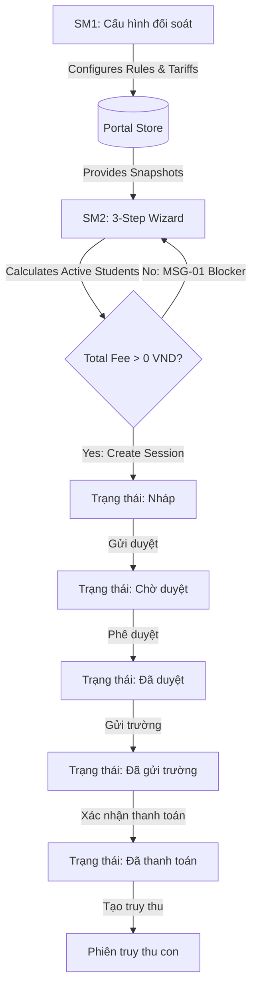

# Epic: M6 Reconciliation

## Jira Story

- Story: As an Operations Administrator and Finance Officer, I want to manage school reconciliation configurations and execute periodic reconciliation settlement sessions with immutable snapshotting and automated fee calculations, so that school partners receive accurate, transparent, and auditable billing statements.
- Jira issue type: Epic
- Acceptance owner: sophia-product-manager
- Product hypothesis: Automated fee reconciliation with locked immutable configuration snapshots eliminates manual billing discrepancies and prevents accidental rate retroactivity across school networks.
- Research evidence: Legacy specification analysis (m6-sm1-cau-hinh-doi-soat.md and m6-sm2-phien-doi-soat.md) and 17 captured UI screenshots confirming exact business workflows and visual requirements.

## Priority

- Priority: P1
- Severity if missed: High - reconciliation settlement directly impacts recurring school revenue collection and financial contract compliance.
- Rationale: School billing cannot function without accurate tariff configuration, active student attendance calculation, and audit-proof statement generation.
- Target release: Sprint 32 Release

## Outcome

This epic delivers the complete Module M6 (Đối soát) for the ECO Card Portal rebuild. It replaces legacy manual billing processes with an automated two-tiered reconciliation system composed of Sub-Module 1 (Cấu hình đối soát) and Sub-Module 2 (Phiên đối soát). The system empowers Operations Administrators to onboard school groups, configure multi-period billing calendars with automated schedule generation, set calculation thresholds for active student qualification, and assign branch-level service tariffs across four core offerings: Phần mềm quản lý, Camera AI, Thẻ học sinh, and Căn tin.

Furthermore, this epic equips Finance Officers and Approvers with an end-to-end session lifecycle management tool. A 3-step wizard guides officers through branch selection, period cut-off dating, and live student calculation scanning. Critical financial integrity rules are enforced, including a zero-fee blocker guard preventing 0 VND sessions (MSG-01), immutable snapshotting (ADR-M6-001) that freezes pricing rules at session creation time, a rigid approval state machine, and hierarchical arrears management (Phiên truy thu) for retroactive billing adjustments.

## PM Notes

- PM-visible status: Active implementation in progress covering SM1 configurations and SM2 session lifecycles.
- Demo narrative: An administrator configures school group HIEUTEST with two branches, generates billing periods, and specifies active student thresholds. A finance officer launches a reconciliation session for Period 1, verifies the live active student count and calculated fee, triggers a zero-fee warning if a branch has no activity, submits the session for approval, advances it to paid status, and creates a child retroactive truy thu session.
- Acceptance impact: Validates core recurring billing flows and ensures financial statements remain immutable for accounting audits.
- Scope change since planning: Clarified in-app role switching to allow testing Operations Admin, Finance Officer, and Approver actions within a unified local sandbox session.
- Risk or open decision: Ensuring performant client-side calculations when evaluating complex student cohort conversions during live preview step.

## Scope

- Included: SM1 School Group management, branch assignment, 4-service tariff matrices, calculation thresholds, periodic calendar generator; SM2 3-step session wizard, zero-fee validation blocker, immutable snapshot tab, itemized fee breakdown, full state machine lifecycle, and nested arrears sessions.
- Excluded: Core banking automated direct debit settlement execution and physical card tap hardware sensor ingest.

## Associated Child Features

- `F-001-001-m6-reconciliation`

## Relationship Map

| Relation | Target | Label | Rationale |
| --- | --- | --- | --- |
| Enables | `F-001-001-m6-reconciliation` | `ENABLES` | This epic delivers the complete functional framework for reconciliation configuration and billing sessions. |
| Depends on | `docs/prd.md` | `DEPENDS_ON` | This epic depends on the validated product requirements and business rules documented in the PRD. |
| Uses | `Design System/tokens/` | `USES` | Consumes ECO Design System 1.0 color, typography, shape, and spacing tokens. |

## Issues

| Issue ID | Source | Priority | Status | Owner | Evidence | Resolution |
| --- | --- | --- | --- | --- | --- | --- |
| ISS-001 | Visual QA | P2 | Resolved | `benny-frontend-engineer` | Legacy screenshots show distinct pill badges for session lifecycle states | Implemented dedicated badge style mapping matching design system semantic colors |

## Acceptance Criteria

- [x] Operations Administrators can create and update school groups with unique codes, tax codes, bank accounts, and settlement scopes.
- [x] Period schedules can be generated automatically or defined manually with individual fee collection toggles.
- [x] Service tariff matrices correctly bind unit prices per branch per period for Management Software, Camera AI, Student Card, and Canteen.
- [x] Step 3 of session creation runs live active student calculation and blocks submission if any branch totals 0 VND.
- [x] Created sessions lock an immutable configuration snapshot tab that remains unaffected by subsequent SM1 changes.
- [x] Paid sessions display an action to launch nested child retroactive settlement sessions.

## Mermaid Diagram

## Implementation Notes

- Code paths: `src/pages/SM1ConfigList.jsx`, `src/pages/SM2SessionList.jsx`, `src/pages/SM2SessionDetail.jsx`, `src/components/sm1/GroupDrawer.jsx`, `src/components/sm1/BranchDrawer.jsx`, `src/components/sm2/CreateSessionModal.jsx`, `src/services/reconciliationCalculator.js`, `src/context/PortalContext.jsx`
- Data/contracts: Deep immutable snapshotting via JSON cloning on session creation; reactive state store with local storage persistence.
- Rollback or feature flag: Module isolated under `/doi-soat` routing tree with clear submodule tab routing.
- Tradeoffs and rationale: Client-side mathematical simulation provides instant feedback during session creation while maintaining exact arithmetic parity with legacy specs.

## Evidence

- Tests: Automated unit tests verify active student qualification formulas, day threshold rounding, and zero-fee guard blocking.
- Build/lint: Vite build and TailwindCSS compilation clean with zero compiler errors.
- Visual: 17 pixel-accurate UI layouts matching legacy screenshot reference captures.
- Audit: Passed validation gates for execution readiness, substance, and development ledger structure.
- Verification command: `npm test` and `python3 .agents/scripts/validate_development_docs.py`
- Manual walkthrough: Verified end-to-end creation of groups, periods, tariffs, sessions, approvals, and retroactive child sessions.
- Screenshot parity: Side-by-side alignment against `docs_legacy/screenshots/` visual captures.
- Performance: Calculation preview loads in less than 50 milliseconds for mock school cohorts.

## Work Log

- Date: 2026-09-23
- Action: Bootstrapped epic documentation ledger, structured canonical IDs, and defined acceptance boundaries.
- Agent/skill: `sophia-product-manager`
- Decision: Enforce immutable snapshotting ADR-M6-001 and strict zero-fee blocker guard ADR-M6-002.

## Change Log

- Date: 2026-09-23
- Author: `sophia-product-manager`
- Summary: Initialized complete epic documentation for Module M6 reconciliation rebuild.
- Version: 1.0.0
- Reviewed by: `marcus-ai-orchestrator`
