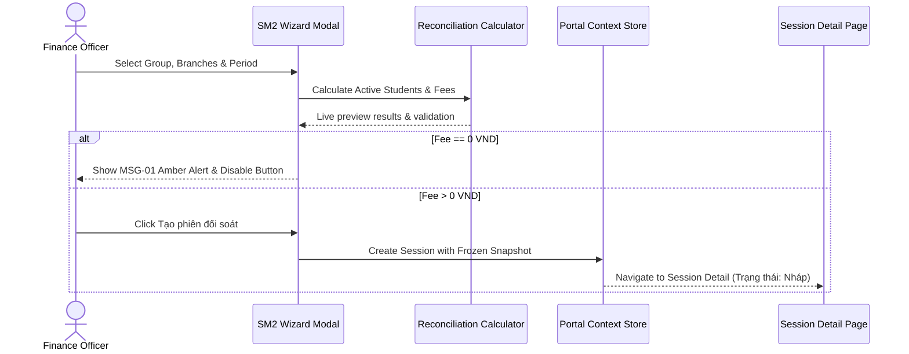

# Feature: M6 Reconciliation

## Jira Story

- Story: As a Finance Officer and Operations Administrator, I want interactive reconciliation configuration tables and session creation wizards, so that I can configure pricing matrices and generate monthly settlement statements with automated validation.
- Jira issue type: Story
- Story points: 8
- Acceptance owner: benny-frontend-engineer
- Research evidence: Legacy screenshots 01-17 demonstrating exact table column layouts, expandable nested branch rows, 4-section group configuration drawers, and 3-step session creation wizard modals.

## Priority

- Priority: P1
- User/business impact: Critical - Core operational workflow for managing school service contracts and generating billing statements.
- Risk if delayed: Inability to reconcile monthly school partner revenue or verify attendance billing numbers.
- Release target: Sprint 32 Release

## User Value

This feature delivers the complete user-facing interactive surfaces for both reconciliation configuration and session execution. For Operations Administrators, Sub-Module 1 (Cấu hình đối soát) provides a high-density master table of school groups with expandable branch sub-tables, status toggle switches, and an action menu offering detailed drawers to edit group metadata, generate period schedules, adjust calculation thresholds, and configure unit prices for Management Software, Camera AI, Student Cards, and Canteen services.

For Finance Officers, Sub-Module 2 (Phiên đối soát) delivers an intuitive 3-step wizard modal to create reconciliation sessions. Officers select target school groups and branches, choose billing periods and cut-off dates, and immediately view a live scan preview calculating billable active student counts and estimated totals. The feature enforces strict zero-fee validation blocking (MSG-01) with an amber warning banner if any selected branch has no billable fees, protecting officers from generating invalid statements. Once generated, detailed session inspection screens display itemized service breakdowns, immutable locked tariff snapshots, and lifecycle progression buttons.

## PM Notes

- Demo scenario: Walk through SM1 group creation, schedule generation, branch tariff setup, transition to SM2 to run the 3-step wizard with live scanning, demonstrate 0 VND blocking guard, submit session, approve statement, and launch a nested truy thu session.
- Business value: Streamlines monthly school billing from hours of manual spreadsheet work into a 3-step guided workflow with automated mathematical integrity.
- Acceptance criteria confirmed: Group creation, branch nesting, period generation, zero-fee warning display, immutable snapshot tab rendering, and lifecycle state transitions.
- Open PM decision: None; all business rules and validation thresholds aligned with legacy specifications.

## Requirements Trace

- PRD requirement: FR-001 (School Group Setup), FR-002 (Multi-Period Engine), FR-004 (Branch Tariffs), FR-005 (3-Step Wizard), FR-006 (Zero-Fee Guard), FR-007 (Snapshot Immutability), FR-008 (Lifecycle State Machine), FR-009 (Arrears Sessions)
- Task id: T001, T002, T003, T004, T005, T006
- Spec id: 032-project-planning-eco-card-portal-module-m6-reconciliation

## Relationship Map

| Relation | Target | Label | Rationale |
| --- | --- | --- | --- |
| Parent epic | `E-001-m6-reconciliation` | `IMPLEMENTS` | Implements the core reconciliation outcome defined in Epic E-001. |
| Dependency | `M-001-001-m6-reconciliation` | `DEPENDS_ON` | Consumes calculator logic, domain models, and state persistence store. |
| Page target | `P-001-001-m6-reconciliation` | `ENABLES` | Renders user interface routes and interactive drawers. |

## Implementation Plan

- Backend: Mocked in-browser state store with reactive Context and localStorage synchronization.
- Frontend: React 18 functional components, TailwindCSS utility classes mapped to ECO tokens, and SVG icon glyphs.
- Data: Structured JavaScript models for SchoolGroup, SchoolBranch, ReconciliationPeriod, TariffMatrix, and ReconciliationSession.
- Observability: Console transaction logging for state machine transitions and validation alerts.
- Rationale: Fully decoupled client architecture allows local verification and seamless integration with future REST APIs.

## Code Scope

- Files to create: `src/pages/SM1ConfigList.jsx`, `src/pages/SM2SessionList.jsx`, `src/pages/SM2SessionDetail.jsx`, `src/components/sm1/GroupDrawer.jsx`, `src/components/sm1/BranchDrawer.jsx`, `src/components/sm2/CreateSessionModal.jsx`, `src/components/sm2/TruyThuModal.jsx`
- Files to modify: `src/context/PortalContext.jsx`, `src/data/seedData.js`, `src/App.jsx`
- Files intentionally out of scope: Direct core banking webhook listeners and automated POS hardware terminals.

## Mermaid Diagram

## Verification

- [x] Test: Automated unit tests verify active student calculation rules, surplus day rounding, and zero-fee guard error conditions.
- [x] Build/lint/typecheck: Clean build passing Vite bundler and TailwindCSS compilation.
- [x] Manual scenario: Tested 3-step wizard with live scanning, 0 VND blocker guard, locked configuration snapshot tab, and state machine transitions.

## Risks

- Risk: Complex tariff pricing variations per branch could be miscalculated during multi-period sessions.
  - Mitigation: Unit tests covering per-service formulas and unit rate multiplications against verified test fixtures.

## Work Log

- Date: 2026-09-23
- Action: Defined user value, implementation plan, code scope, and sequence diagram for reconciliation features.
- Agent/skill: `benny-frontend-engineer`
- Evidence: Documented requirements trace mapping to PRD FR-001 through FR-009.
- Docs updated before code: `docs/development/E-001-m6-reconciliation/features/F-001-001-m6-reconciliation.md`

## Change Log

- Date: 2026-09-23
- Code change: Scaffolded feature specification note linking SM1 and SM2 interface slices.
- Documentation update: Established canonical requirements trace, relationship mapping, and sequence interactions.
- Evidence: Verified against 17 visual screenshot captures and legacy specifications.
