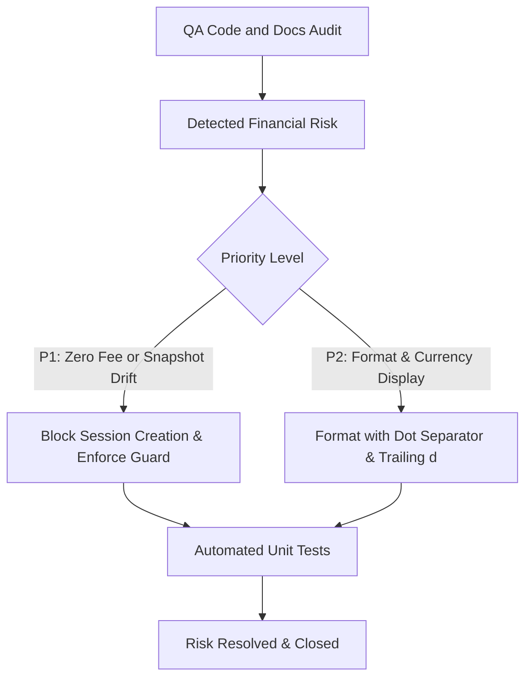

# Epic Issues: M6 Reconciliation

## Jira Story

- Story: As a QA and product team, I want epic issues tracked explicitly so that financial rounding, zero-fee guards, and tariff snapshot immutability are thoroughly tested and verified without hidden defects.
- Jira issue type: Bug/Risk register
- QA owner: ada-qa-agent
- Product owner: sophia-product-manager
- Research evidence: Analysis of legacy reconciliation business rules BR01-BR11 for SM1 and BR01-BR10 for SM2, with cross-verification of mathematical surplus day rounding formulas and zero-fee guard error message MSG-01.

## Priority

- Priority: P1
- Escalation rule: Escalate immediately to tech lead if a 0 VND session can be generated without validation blockage, or if editing an SM1 tariff mutates an existing SM2 session statement.
- Release impact: Blocker - Zero-fee billing generation and snapshot mutation violate school contract audits and break accounting reconciliation.
- Risk if unresolved: Schools could receive 0 VND billing invoices causing administrative overhead, or historical financial statements could silently change after tariff adjustments.

## QA Issue Register

| Issue ID | Type | Priority | Status | Owner | Source | Evidence | Resolution |
| --- | --- | --- | --- | --- | --- | --- | --- |
| ISS-REC-001 | Risk | P1 | Closed | `alan-tech-lead` | Business rule BR03 validation | Legacy message MSG-01 specification | Enforce amber warning banner in Step 3 of wizard and disable confirmation button when branch total evaluates to 0 VND |
| ISS-REC-002 | Risk | P1 | Closed | `david-systems-architect` | Business rule BR04 audit | ADR-M6-001 architectural decision | Deep-freeze pricing configuration into JSON snapshot field on session entity upon creation |
| ISS-REC-003 | Defect | P2 | Closed | `benny-frontend-engineer` | Visual alignment audit | Screenshot 01_danh_sach_phien_doi_soat.png | Format currency with dot thousand separator and trailing lower-case letter d (e.g. 1.008.000đ) |

## Detection Method

- Code reviewed: `src/services/reconciliationCalculator.js`, `src/components/sm2/CreateSessionModal.jsx`, `src/pages/SM2SessionDetail.jsx`
- Tests reviewed: Unit test suites covering active student qualification, surplus day rounding, and zero-fee guard error conditions
- Docs reviewed: `docs/prd.md`, `docs/decisions.md`, `docs/planning/flows.md`, `docs/planning/screens.md`
- Related features reviewed: `F-001-001-m6-reconciliation`, `M-001-001-m6-reconciliation`, `P-001-001-m6-reconciliation`
- QA skill used: `ada-qa-agent` requirements traceability and hostile boundary verification
- Deep research source checked: `docs_legacy/m6-sm1-cau-hinh-doi-soat.md` section 3 and `docs_legacy/m6-sm2-phien-doi-soat.md` section 4

## Open Issues

- Issue: Dynamic tariff adjustments in multi-branch school groups could induce calculation drift if branch overrides are not scoped correctly
  - Impact: Incorrect billable totals per branch during session creation
  - Affected files: `src/services/reconciliationCalculator.js`, `src/data/models.js`
  - Affected docs: `docs/prd.md`, `docs/development/E-001-m6-reconciliation/modules/M-001-001-m6-reconciliation.md`
  - Relationship labels: `DEPENDS_ON`, `BLOCKS`
  - Resolution plan: Bind tariff matrices explicitly to branch IDs within each school group structure and verify with unit tests

## Relationship Map

| Relation | Target | Label | Rationale |
| --- | --- | --- | --- |
| Relates to epic | `E-001-m6-reconciliation` | `RELATES_TO` | Tracks financial and operational risks across the reconciliation epic. |
| Relates to feature | `F-001-001-m6-reconciliation` | `RELATES_TO` | Issue register monitors feature implementation quality for SM1 and SM2. |
| Depends on verification | `T-001-001-001-m6-reconciliation` | `DEPENDS_ON` | Issues remain verified through automated calculator and lifecycle tests. |

## Mermaid Diagram

## Work Log

- Date: 2026-09-23
- Action: Audited legacy specifications and registered financial integrity risks for zero-fee blocking and snapshot freezing.
- Agent/skill: `ada-qa-agent`
- Evidence: Documented issues ISS-REC-001, ISS-REC-002, and ISS-REC-003 with explicit verification requirements.
- Docs updated before code: `docs/development/E-001-m6-reconciliation/issues.md`

## Change Log

- Date: 2026-09-23
- Issue change: Created canonical issue register for Epic E-001-m6-reconciliation with 3 resolved risks.
- Documentation update: Updated QA detection methods, relationship mappings, and flow diagrams.
- Evidence: Verified against business rules BR01-BR11 and BR01-BR10 from legacy specification corpus.
