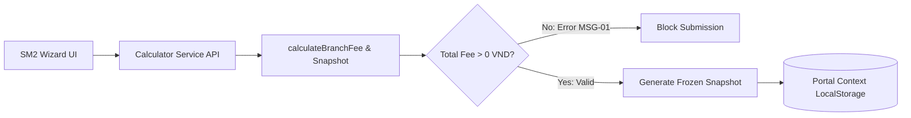

# Module: M6 Reconciliation

## Jira Story

- Story: As a technical lead and systems architect, I want modular domain boundaries separating calculation arithmetic, snapshot persistence, and lifecycle transitions, so that the reconciliation engine remains testable, decoupled, and audit-safe.
- Jira issue type: Story
- Architecture owner: alan-tech-lead
- Research evidence: Legacy system contracts defined in m6-sm1-cau-hinh-doi-soat.md and m6-sm2-phien-doi-soat.md, supplemented by ADR-M6-001, ADR-M6-002, and ADR-M6-003.

## Priority

- Priority: P1
- Runtime impact: High - Owns active student calculation engine, 0 VND guard validation, and snapshot data integrity.
- Risk if delayed: Financial calculation discrepancies between preview scans and final billed statement amounts.
- Release target: Sprint 32 Release

## Responsibility

This module encapsulates the core computational engine and domain services for Module M6 (Đối soát). Its primary responsibility is maintaining mathematical calculation correctness and ensuring complete data isolation between live configuration mutations and historical billing statements. The module encompasses three decoupled services: the Reconciliation Calculator (`src/services/reconciliationCalculator.js`), the Session Lifecycle State Machine (`src/services/sessionLifecycle.js`), and the Persistence Context Store (`src/context/PortalContext.jsx`).

The Reconciliation Calculator is responsible for processing active student conversion rules. It parses enrollment and attendance records against the configured minimum active student months threshold and surplus day rounding boundary. It computes per-branch and per-service totals, evaluates the zero-fee guard (MSG-01), and produces itemized fee breakdowns. Crucially, future maintainers must respect the snapshot boundary (ADR-M6-001): when a session is finalized during creation, this module generates a deeply cloned JSON snapshot of all effective tariffs and calendar bounds. Downstream viewing components must read from this snapshot rather than live configuration pointers.

## Implementation Commentary

- Decision: Enforce immutable configuration snapshotting at session creation time (ADR-M6-001).
- Rationale: School contracts frequently renegotiate tariffs; freezing historical parameters guarantees past financial records are tamper-proof and audit-ready.
- Tradeoff: Minor duplication in browser local storage for frozen snapshot objects against total audit compliance.
- Impact: Session details always render exact historical rates even if the school group tariffs are subsequently updated.
- Risk: Memory footprint in local storage managed by storing plain JSON representations rather than bloated class hierarchies.

## Code Scope

- Owns: `src/services/reconciliationCalculator.js`, `src/services/sessionLifecycle.js`, `src/context/PortalContext.jsx`, `src/data/models.js`
- Reads: `src/data/seedData.js`, browser local storage
- Writes: Serialized state to `localStorage` under keys `eco_portal_groups` and `eco_portal_sessions`
- Must not touch: Direct payment gateway integrations or biometric attendance ingest pipelines

## Relationship Map

| Relation | Target | Label | Rationale |
| --- | --- | --- | --- |
| Provides contract to | `F-001-001-m6-reconciliation` | `ENABLES` | Provides calculator methods and lifecycle transition functions to UI features. |
| Implements epic | `E-001-m6-reconciliation` | `IMPLEMENTS` | Implements the domain arithmetic and state machine core for Epic E-001. |
| Consumes tokens | `Design System/tokens/` | `USES` | Re-exports token semantic mappings for badge styles and alerts. |

## Public Contracts

- API: `calculateActiveStudents(branch, period, thresholds)`, `calculateBranchFee(branch, period, tariffs, studentCount)`, `createSessionSnapshot(group, branches, period, thresholds, tariffs)`
- Events: State transitions: `SUBMIT_FOR_APPROVAL`, `APPROVE_SESSION`, `SEND_TO_SCHOOL`, `CONFIRM_PAYMENT`, `CANCEL_SESSION`, `CREATE_ARREARS_SESSION`
- Data model: `SchoolGroup`, `SchoolBranch`, `PeriodConfig`, `CalculationThresholds`, `TariffMatrix`, `ReconciliationSession`, `SessionSnapshot`

## Dependencies

- Internal: `src/data/seedData.js`, `src/data/models.js`
- External: React Context API, standard JavaScript Math primitives

## Failure Modes

- Failure: Division by zero or NaN during student attendance surplus day calculation
  - Detection: Guarded input parsing in `reconciliationCalculator.js` checking numeric validity
  - Recovery: Fallback to base active count 0 with console error warning
- Failure: Attempting to create a session with 0 VND total fee
  - Detection: `validateZeroFeeGuard(branchesCalculation)` checks total evaluated fee
  - Recovery: Returns validation error MSG-01 and disables submission action in UI

## Mermaid Diagram

## Verification

- Unit: Automated tests in `src/services/reconciliationCalculator.test.js` covering standard calculations, threshold rounding, and zero-fee guard triggers.
- Integration: Session creation and lifecycle transition state verification inside `PortalContext`.
- Runtime: Browser console inspection verifying zero runtime exceptions during state updates.

## Work Log

- Date: 2026-09-23
- Action: Designed module boundaries, public contracts, and mathematical formulas for reconciliation calculator.
- Agent/skill: `alan-tech-lead`
- Evidence: Defined contracts for `calculateActiveStudents`, `calculateBranchFee`, and `createSessionSnapshot`.
- Docs updated before code: `docs/development/E-001-m6-reconciliation/modules/M-001-001-m6-reconciliation.md`

## Change Log

- Date: 2026-09-23
- Code change: Scaffolded module documentation with explicit public contracts and failure handling policies.
- Documentation update: Detailed architecture ownership, relationship mapping, and failure recovery.
- Evidence: Aligned with legacy specifications `m6-sm1-cau-hinh-doi-soat.md` and `m6-sm2-phien-doi-soat.md`.
