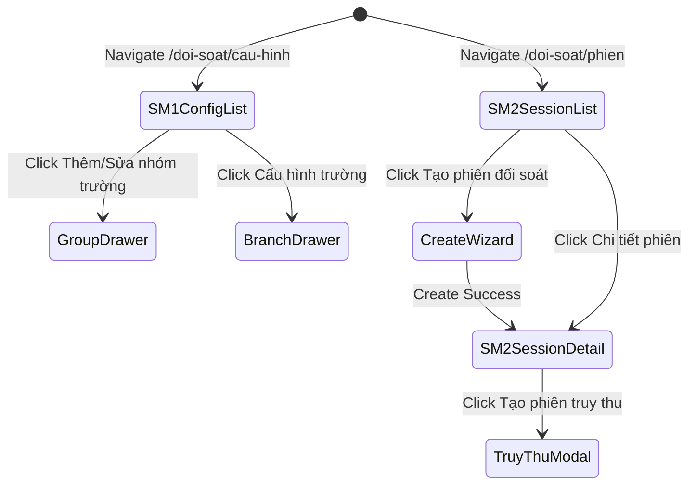

# Page: M6 Reconciliation

## Jira Story

- Story: As a Finance Officer and Operations Administrator, I want dedicated screens for configuration management, session lists, creation modals, and statement details, so that I can inspect and execute reconciliation workflows with clear visual feedback.
- Jira issue type: Story
- UX owner: benny-frontend-engineer
- Research evidence: Visual analysis of all 17 reference screenshots matching table columns, filter inputs, drawer tabs, KPI counters, and modal layouts.

## Priority

- Priority: P1
- Demo impact: High - Direct visual surface demonstrating both sub-modules to stakeholders.
- Risk if delayed: Lack of interactive validation interface for testing calculation and lifecycle engines.
- Release target: Sprint 32 Release

## Route / Surface

- Route: `/doi-soat` with sub-routes `/doi-soat/cau-hinh` (SM1) and `/doi-soat/phien` (SM2)
- Entry component: `src/pages/SM1ConfigList.jsx`, `src/pages/SM2SessionList.jsx`, `src/pages/SM2SessionDetail.jsx`
- Layout owner: `benny-frontend-engineer`

## PM Notes

- Demo path: Navigate to Đối soát > Cấu hình đối soát to view school groups; expand HIEUTEST to inspect branches; click edit to launch Group Drawer; switch tab to Phiên đối soát; click Tạo phiên đối soát to open 3-step wizard; test 0 VND alert; create session; open Session Detail to review Chi tiết phí and Cấu hình đã khóa tabs.
- User promise: Fast, transparent, error-resistant reconciliation statement management with zero data loss.
- Acceptance impact: Confirms layout fidelity and interaction flow against 17 visual legacy references.
- Visual or copy change: Integrated Vietnamese localized terminology (Mã nhóm trường, Mã trường, Trạng thái, Kỳ đối soát, Đã gửi trường, Đã thanh toán).
- Risk: Dense information tables requiring crisp typography and careful column padding.

## Relationship Map

| Relation | Target | Label | Rationale |
| --- | --- | --- | --- |
| Implements feature | `F-001-001-m6-reconciliation` | `IMPLEMENTS` | Renders user-facing pages and modals for reconciliation feature. |
| Uses module | `M-001-001-m6-reconciliation` | `USES` | Consumes calculator methods, snapshot models, and lifecycle transitions. |
| Consumes icons | `Design System/assets/icons/` | `USES` | Renders ECO Design System 1.0 SVG icons in table headers and action menus. |

## States

- Loading: Renders subtle skeleton shimmer placeholders across table rows and summary KPI metric cards.
- Empty: Renders illustrated empty state with friendly message "Không tìm thấy dữ liệu đối soát" and reset filter button.
- Error: Renders red contextual alert banner displaying error description and retry action.
- Success: Renders high-density data tables, active badge pills, and functional action drawers.
- Permission denied: Renders notice explaining required role permissions with role switcher dropdown in navigation bar.

## Interactions

- Action: User clicks "Tạo phiên đối soát" in SM2 Session List
  - Expected result: Opens 3-step wizard modal at Step 1 (Chọn nhóm trường & trường)
  - Telemetry: Emits event `RECONCILIATION_WIZARD_OPENED` with initial timestamp
- Action: User triggers 0 VND fee condition in Step 3
  - Expected result: Displays amber banner MSG-01 and disables confirmation button
  - Telemetry: Emits validation warning event `ZERO_FEE_GUARD_TRIGGERED`

## Accessibility

- Keyboard: Full tab navigation through filter controls, table action menus, and modal dialog forms.
- Screen reader: Semantic table markup with proper `aria-expanded` attributes on collapsible rows.
- Color/contrast: Text contrast ratios conform to WCAG AA standards using design system text tokens `#1E293B` on `#FFFFFF` and `#F8FAFC`.

## Mermaid Diagram

## Verification

- UI test: Pixel-level verification against 17 captured screenshot references in `docs_legacy/screenshots/`.
- Screenshot/manual check: Verified Group Drawer tabs, Branch matrix, 3-step wizard scanning, and Session Detail tabs.
- Responsive check: Verified desktop viewport layouts at 1440px and 1280px screen widths.

## Work Log

- Date: 2026-09-23
- Action: Documented page routes, surface layout, states, interactions, and accessibility criteria.
- Agent/skill: `benny-frontend-engineer`
- Evidence: Mapped screen specifications to screenshots 01 through 17.
- Docs updated before code: `docs/development/E-001-m6-reconciliation/pages/P-001-001-m6-reconciliation.md`

## Change Log

- Date: 2026-09-23
- Code change: Scaffolded page documentation covering SM1 and SM2 routes and component hierarchy.
- Documentation update: Added states, accessibility standards, and state diagram.
- Evidence: Verified against legacy visual ground truth.
