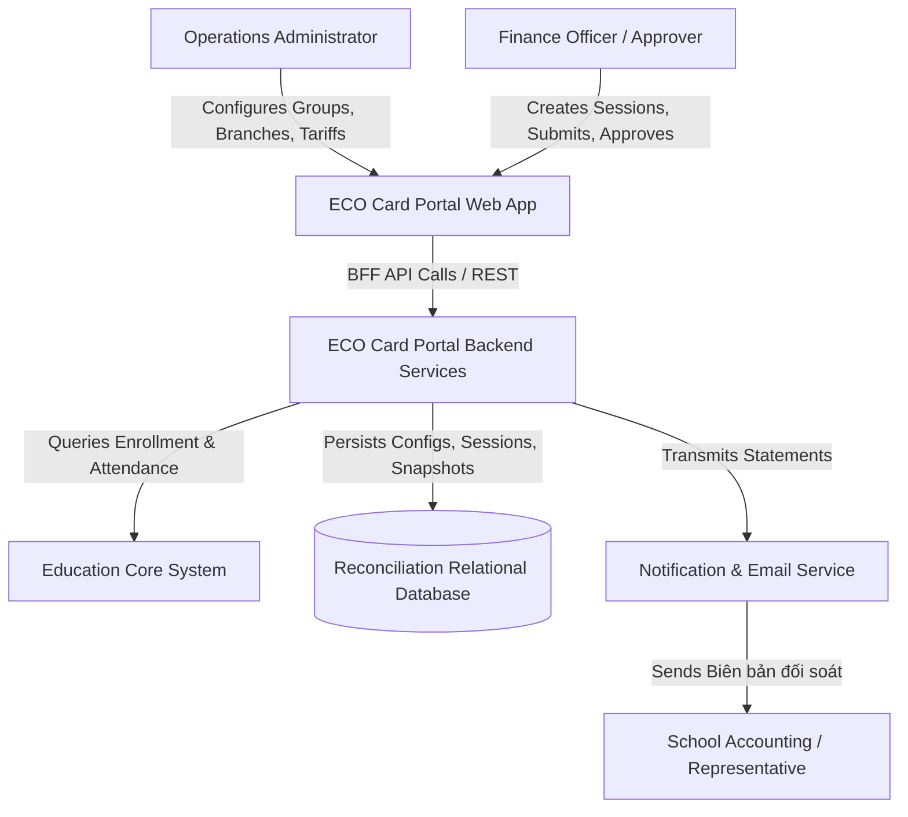
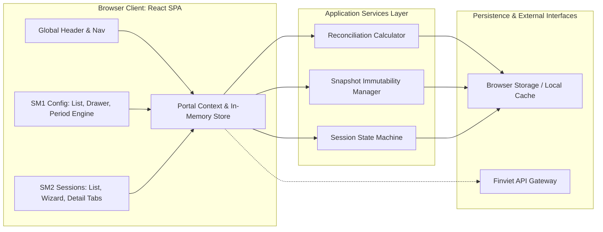
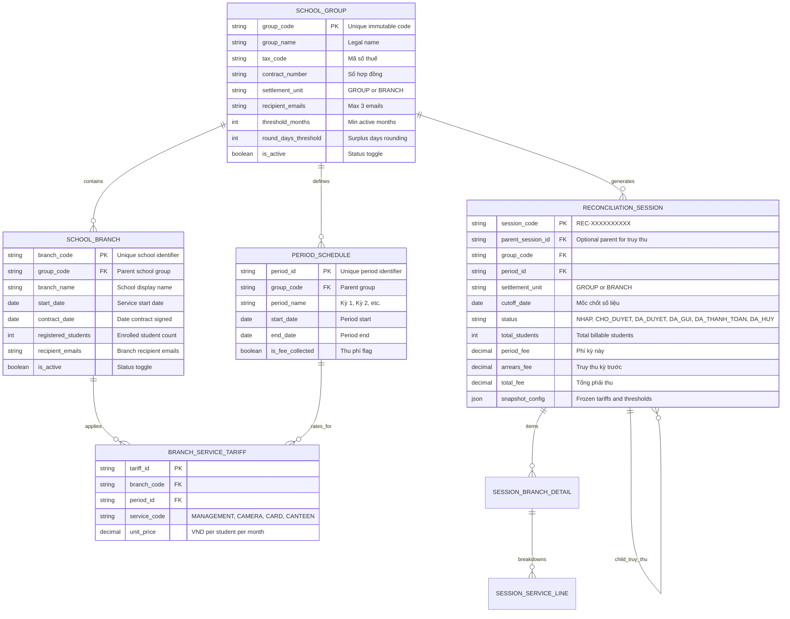
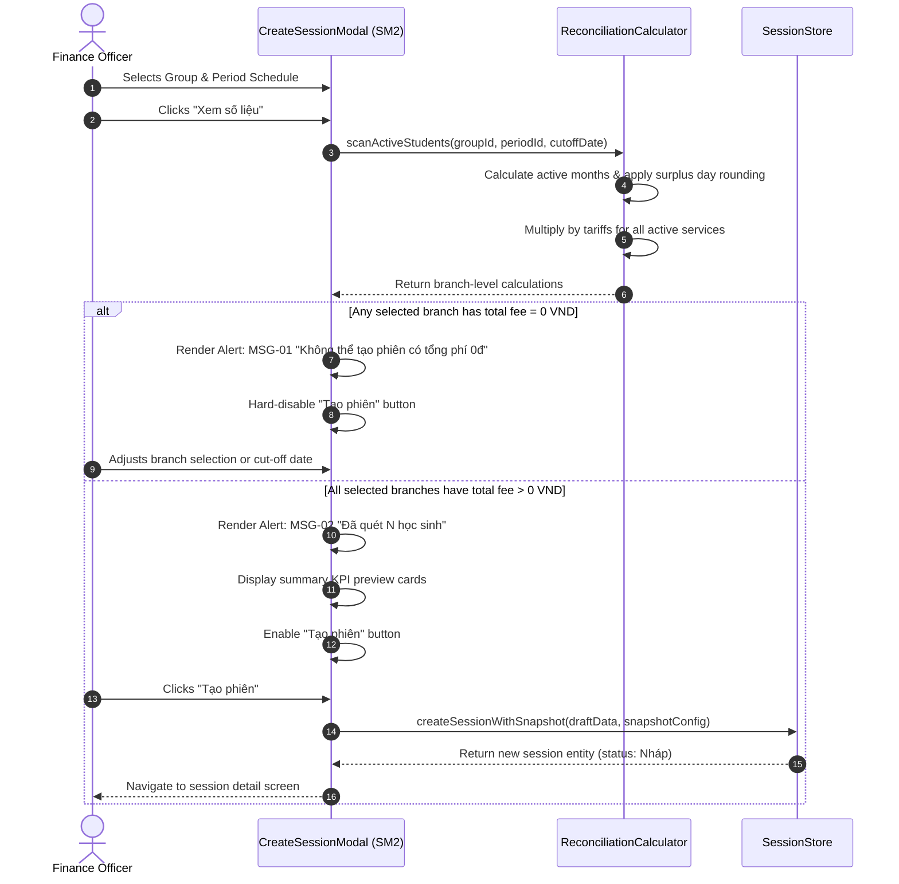
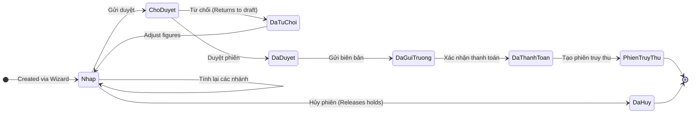
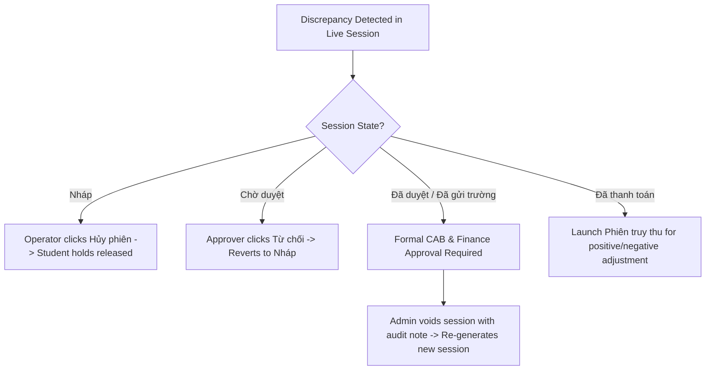
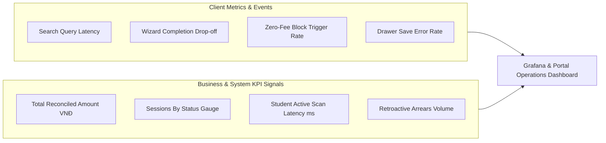

# System Architecture Diagrams: Module M6 (Đối soát)

This document contains architectural diagrams documenting system context, container topology, relational data schemas, execution sequences, lifecycle state transitions, and observability boundaries.

---

## 1. C4 System Context Diagram

The system context diagram illustrates the boundary between the internal portal users, the core portal frontend, the backend reconciliation services, the school educational database, and the outbound statement delivery services.

---

## 2. C4 Container & Component Architecture Diagram

The component diagram demonstrates the modular structure within the web client: presentation pages interact with the centralized state store, which coordinates with the calculation engine, snapshot manager, and state machine before syncing with persistence layers.

---

## 3. Entity-Relationship Data Model Diagram

The relational schema links legal groups to branches, periods, and tariff matrices. Sessions freeze configurations into a JSON snapshot attribute and support self-referential parent-child relationships for retroactive settlement (*truy thu*).

---

## 4. Sequence Diagram: Session Creation & Zero-Fee Evaluation Flow

The sequence diagram captures the primary creation workflow and illustrates the conditional evaluation path enforcing the 0 VND validation guard (MSG-01).

---

## 5. Session Lifecycle State Machine Diagram

This state chart outlines the strict linear and branched state flow of a reconciliation session, specifying which actions trigger lifecycle advancements.

---

## 6. Rollback & Change Advisory Board (CAB) Flow

The rollback flowchart governs error correction across each lifecycle stage, ensuring audit compliance and eliminating unauthorized data destruction.

---

## 7. Observability & Telemetry Signals Map

The telemetry diagram defines the operational logging signals captured at client and service boundaries to monitor settlement performance and operator activity.
