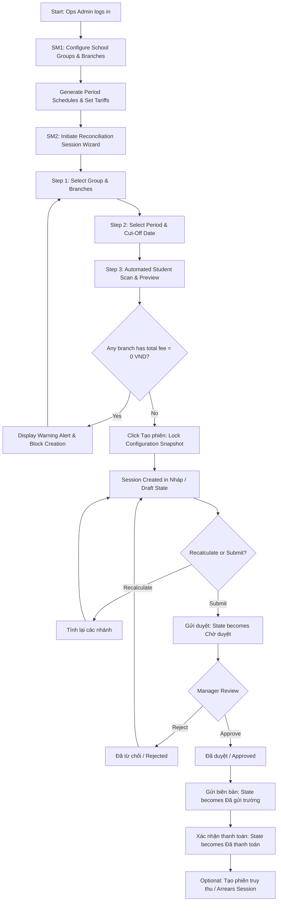
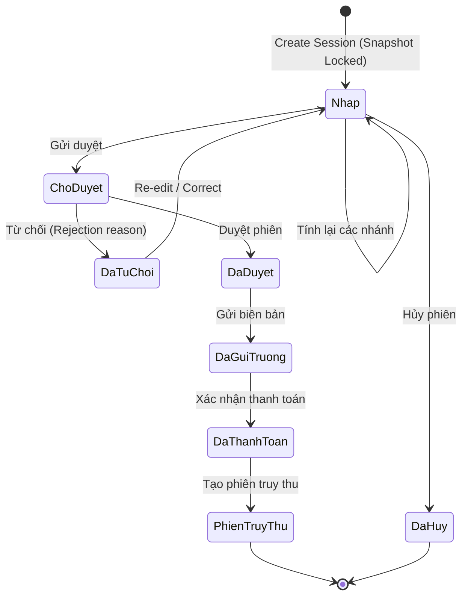

# User & System Interaction Flows: Module M6 (Đối soát)

This document details the end-to-end user workflows, system interaction sequences, failure handling paths, and recovery flows for Sub-Modules SM1 (Cấu hình đối soát) and SM2 (Phiên đối soát).

---

## 1. Flow Overview & Architecture Map

---

## 2. Detailed Workflows

### 2.1 Workflow 1: School Group Onboarding & Tariff Configuration (SM1)
1. **User Action**: The Ops Admin navigates to `/reconciliation/config` and clicks the `+ Tạo mới` button on the top right of the table card.
2. **System Response**: A slide-over drawer animates from the right side of the screen, presenting 4 numbered sections.
3. **User Action**: Enters legal details in Section 1 (Group Code `HIEUTEST`, Name, Tax Code, Contract Number, Representative).
4. **User Action**: In Section 2, selects the Settlement Scope card (`Theo nhóm trường` or `Theo từng trường`) and enters up to 3 notification email addresses separated by commas.
5. **User Action**: In Section 3, inputs the Service Year range (e.g. `07/09/2026 - 25/05/2027`) and Period Count (`2`), then clicks `Sinh lịch kỳ`.
6. **System Response**: Automatically divides the calendar year into equal periods (Kỳ 1 and Kỳ 2), populates the period table, and enables the `Thu phí` toggle by default for each row.
7. **User Action**: In Section 4, inputs minimum active threshold months (e.g. `1`) and rounding surplus days (e.g. `10`).
8. **User Action**: Clicks `Lưu` in the sticky footer.
9. **System Response**: Validates inputs, saves the school group record, closes the drawer, displays a success toast notification, and updates the master table.
10. **User Action**: Clicks `Thao tác -> Thêm chi nhánh` on the newly created group.
11. **System Response**: Opens the Branch Configuration drawer with prefilled group context.
12. **User Action**: Selects a school branch, inputs student count, checks active services (e.g. *Phần mềm quản lý nhà trường*, *Camera AI*), and enters per-period unit prices.
13. **User Action**: Clicks `Lưu`. The branch appears in the expandable child table under the group row.

---

### 2.2 Workflow 2: Reconciliation Session Creation & Zero-Fee Guard (SM2)
1. **User Action**: The Finance Officer navigates to `/reconciliation/sessions` and clicks `+ Tạo mới`.
2. **System Response**: Opens the 3-Step Creation Wizard Modal focused on Step 1 (`Chọn nhóm trường`).
3. **User Action**: Selects the school group from the dropdown.
4. **System Response**: Displays group parameters (settlement unit, active branches, calculation thresholds). If the unit is `Theo từng trường`, renders a branch selection list with `Chọn tất cả` enabled by default.
5. **User Action**: Verifies branch selection and proceeds to Step 2 (`Chọn kỳ đối soát`).
6. **User Action**: Selects the billing period from the dropdown. Any period with an existing active session displays an inline tag `Đã có phiên`. Sets cut-off date (defaulting to current date) and optionally toggles retroactive arrears settlement.
7. **User Action**: Proceeds to Step 3 and clicks `Xem số liệu`.
8. **System Response (Calculation Engine)**:
   - Sets button to loading state: `Đang quét học sinh và tính phí...`.
   - Scans active student rosters matching branch enrollments.
   - Evaluates active days against threshold rules and surplus rounding.
   - Multiplies active months by locked tariffs for each service.
9. **Branch Fee Evaluation (Failure vs Success Flow)**:
   - **Failure Flow**: If any selected branch has a total fee of 0 VND, the modal displays an amber warning alert (`MSG-01: Không thể tạo phiên có tổng phí 0đ - [Tên chi nhánh] chưa phát sinh phí...`) and disables the `Tạo phiên` button.
   - **Recovery Flow**: The operator returns to Step 1 to deselect the 0 VND branch, or returns to Step 2 to adjust the cut-off date, and clicks `Cập nhật số liệu`.
   - **Success Flow**: When all selected branches have total fees > 0 VND, an info alert displays `Đã quét N học sinh`, and summary metric cards render: *Học sinh thu phí*, *Phí kỳ này*, *Truy thu*, and *Tổng phải thu*. The `Tạo phiên` button illuminates in solid primary blue.
10. **User Action**: Clicks `Tạo phiên`.
11. **System Response**: Copies the exact configuration snapshot into the new session entity, sets the initial status to `Nháp`, closes the modal, and routes to the new session's detail page.

---

### 2.3 Workflow 3: Session Lifecycle & Retroactive Settlement (SM2)

1. **Draft Phase (`Nháp`)**:
   - Operator can click `Tính lại các nhánh` to refresh calculations if underlying student roster data was modified.
   - Operator can click `Hủy phiên` to cancel the session, prompting a confirmation dialog and transitioning the session to `Đã hủy` while releasing student holds (`Đã nhả kết quả`).
   - Operator clicks `Gửi duyệt`. The system transitions the status to `Chờ duyệt` and locks editing actions.
2. **Approval Phase (`Chờ duyệt`)**:
   - The Approver accesses the session detail, reviews KPI cards, and expands the `Chi tiết phí` table to inspect service-level line items.
   - If rejected, clicks `Từ chối`. Status transitions to `Đã từ chối` and returns to draft for operational adjustment.
   - If approved, clicks `Duyệt phiên`. Status transitions to `Đã duyệt`.
3. **Execution & Settlement (`Đã duyệt` -> `Đã gửi trường` -> `Đã thanh toán`)**:
   - With an approved session, the operator can click `Tải biên bản` (downloads official statement document) or `Gửi biên bản` (transmits statement to school contacts via email). Transmitting advances status to `Đã gửi trường`.
   - Upon financial remittance, the Finance officer clicks `Xác nhận thanh toán`. Status advances to `Đã thanh toán`.
4. **Retroactive Arrears Settlement (`Tạo phiên truy thu`)**:
   - From the `Đã thanh toán` session, the operator selects `Tạo phiên truy thu` from the action menu.
   - A modal prompts for the target branch and arrears cut-off period.
   - A child session entity (`parent_session_id = REC-XXXXX`) is created with label `PHIÊN TRUY THU`.
   - The child session displays nested directly beneath the parent row in the session master table and progresses through its own approval lifecycle.
