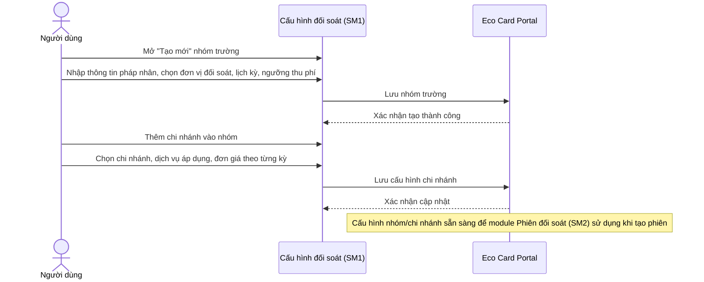
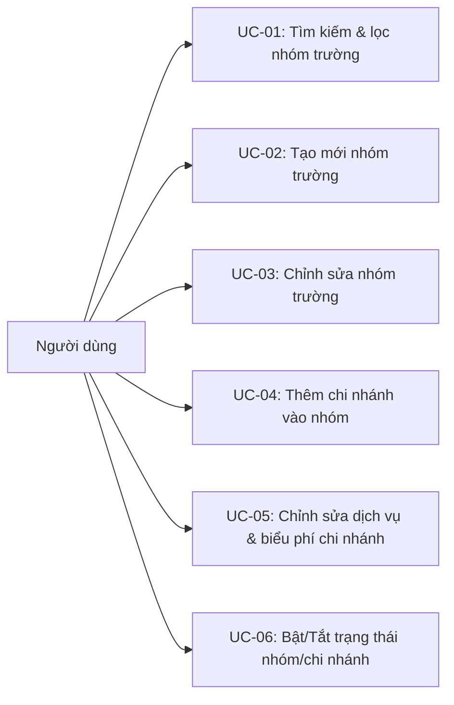
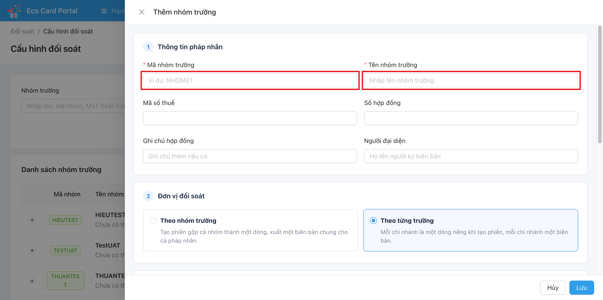
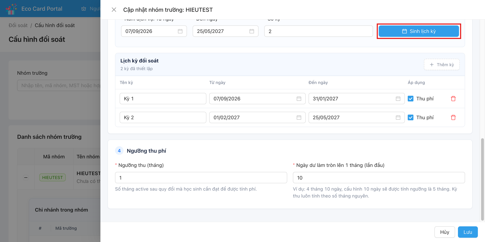
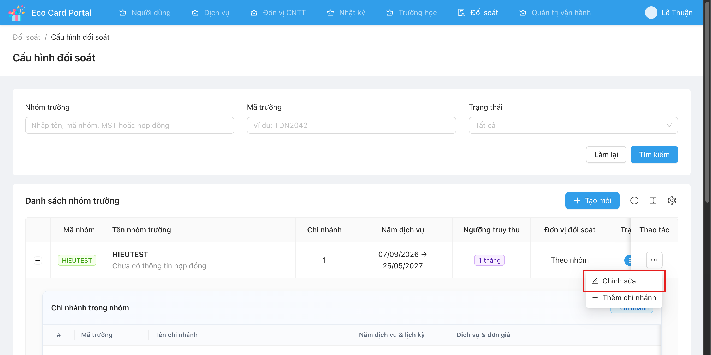
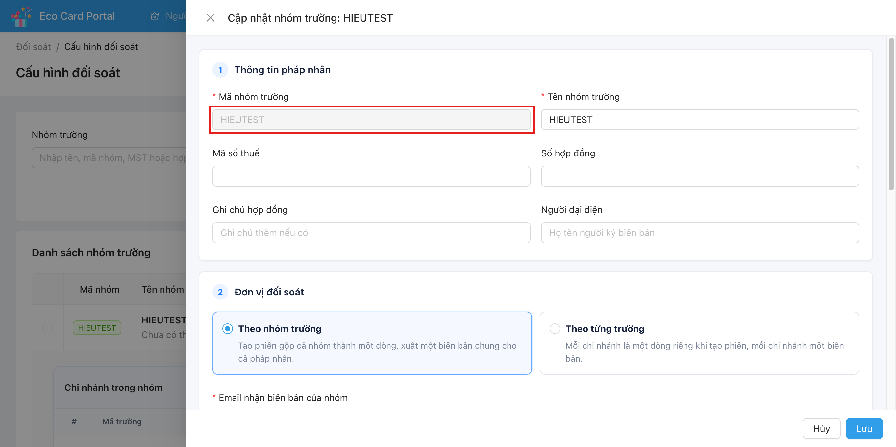
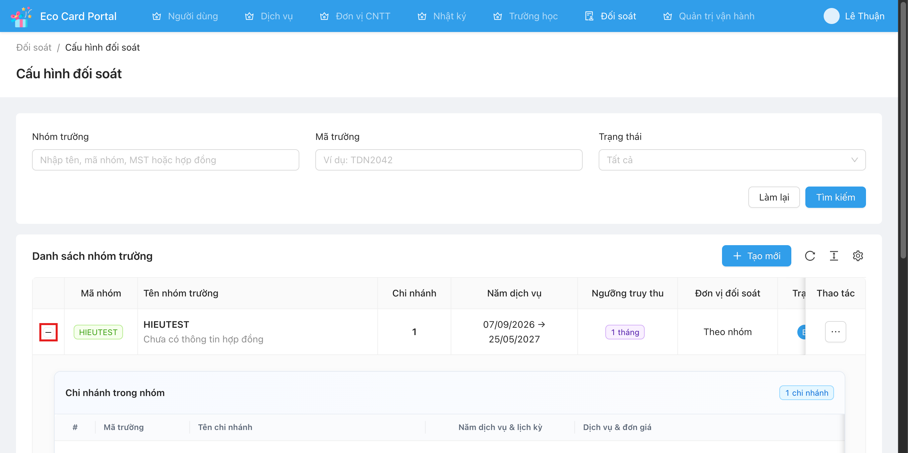
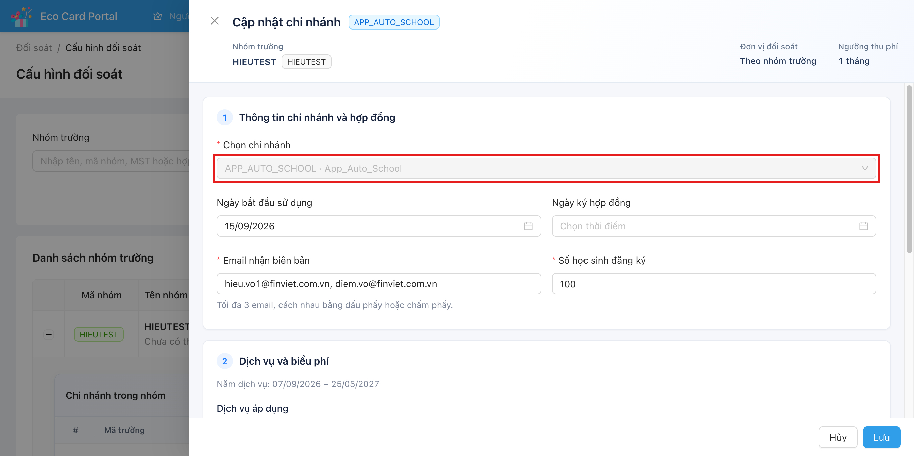
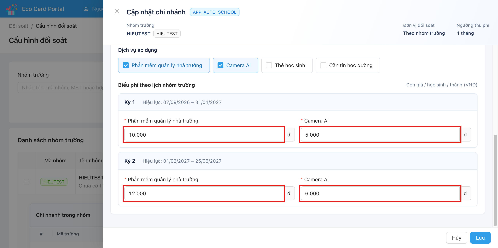

# Tên: Cấu hình đối soát

## Mục lục
1. Thông tin tổng quan
2. Tổng quan nghiệp vụ
3. Đặc tả tính năng

## 1. Thông tin tổng quan

### 1.1 Giới thiệu chung
"Cấu hình đối soát" là màn hình thiết lập các thông số dùng làm nền tảng cho việc tạo "Phiên đối soát" (SM2) sau này. Tại đây, người dùng khai báo từng **nhóm trường** (pháp nhân/khách hàng), các **chi nhánh** (trường học) thuộc nhóm, dịch vụ và biểu phí áp dụng cho từng chi nhánh theo từng kỳ, cùng các ngưỡng tính phí truy thu. Module dành cho người dùng nội bộ Finviet quản trị hợp đồng/billing của các nhóm trường.

### 1.2 Mục tiêu
- Khai báo pháp nhân (nhóm trường) và thông tin hợp đồng gắn với nhóm.
- Xác định đơn vị đối soát: gộp theo cả nhóm hay tách riêng theo từng chi nhánh.
- Thiết lập lịch kỳ đối soát (số kỳ, ngày bắt đầu/kết thúc từng kỳ) dùng chung cho cả nhóm.
- Khai báo dịch vụ và đơn giá áp dụng cho từng chi nhánh, có thể khác nhau theo từng kỳ.
- Thiết lập ngưỡng thu phí (số tháng active tối thiểu) và quy tắc làm tròn ngày dư thành tháng.
- Bật/tắt hoạt động của một nhóm hoặc một chi nhánh cụ thể mà không cần xoá dữ liệu.

### 1.3 Phạm vi
| In scope | Out of scope |
|---|---|
| Danh sách, tìm kiếm, lọc nhóm trường theo tên/mã/MST/hợp đồng, mã trường, trạng thái | Quy trình duyệt/xuất biên bản của phiên đối soát (xem SM2 - Phiên đối soát) |
| Tạo mới / chỉnh sửa nhóm trường (thông tin pháp nhân, đơn vị đối soát, lịch kỳ, ngưỡng thu phí) | Quản lý danh sách trường học / thông tin trường (thuộc module Trường học) |
| Thêm chi nhánh vào nhóm, chỉnh sửa dịch vụ & biểu phí theo từng chi nhánh/kỳ | Quản lý học sinh, tính active/tháng của học sinh (nguồn dữ liệu đầu vào, không thuộc UI này) |
| Bật/Tắt trạng thái nhóm trường và trạng thái từng chi nhánh (quan sát UI switch, chưa thao tác thật) | Xoá nhóm trường / xoá chi nhánh (không thấy nút xoá trên UI) |

### 1.4 Tài liệu tham khảo
Liên quan trực tiếp tới [Phiên đối soát](m6-sm2-phien-doi-soat.md) — phiên đối soát được tạo dựa trên cấu hình nhóm/chi nhánh khai báo tại module này, và snapshot ("khóa") lại cấu hình biểu phí tại thời điểm tạo phiên.

## 2. Tổng quan nghiệp vụ

### 2.1 Đối tượng
| Actor | Vai trò | Trách nhiệm chính |
|---|---|---|
| Người dùng | Quản trị cấu hình đối soát (không quan sát được gate phân quyền theo vai trò cụ thể trên UI — [Cần xác nhận] có thể là Ops hoặc Finance) | Tạo/chỉnh sửa nhóm trường, chi nhánh, dịch vụ, biểu phí, ngưỡng thu phí; bật/tắt trạng thái |
| Hệ thống Eco Card Portal | Hệ thống | Lưu trữ cấu hình, cung cấp dữ liệu cấu hình cho module Phiên đối soát khi tạo phiên mới |

### 2.2 Luồng nghiệp vụ

#### 2.2.1 Mô hình hóa nghiệp vụ

#### 2.2.2 Mô tả các bước nghiệp vụ
| Bước | Người thực hiện | Mô tả | Kết quả |
|---|---|---|---|
| 1 | Người dùng | Tìm kiếm/lọc nhóm trường theo tên, mã trường, trạng thái | Danh sách nhóm trường phù hợp bộ lọc |
| 2 | Người dùng | Bấm "Tạo mới", nhập thông tin pháp nhân (mã, tên, MST, hợp đồng...) | Form tạo nhóm trường hiển thị |
| 3 | Người dùng | Chọn đơn vị đối soát: "Theo nhóm trường" hoặc "Theo từng trường" | Xác định cách gộp/tách phiên đối soát sau này |
| 4 | Người dùng | Nhập năm dịch vụ (từ ngày - đến ngày), số kỳ, bấm "Sinh lịch kỳ" hoặc thêm kỳ thủ công | Lịch kỳ đối soát của nhóm được thiết lập |
| 5 | Người dùng | Nhập ngưỡng thu (tháng) và ngày dư làm tròn tháng (lần đầu) | Ngưỡng tính phí được thiết lập |
| 6 | Người dùng | Bấm "Lưu" | Nhóm trường được tạo, xuất hiện trong danh sách |
| 7 | Người dùng | Mở nhóm trường vừa tạo, bấm "Thêm chi nhánh" hoặc "Chỉnh sửa" trên một chi nhánh có sẵn | Form cấu hình chi nhánh hiển thị |
| 8 | Người dùng | Chọn chi nhánh, nhập số học sinh đăng ký, email nhận biên bản, chọn dịch vụ áp dụng và đơn giá cho từng kỳ | Cấu hình chi nhánh được lưu |
| 9 | Người dùng | Bật/Tắt trạng thái nhóm hoặc chi nhánh khi cần ngưng/khôi phục sử dụng | Trạng thái Bật/Tắt được cập nhật (chưa quan sát ảnh hưởng cụ thể tới việc tạo phiên) |

### 2.3 Nguyên tắc nghiệp vụ
| ID | Nguyên tắc nghiệp vụ |
|---|---|
| BR01 | Mã nhóm trường là khoá định danh duy nhất và không thể chỉnh sửa sau khi tạo (ô "Mã nhóm trường" bị khoá/disabled trong form Chỉnh sửa). |
| BR02 | Đơn vị đối soát của nhóm quyết định cách tạo phiên ở SM2: "Theo nhóm trường" gộp toàn bộ chi nhánh thành 1 dòng/1 biên bản chung cho cả pháp nhân; "Theo từng trường" tạo 1 dòng/1 biên bản riêng cho mỗi chi nhánh. |
| BR03 | Email nhận biên bản tối đa 3 địa chỉ, phân tách bằng dấu phẩy hoặc chấm phẩy — áp dụng ở cả cấp nhóm (email chung) và cấp chi nhánh (email riêng từng chi nhánh, mặc định có thể kế thừa từ email nhóm). |
| BR04 | Lịch kỳ đối soát (danh sách các "Kỳ" với ngày bắt đầu/kết thúc) áp dụng chung cho toàn bộ chi nhánh trong nhóm; có thể sinh tự động theo số kỳ nhập vào ("Sinh lịch kỳ") hoặc thêm/xoá kỳ thủ công. |
| BR05 | Mỗi kỳ trong lịch có thể bật/tắt cờ "Thu phí" độc lập với các kỳ khác. |
| BR06 | "Ngưỡng thu (tháng)" quy định số tháng active tối thiểu (sau quy đổi) mà một học sinh cần đạt để được tính phí trong kỳ đó. |
| BR07 | "Ngày dư làm tròn lên 1 tháng (lần đầu)" quy đổi số ngày dư thành tháng khi tính ngưỡng lần đầu (ví dụ: 4 tháng 10 ngày, cấu hình ngưỡng làm tròn 10 ngày → tính là 5 tháng); kỳ thu luôn tính theo số tháng nguyên. |
| BR08 | Biểu phí (đơn giá dịch vụ theo học sinh/tháng) được thiết lập riêng cho từng kỳ ở cấp chi nhánh, cho phép đơn giá thay đổi giữa các kỳ (ví dụ Kỳ 1: 10.000đ, Kỳ 2: 12.000đ cho cùng một dịch vụ). |
| BR09 | Danh sách dịch vụ áp dụng có thể khác nhau giữa các chi nhánh trong cùng một nhóm (chọn từ: Phần mềm quản lý nhà trường, Camera AI, Thẻ học sinh, Căn tin học đường). |
| BR10 | Trạng thái Bật/Tắt (switch) có thể thiết lập độc lập ở cấp nhóm trường và ở cấp từng chi nhánh. |
| BR11 [Cần xác nhận] | Việc Tắt trạng thái nhóm/chi nhánh có khả năng ngăn không cho tạo phiên đối soát mới cho nhóm/chi nhánh đó ở SM2 — chưa quan sát trực tiếp được hành vi này. |

## 3. Đặc tả tính năng

### 3.1 Phân rã chức năng
| Feature | Platform | Priority | User Story |
|---|---|---|---|
| Tìm kiếm & lọc danh sách nhóm trường | Web | Cao | US-01 |
| Xem chi tiết chi nhánh trong nhóm (mở rộng dòng) | Web | Cao | US-02 |
| Tạo mới nhóm trường | Web | Cao | US-03 |
| Chỉnh sửa nhóm trường | Web | Cao | US-04 |
| Thêm chi nhánh vào nhóm | Web | Cao | US-05 |
| Chỉnh sửa dịch vụ & biểu phí chi nhánh | Web | Cao | US-06 |
| Bật/Tắt trạng thái nhóm/chi nhánh | Web | Trung bình | US-07 |

### 3.2 Acceptance Criteria
| User Story | Chức năng | Acceptance Criteria |
|---|---|---|
| US-01 | Tìm kiếm & lọc | Người dùng nhập tên/mã nhóm/MST/hợp đồng, mã trường hoặc chọn trạng thái (Bật/Tắt) và bấm "Tìm kiếm" thì danh sách chỉ hiển thị các nhóm trường thoả điều kiện lọc |
| US-02 | Xem chi tiết chi nhánh | Bấm nút mở rộng (+) trên dòng nhóm trường thì hiển thị bảng "Chi nhánh trong nhóm" với năm dịch vụ, lịch kỳ, dịch vụ & đơn giá, trạng thái của từng chi nhánh |
| US-03 | Tạo mới nhóm trường | Sau khi điền đủ trường bắt buộc (mã, tên nhóm, đơn vị đối soát, email, năm dịch vụ, số kỳ, ngưỡng thu phí) và bấm "Lưu", nhóm trường mới xuất hiện trong danh sách |
| US-04 | Chỉnh sửa nhóm trường | Mở "Chỉnh sửa" từ menu Thao tác, sửa các trường (trừ Mã nhóm trường bị khoá), bấm "Lưu" thì cấu hình được cập nhật |
| US-05 | Thêm chi nhánh | Từ menu Thao tác của nhóm, chọn "Thêm chi nhánh", chọn trường, nhập thông tin hợp đồng/email/số học sinh và biểu phí theo từng kỳ, bấm "Lưu" thì chi nhánh xuất hiện trong bảng "Chi nhánh trong nhóm" |
| US-06 | Chỉnh sửa chi nhánh | Bấm "Sửa" trên dòng chi nhánh, chỉnh dịch vụ áp dụng và đơn giá theo từng kỳ, bấm "Lưu" thì biểu phí được cập nhật |
| US-07 | Bật/Tắt trạng thái | Gạt switch "Bật/Tắt" ở cấp nhóm hoặc cấp chi nhánh thì trạng thái hiển thị thay đổi tương ứng [Chưa thao tác trực tiếp để tránh ảnh hưởng dữ liệu thật] |

### 3.3 Use case

| Trường | Nội dung |
|---|---|
| Use case ID | UC-01 |
| Use case name | Tìm kiếm & lọc danh sách nhóm trường |
| Use case description | Người dùng tìm nhóm trường theo tên/mã/MST/hợp đồng, mã trường và/hoặc trạng thái Bật/Tắt |
| Actor | Người dùng |
| Happy path | 1. Vào "Đối soát" > "Cấu hình đối soát". 2. Nhập từ khoá vào "Nhóm trường" và/hoặc "Mã trường", chọn "Trạng thái". 3. Bấm "Tìm kiếm". 4. Danh sách "Danh sách nhóm trường" hiển thị kết quả phù hợp. |
| Exception | Không có nhóm trường phù hợp → bảng hiển thị rỗng (message cụ thể: Chưa quan sát được) |
| Trigger | Người dùng bấm "Tìm kiếm" hoặc "Làm lại" |
| Pre-condition | Người dùng đã đăng nhập và có quyền truy cập module Đối soát |
| Post-condition | Danh sách hiển thị đúng theo điều kiện lọc |
| Business Rules | Không có |

| Trường | Nội dung |
|---|---|
| Use case ID | UC-02 |
| Use case name | Tạo mới nhóm trường |
| Use case description | Khởi tạo một nhóm trường (pháp nhân) mới với thông tin hợp đồng, đơn vị đối soát, lịch kỳ và ngưỡng thu phí |
| Actor | Người dùng |
| Happy path | 1. Bấm "Tạo mới" trên danh sách. 2. Nhập "Mã nhóm trường", "Tên nhóm trường" (bắt buộc); có thể nhập thêm Mã số thuế, Số hợp đồng, Ghi chú hợp đồng, Người đại diện.  3. Chọn đơn vị đối soát "Theo nhóm trường" hoặc "Theo từng trường"; nhập Email nhận biên bản (tối đa 3). 4. Nhập Năm dịch vụ (từ ngày - đến ngày) và Số kỳ, bấm "Sinh lịch kỳ" để tự sinh các kỳ, hoặc "Thêm kỳ" để thêm thủ công.  5. Nhập Ngưỡng thu (tháng) và Ngày dư làm tròn lên 1 tháng (lần đầu). 6. Bấm "Lưu". |
| Exception | Thiếu trường bắt buộc → không cho Lưu (validate message cụ thể: Chưa quan sát được vì không submit dữ liệu thiếu/sai) |
| Trigger | Người dùng bấm nút "Tạo mới" |
| Pre-condition | Mã nhóm trường chưa tồn tại trong hệ thống |
| Post-condition | Nhóm trường mới xuất hiện trong "Danh sách nhóm trường" với trạng thái Bật mặc định |
| Business Rules | BR01, BR02, BR03, BR04, BR06, BR07 |

| Trường | Nội dung |
|---|---|
| Use case ID | UC-03 |
| Use case name | Chỉnh sửa nhóm trường |
| Use case description | Cập nhật thông tin pháp nhân, đơn vị đối soát, lịch kỳ hoặc ngưỡng thu phí của một nhóm trường đã tồn tại |
| Actor | Người dùng |
| Happy path | 1. Trên dòng nhóm trường, bấm "Thao tác" > "Chỉnh sửa".  2. Drawer "Cập nhật nhóm trường: {mã nhóm}" hiển thị, Mã nhóm trường bị khoá không sửa được.  3. Chỉnh các trường cần thiết. 4. Bấm "Lưu". |
| Exception | Chưa quan sát được (không submit dữ liệu sai để tránh ảnh hưởng hệ thống) |
| Trigger | Chọn "Chỉnh sửa" từ menu Thao tác |
| Pre-condition | Nhóm trường đã tồn tại |
| Post-condition | Thông tin nhóm trường được cập nhật, danh sách phản ánh thay đổi |
| Business Rules | BR01, BR02, BR03, BR04, BR05, BR06, BR07 |

| Trường | Nội dung |
|---|---|
| Use case ID | UC-04 |
| Use case name | Thêm chi nhánh vào nhóm |
| Use case description | Gắn thêm một trường học (chi nhánh) vào nhóm trường đã có, thiết lập dịch vụ & biểu phí riêng cho chi nhánh đó |
| Actor | Người dùng |
| Happy path | 1. Trên dòng nhóm trường, bấm "Thao tác" > "Thêm chi nhánh". 2. Chọn chi nhánh (trường học) cần thêm. 3. Nhập ngày bắt đầu sử dụng, ngày ký hợp đồng, email nhận biên bản, số học sinh đăng ký. 4. Chọn các dịch vụ áp dụng (Phần mềm quản lý nhà trường, Camera AI, Thẻ học sinh, Căn tin học đường). 5. Nhập đơn giá cho từng dịch vụ theo từng kỳ trong lịch của nhóm. 6. Bấm "Lưu". |
| Exception | Chưa quan sát được |
| Trigger | Chọn "Thêm chi nhánh" từ menu Thao tác của nhóm |
| Pre-condition | Nhóm trường đã tồn tại và đã có lịch kỳ được thiết lập |
| Post-condition | Chi nhánh mới xuất hiện trong bảng "Chi nhánh trong nhóm" khi mở rộng dòng nhóm |
| Business Rules | BR03, BR08, BR09 |

| Trường | Nội dung |
|---|---|
| Use case ID | UC-05 |
| Use case name | Chỉnh sửa dịch vụ & biểu phí chi nhánh |
| Use case description | Cập nhật thông tin hợp đồng, dịch vụ áp dụng và đơn giá theo từng kỳ cho một chi nhánh đã có trong nhóm |
| Actor | Người dùng |
| Happy path | 1. Mở rộng dòng nhóm trường để xem "Chi nhánh trong nhóm".  2. Bấm "Sửa" trên dòng chi nhánh cần chỉnh. 3. Drawer "Cập nhật chi nhánh" hiển thị, phần "Chọn chi nhánh" bị khoá.  4. Chỉnh email, số học sinh đăng ký, dịch vụ áp dụng, đơn giá theo từng kỳ.  5. Bấm "Lưu". |
| Exception | Chưa quan sát được |
| Trigger | Bấm "Sửa" trên dòng chi nhánh |
| Pre-condition | Chi nhánh đã tồn tại trong nhóm |
| Post-condition | Biểu phí/dịch vụ của chi nhánh được cập nhật; các phiên đối soát đã tạo trước đó KHÔNG bị ảnh hưởng vì đã snapshot cấu hình (xem BR04, SM2) |
| Business Rules | BR03, BR08, BR09 |

| Trường | Nội dung |
|---|---|
| Use case ID | UC-06 |
| Use case name | Bật/Tắt trạng thái nhóm trường hoặc chi nhánh |
| Use case description | Chuyển đổi trạng thái hoạt động của nhóm hoặc từng chi nhánh mà không xoá dữ liệu |
| Actor | Người dùng |
| Happy path | 1. Trên dòng nhóm (hoặc dòng chi nhánh khi mở rộng), gạt switch trạng thái. 2. Trạng thái đổi từ "Bật" sang "Tắt" hoặc ngược lại. |
| Exception | Chưa quan sát được (không thao tác trực tiếp để tránh thay đổi dữ liệu thật của hệ thống dev) |
| Trigger | Người dùng bấm vào switch trạng thái |
| Pre-condition | Nhóm/chi nhánh đã tồn tại |
| Post-condition | Trạng thái Bật/Tắt được cập nhật [Cần xác nhận ảnh hưởng tới khả năng tạo phiên ở SM2 — xem BR11] |
| Business Rules | BR10, BR11 |

### 3.4 Edge Cases & Error Handling

#### 3.4.1 Tổng quan
| Nhóm | Tình huống | Xử lý mong đợi |
|---|---|---|
| Định danh nhóm | Mã nhóm trường đã tồn tại | Chưa quan sát được (không thử tạo trùng mã để tránh phát sinh dữ liệu rác) |
| Lịch kỳ | Số kỳ nhập vào không khớp khoảng "Năm dịch vụ" khi bấm "Sinh lịch kỳ" | Chưa quan sát được |
| Biểu phí | Không chọn dịch vụ nào cho chi nhánh | Chưa quan sát được |

#### 3.4.2 Danh sách Thông báo (lỗi/thành công)
| Message ID | Trường hợp lỗi | Rule kiểm tra | Message đề xuất | Hình thức báo | Hành vi hệ thống |
|---|---|---|---|---|---|
| — | Chưa quan sát được message lỗi/thành công cụ thể nào trong module này qua sử dụng thụ động (không submit dữ liệu thiếu/sai theo yêu cầu quan sát-only) | — | — | — | — |

### 3.5 Non-functional Requirements
| ID | Nhóm | Yêu cầu |
|---|---|---|
| NF01 | Ngôn ngữ | Toàn bộ giao diện bằng tiếng Việt |
| NF02 | Định dạng số | Tiền tệ hiển thị theo định dạng VNĐ có dấu phân cách nghìn (VD: 10.000đ) |
| NF03 | Định dạng ngày | Ngày hiển thị theo dd/mm/yyyy |

### 3.6 Quy ước UI chung
- Bảng danh sách có nút mở rộng dòng (dấu +/−) để xem chi tiết cấp con (chi nhánh trong nhóm) mà không cần chuyển trang.
- Form tạo mới/chỉnh sửa hiển thị dạng Drawer (trượt từ phải) chia theo section đánh số (1, 2, 3, 4), mỗi section có tiêu đề mô tả nhóm thông tin.
- Trường bắt buộc được đánh dấu bằng dấu `*` màu đỏ trước label.
- Trạng thái Bật/Tắt luôn được biểu diễn bằng switch (không dùng badge tĩnh) ở cả cấp nhóm và cấp chi nhánh.
- Menu "Thao tác" luôn mở dưới dạng dropdown khi bấm nút ba chấm/nút "Thao tác" ở cuối dòng.
- Các trường ngày tháng đều readonly và chỉ chọn qua date-picker (không cho gõ tay).
