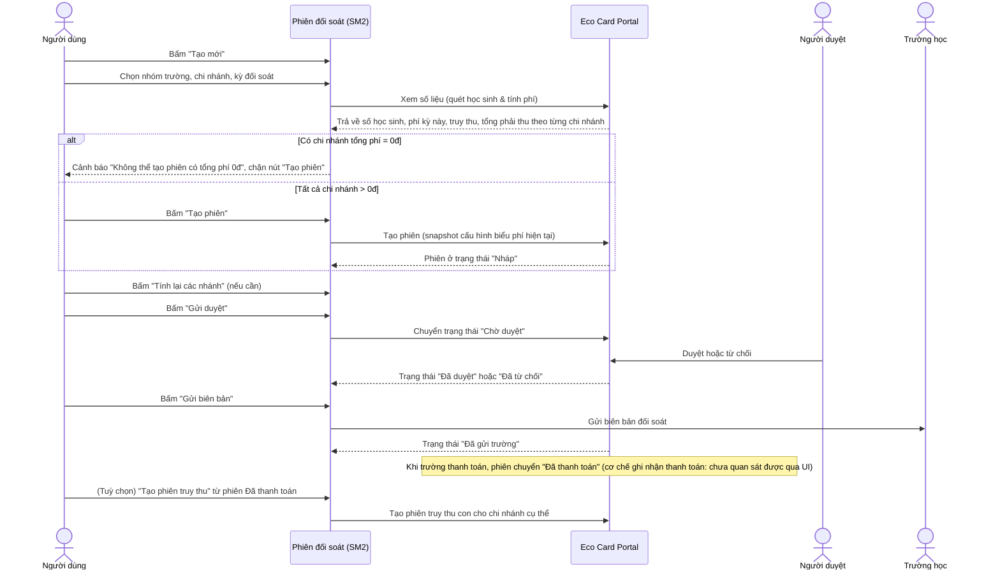
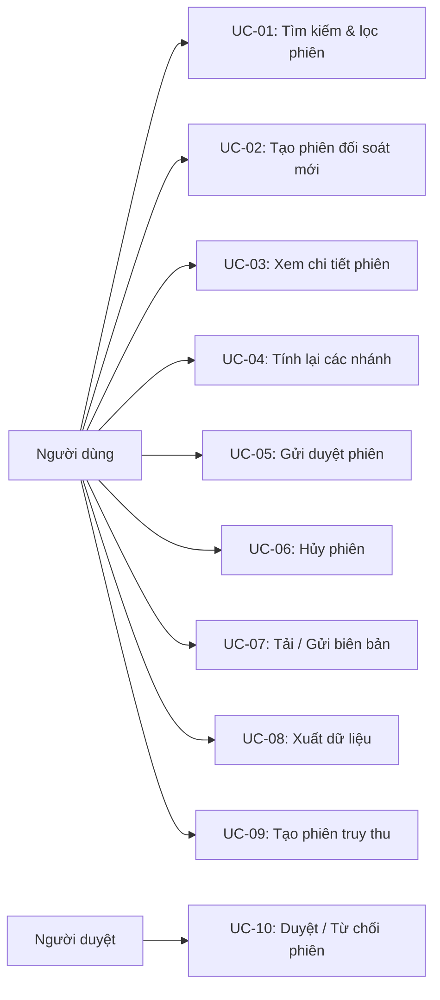
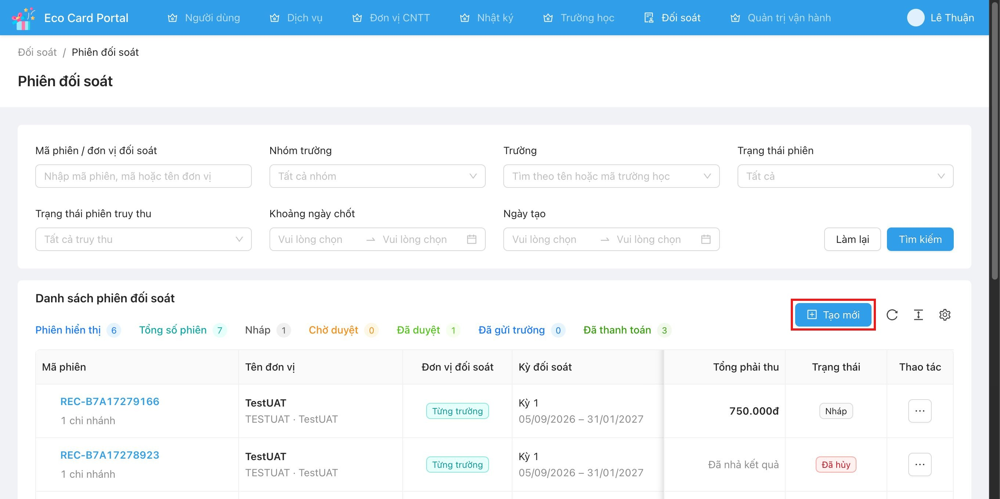
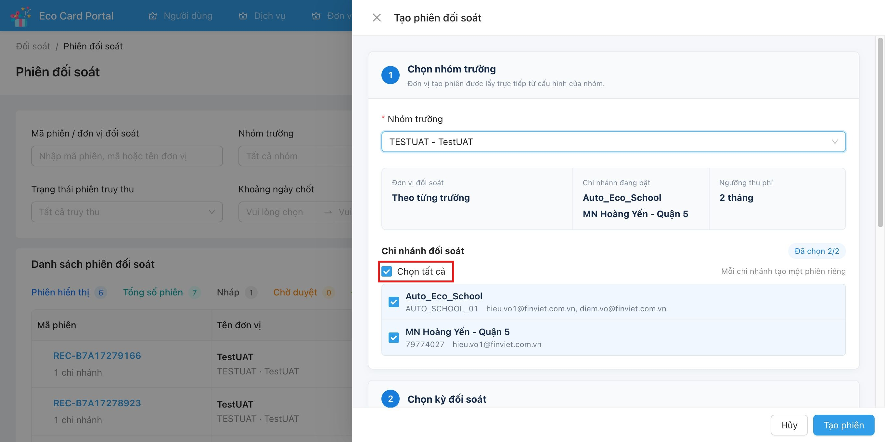
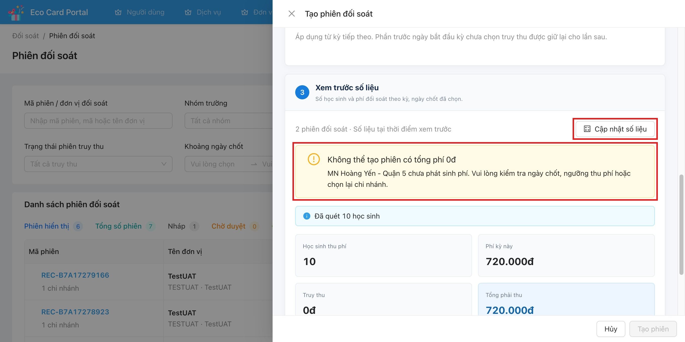
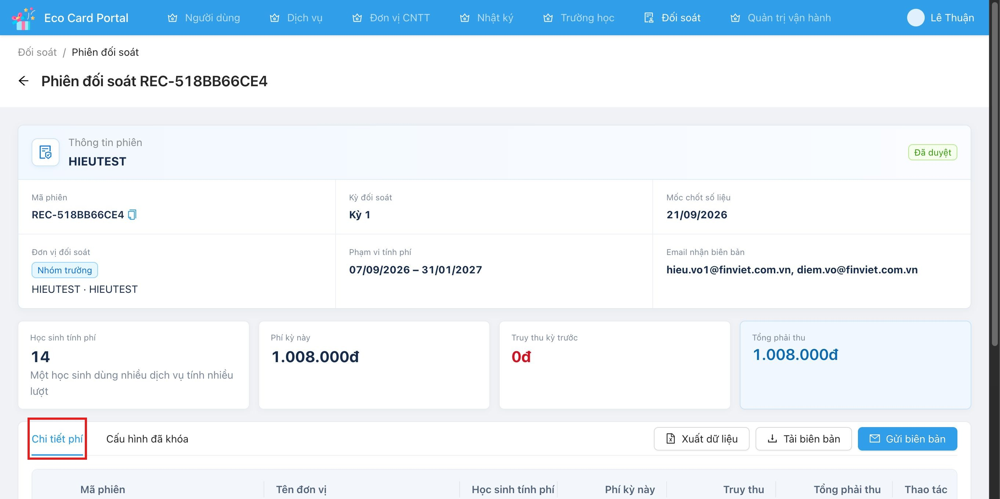
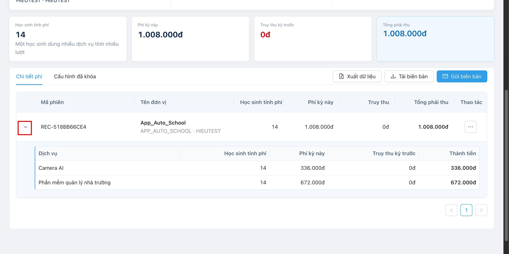
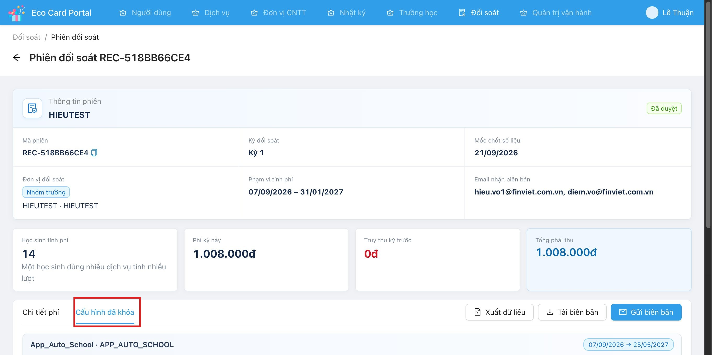
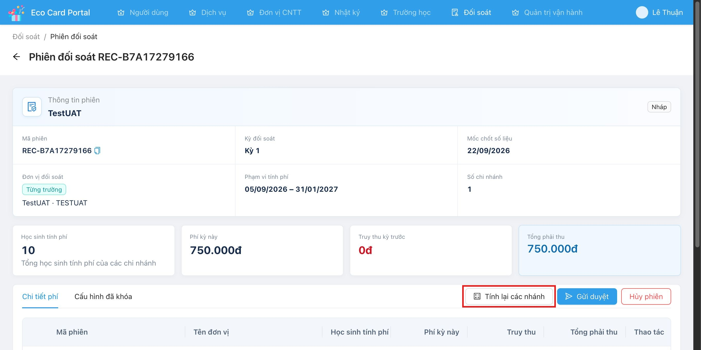

# Tên: Phiên đối soát

## Mục lục
1. Thông tin tổng quan
2. Tổng quan nghiệp vụ
3. Đặc tả tính năng

## 1. Thông tin tổng quan

### 1.1 Giới thiệu chung
"Phiên đối soát" là màn hình tạo và quản lý vòng đời các phiên tính phí định kỳ cho từng nhóm trường/chi nhánh, dựa trên cấu hình đã khai báo ở "Cấu hình đối soát" (SM1). Mỗi phiên đối soát đại diện cho một lần chốt số liệu học sinh sử dụng dịch vụ trong một kỳ, tính ra số tiền phải thu, và đi qua vòng đời duyệt/gửi biên bản/thanh toán. Module dành cho người dùng nội bộ Finviet phụ trách billing/đối soát công nợ với các trường.

### 1.2 Mục tiêu
- Tạo phiên đối soát cho một nhóm trường theo kỳ đã cấu hình, với bước xem trước số liệu (quét học sinh, tính phí) trước khi xác nhận tạo.
- Theo dõi vòng đời trạng thái của phiên: Nháp → Chờ duyệt → Đã duyệt/Đã từ chối → Đã gửi trường → Đã thanh toán, có thể Hủy phiên.
- Xem chi tiết phí theo từng chi nhánh/dịch vụ, và xem lại cấu hình biểu phí đã "khóa" (snapshot) tại thời điểm tạo phiên.
- Xuất dữ liệu, tải/gửi biên bản đối soát.
- Tạo phiên truy thu bổ sung từ một phiên đã thanh toán khi phát sinh khoản thu chưa thu đủ.

### 1.3 Phạm vi
| In scope | Out of scope |
|---|---|
| Tìm kiếm, lọc danh sách phiên đối soát theo nhóm, trường, trạng thái phiên, trạng thái truy thu, ngày chốt, ngày tạo | Cấu hình dịch vụ/biểu phí/lịch kỳ (thuộc SM1 - Cấu hình đối soát) |
| Tạo phiên đối soát mới (chọn nhóm, chi nhánh, kỳ, xem trước số liệu) | Quy trình duyệt chi tiết ở vai trò người duyệt (chỉ quan sát được nút "Gửi duyệt" từ phía người tạo, chưa quan sát được màn hình duyệt) |
| Xem chi tiết phiên: Chi tiết phí theo chi nhánh/dịch vụ, Cấu hình đã khóa | Nội dung/định dạng chi tiết của file biên bản tải về (không mở file để giữ nguyên tắc quan sát qua UI) |
| Tính lại, Gửi duyệt, Hủy phiên (khi Nháp) | Cơ chế gửi email biên bản cho trường (nội dung email, hệ thống gửi) |
| Tải biên bản, Gửi biên bản, Xuất dữ liệu | Thanh toán thực tế (ghi nhận Đã thanh toán) — chưa quan sát được UI thao tác chuyển trạng thái này |
| Tạo phiên truy thu từ phiên Đã thanh toán | |

### 1.4 Tài liệu tham khảo
Liên quan trực tiếp tới [Cấu hình đối soát](m6-sm1-cau-hinh-doi-soat.md) — phiên đối soát lấy đơn vị đối soát, danh sách chi nhánh, dịch vụ và biểu phí trực tiếp từ cấu hình nhóm trường tại thời điểm tạo phiên.

## 2. Tổng quan nghiệp vụ

### 2.1 Đối tượng
| Actor | Vai trò | Trách nhiệm chính |
|---|---|---|
| Người dùng | Người tạo/xử lý phiên đối soát (không quan sát được gate phân quyền cụ thể theo vai trò trên UI — [Cần xác nhận] có thể là Ops hoặc Finance) | Tạo phiên, tính lại, gửi duyệt, hủy phiên, tải/gửi biên bản, xuất dữ liệu, tạo phiên truy thu |
| Người duyệt | Vai trò duyệt phiên [Cần xác nhận — suy luận từ trạng thái "Chờ duyệt"/"Đã duyệt"/"Đã từ chối", chưa quan sát được màn hình thao tác của vai trò này] | Duyệt hoặc từ chối phiên ở trạng thái "Chờ duyệt" |
| Hệ thống Eco Card Portal | Hệ thống | Quét dữ liệu học sinh active, tính phí, snapshot cấu hình biểu phí vào phiên, quản lý vòng đời trạng thái |
| Trường học | Bên nhận biên bản | Nhận biên bản đối soát qua email/"Gửi biên bản" (chưa quan sát được thao tác phía trường) |

### 2.2 Luồng nghiệp vụ

#### 2.2.1 Mô hình hóa nghiệp vụ

#### 2.2.2 Mô tả các bước nghiệp vụ
| Bước | Người thực hiện | Mô tả | Kết quả |
|---|---|---|---|
| 1 | Người dùng | Bấm "Tạo mới", chọn nhóm trường | Hệ thống hiển thị đơn vị đối soát, danh sách chi nhánh đang bật, ngưỡng thu phí lấy từ SM1 |
| 2 | Người dùng | (Nếu đơn vị đối soát = "Theo từng trường") Chọn các chi nhánh cần tạo phiên | Mỗi chi nhánh chọn sẽ sinh một phiên riêng |
| 3 | Người dùng | Chọn kỳ đối soát; kỳ đã có phiên hiển thị nhãn "Đã có phiên" | Ngày chốt tự set theo ngày hiện tại; có thể tick "Truy thu phần chưa thu trước ngày bắt đầu kỳ này" |
| 4 | Người dùng | Bấm "Xem số liệu" | Hệ thống quét học sinh active và tính phí theo từng chi nhánh, hiển thị bảng xem trước |
| 5 | Hệ thống | Nếu có chi nhánh tổng phí = 0đ | Hiển thị cảnh báo và khoá nút "Tạo phiên" |
| 6 | Người dùng | Bấm "Tạo phiên" (khi số liệu hợp lệ) | Phiên mới được tạo với trạng thái "Nháp", cấu hình biểu phí được snapshot vào phiên |
| 7 | Người dùng | Xem chi tiết phiên Nháp, có thể "Tính lại các nhánh" nếu số liệu nguồn thay đổi | Số liệu phiên được tính lại |
| 8 | Người dùng | Bấm "Gửi duyệt" | Phiên chuyển trạng thái "Chờ duyệt" |
| 9 | Người duyệt | Duyệt hoặc từ chối phiên [Cần xác nhận thao tác cụ thể] | Phiên chuyển "Đã duyệt" hoặc "Đã từ chối" |
| 10 | Người dùng | Với phiên "Đã duyệt": Tải biên bản, hoặc "Gửi biên bản" cho trường | Phiên chuyển "Đã gửi trường" sau khi gửi biên bản [Cần xác nhận trình tự chính xác] |
| 11 | Hệ thống/Kế toán | Ghi nhận thanh toán [Chưa quan sát được UI] | Phiên chuyển "Đã thanh toán" |
| 12 | Người dùng | Với phiên "Đã thanh toán": bấm "Tạo phiên truy thu" nếu cần thu thêm cho một chi nhánh cụ thể | Phiên truy thu con được tạo, gắn với phiên gốc, hiển thị lồng dưới phiên gốc trong danh sách |

### 2.3 Nguyên tắc nghiệp vụ
| ID | Nguyên tắc nghiệp vụ |
|---|---|
| BR01 | Một kỳ đối soát của một nhóm trường chỉ tạo được một phiên hoạt động; kỳ đã có phiên được đánh dấu nhãn "Đã có phiên" trong danh sách chọn kỳ khi tạo mới. |
| BR02 | Nếu nhóm cấu hình đơn vị đối soát "Theo từng trường", mỗi chi nhánh được chọn khi tạo phiên sẽ sinh ra một phiên đối soát riêng biệt (không gộp chung). |
| BR03 | Trước khi tạo phiên, hệ thống bắt buộc "Xem số liệu" để quét học sinh active và tính phí xem trước; hệ thống chặn tạo phiên nếu bất kỳ chi nhánh nào trong lô có tổng phí = 0đ (thông báo: "Không thể tạo phiên có tổng phí 0đ" / "{Tên chi nhánh} chưa phát sinh phí. Vui lòng kiểm tra ngày chốt, ngưỡng thu phí hoặc chọn lại chi nhánh."). |
| BR04 | Cấu hình biểu phí (dịch vụ, đơn giá theo kỳ) được snapshot ("khóa") vào phiên tại thời điểm tạo; các thay đổi cấu hình sau đó ở SM1 không ảnh hưởng ngược lại phiên đã tạo — xem tab "Cấu hình đã khóa" trong chi tiết phiên. |
| BR05 | Một học sinh sử dụng nhiều dịch vụ được tính phí nhiều lượt trong cùng phiên, mỗi dịch vụ tính một dòng riêng (ghi chú UI: "Một học sinh dùng nhiều dịch vụ tính nhiều lượt"). |
| BR06 | Vòng đời trạng thái phiên quan sát được: Nháp → Chờ duyệt (qua "Gửi duyệt") → Đã duyệt / Đã từ chối → Đã gửi trường → Đã thanh toán; có thể "Hủy phiên" khi đang ở trạng thái Nháp. [Cần xác nhận] các bước chuyển Chờ duyệt→Đã duyệt/Đã từ chối và Đã duyệt→Đã gửi trường→Đã thanh toán vì hệ thống dev không có phiên đang ở các trạng thái trung gian này để quan sát trực tiếp. |
| BR07 | Chỉ phiên ở trạng thái "Đã thanh toán" mới có hành động "Tạo phiên truy thu" — sinh phiên phụ ("PHIÊN TRUY THU") gắn với một chi nhánh cụ thể của phiên gốc để thu khoản phát sinh sau đó; phiên truy thu hiển thị lồng (nested) dưới phiên gốc trong danh sách. |
| BR08 | Phiên ở trạng thái cuối/đã đóng (ví dụ "Đã hủy") chỉ còn hành động "Xem chi tiết", không còn thao tác nghiệp vụ nào khác trên menu Thao tác. |
| BR09 | Tuỳ chọn "Truy thu phần chưa thu trước ngày bắt đầu kỳ này" khi tạo phiên cho phép gộp khoản truy thu phát sinh trước đó vào phiên hiện tại; nếu không chọn, phần đó được giữ lại để truy thu ở kỳ kế tiếp. |
| BR10 | Ngày chốt (mốc chốt số liệu) mặc định là ngày tạo phiên (hôm nay), không phụ thuộc vào ngày bắt đầu/kết thúc của kỳ đối soát được chọn. |

## 3. Đặc tả tính năng

### 3.1 Phân rã chức năng
| Feature | Platform | Priority | User Story |
|---|---|---|---|
| Tìm kiếm & lọc danh sách phiên đối soát | Web | Cao | US-01 |
| Tạo phiên đối soát mới (kèm xem trước số liệu) | Web | Cao | US-02 |
| Xem chi tiết phiên (Chi tiết phí / Cấu hình đã khóa) | Web | Cao | US-03 |
| Tính lại các nhánh (phiên Nháp) | Web | Trung bình | US-04 |
| Gửi duyệt phiên | Web | Cao | US-05 |
| Hủy phiên (Nháp) | Web | Trung bình | US-06 |
| Tải biên bản / Gửi biên bản | Web | Cao | US-07 |
| Xuất dữ liệu phiên | Web | Trung bình | US-08 |
| Tạo phiên truy thu | Web | Trung bình | US-09 |

### 3.2 Acceptance Criteria
| User Story | Chức năng | Acceptance Criteria |
|---|---|---|
| US-01 | Tìm kiếm & lọc | Nhập/chọn điều kiện lọc (mã phiên, nhóm, trường, trạng thái phiên, trạng thái truy thu, khoảng ngày chốt, ngày tạo) và bấm "Tìm kiếm" thì bảng chỉ hiển thị phiên thoả điều kiện |
| US-02 | Tạo phiên mới | Chọn nhóm, (chọn chi nhánh nếu "Theo từng trường"), chọn kỳ, bấm "Xem số liệu" để hệ thống tính phí; nếu tất cả chi nhánh có tổng phí > 0đ thì nút "Tạo phiên" được bật, bấm "Tạo phiên" thì phiên mới xuất hiện với trạng thái "Nháp" |
| US-03 | Xem chi tiết | Vào chi tiết phiên, tab "Chi tiết phí" hiển thị bảng theo chi nhánh/dịch vụ; tab "Cấu hình đã khóa" hiển thị biểu phí đã snapshot tại thời điểm tạo phiên |
| US-04 | Tính lại | Với phiên Nháp, bấm "Tính lại các nhánh" thì số liệu phí được tính lại theo dữ liệu học sinh hiện tại |
| US-05 | Gửi duyệt | Với phiên Nháp, bấm "Gửi duyệt" thì trạng thái chuyển "Chờ duyệt" |
| US-06 | Hủy phiên | Với phiên Nháp, bấm "Hủy phiên" thì trạng thái chuyển "Đã hủy", các hành động nghiệp vụ khác không còn khả dụng |
| US-07 | Tải/Gửi biên bản | Với phiên Đã duyệt (trở lên), bấm "Tải biên bản" thì tải file biên bản về máy; bấm "Gửi biên bản" thì biên bản được gửi tới email đã cấu hình |
| US-08 | Xuất dữ liệu | Bấm "Xuất dữ liệu" thì hệ thống xuất file dữ liệu chi tiết phiên |
| US-09 | Tạo phiên truy thu | Với phiên Đã thanh toán, bấm "Tạo phiên truy thu" thì một phiên phụ được tạo cho chi nhánh liên quan, hiển thị lồng dưới phiên gốc |

### 3.3 Use case

| Trường | Nội dung |
|---|---|
| Use case ID | UC-01 |
| Use case name | Tìm kiếm & lọc danh sách phiên đối soát |
| Use case description | Người dùng lọc danh sách phiên theo mã phiên, nhóm, trường, trạng thái phiên/truy thu, khoảng ngày |
| Actor | Người dùng |
| Happy path | 1. Vào "Đối soát" > "Phiên đối soát".  2. Nhập/chọn điều kiện lọc. 3. Bấm "Tìm kiếm". 4. Bảng hiển thị kết quả cùng các số liệu tổng hợp (Phiên hiển thị, Tổng số phiên, Nháp, Chờ duyệt, Đã duyệt, Đã gửi trường, Đã thanh toán). |
| Exception | Không có phiên phù hợp → Chưa quan sát được message cụ thể |
| Trigger | Bấm "Tìm kiếm" hoặc "Làm lại" |
| Pre-condition | Người dùng đã đăng nhập, có quyền truy cập module Đối soát |
| Post-condition | Danh sách hiển thị đúng điều kiện lọc |
| Business Rules | Không có |

| Trường | Nội dung |
|---|---|
| Use case ID | UC-02 |
| Use case name | Tạo phiên đối soát mới |
| Use case description | Khởi tạo một (hoặc nhiều, nếu theo từng trường) phiên đối soát cho một nhóm trường theo kỳ đã chọn, sau khi xem trước số liệu |
| Actor | Người dùng |
| Happy path | 1. Bấm "Tạo mới". 2. Chọn "Nhóm trường"; hệ thống hiển thị đơn vị đối soát, chi nhánh đang bật, ngưỡng thu phí. 3. Nếu đơn vị đối soát là "Theo từng trường", chọn các chi nhánh cần tạo phiên (mặc định chọn tất cả).  4. Chọn "Kỳ đối soát" (kỳ đã có phiên hiển thị nhãn "Đã có phiên"); Ngày chốt tự động là ngày hiện tại; tuỳ chọn tick "Truy thu phần chưa thu trước ngày bắt đầu kỳ này". 5. Bấm "Xem số liệu"; hệ thống quét học sinh và tính phí, hiển thị bảng số liệu theo từng chi nhánh.  6. Nếu tất cả chi nhánh có tổng phí > 0đ, bấm "Tạo phiên". |
| Exception | Nếu có chi nhánh tổng phí = 0đ: hệ thống hiển thị cảnh báo "Không thể tạo phiên có tổng phí 0đ" kèm tên chi nhánh cụ thể và khoá nút "Tạo phiên" cho toàn bộ lô (xem 3.4.2) |
| Trigger | Bấm nút "Tạo mới" trên danh sách phiên |
| Pre-condition | Nhóm trường đã có cấu hình hợp lệ ở SM1 (lịch kỳ, dịch vụ, biểu phí); kỳ được chọn chưa có phiên hoạt động (hoặc người dùng chấp nhận tạo thêm dù có nhãn "Đã có phiên" — [Cần xác nhận] hệ thống có chặn cứng hay chỉ cảnh báo) |
| Post-condition | Phiên mới được tạo ở trạng thái "Nháp" với cấu hình biểu phí đã snapshot |
| Business Rules | BR01, BR02, BR03, BR04, BR05, BR09, BR10 |

| Trường | Nội dung |
|---|---|
| Use case ID | UC-03 |
| Use case name | Xem chi tiết phiên đối soát |
| Use case description | Xem thông tin tổng quan, chi tiết phí theo chi nhánh/dịch vụ, và cấu hình biểu phí đã khoá của một phiên |
| Actor | Người dùng |
| Happy path | 1. Từ danh sách, bấm vào mã phiên hoặc "Thao tác" > "Xem chi tiết". 2. Trang chi tiết hiển thị thông tin phiên (mã, kỳ, mốc chốt, đơn vị đối soát, phạm vi tính phí, email nhận biên bản, học sinh tính phí, phí kỳ này, truy thu kỳ trước, tổng phải thu).  3. Tab "Chi tiết phí": mở rộng dòng chi nhánh để xem breakdown theo từng dịch vụ (học sinh tính phí, phí kỳ này, truy thu kỳ trước, thành tiền).  4. Tab "Cấu hình đã khóa": xem biểu phí đã snapshot tại thời điểm tạo phiên, theo từng dịch vụ và từng kỳ hiệu lực.  |
| Exception | Không có |
| Trigger | Bấm vào mã phiên hoặc chọn "Xem chi tiết" |
| Pre-condition | Phiên đã tồn tại |
| Post-condition | Không thay đổi dữ liệu |
| Business Rules | BR04, BR05 |

| Trường | Nội dung |
|---|---|
| Use case ID | UC-04 |
| Use case name | Tính lại các nhánh |
| Use case description | Tính lại số liệu phí của phiên đang ở trạng thái Nháp theo dữ liệu học sinh/cấu hình hiện tại |
| Actor | Người dùng |
| Happy path | 1. Vào chi tiết phiên Nháp.  2. Bấm "Tính lại các nhánh". 3. Số liệu phí được cập nhật lại. |
| Exception | Chưa quan sát được |
| Trigger | Bấm "Tính lại các nhánh" |
| Pre-condition | Phiên đang ở trạng thái Nháp |
| Post-condition | Số liệu phí của phiên được cập nhật |
| Business Rules | BR04 |

| Trường | Nội dung |
|---|---|
| Use case ID | UC-05 |
| Use case name | Gửi duyệt phiên |
| Use case description | Chuyển phiên từ Nháp sang trạng thái chờ người có thẩm quyền duyệt |
| Actor | Người dùng |
| Happy path | 1. Vào chi tiết phiên Nháp (hoặc menu Thao tác trên danh sách). 2. Bấm "Gửi duyệt". 3. Trạng thái phiên chuyển "Chờ duyệt". |
| Exception | Chưa quan sát được |
| Trigger | Bấm "Gửi duyệt" |
| Pre-condition | Phiên đang ở trạng thái Nháp |
| Post-condition | Phiên chuyển trạng thái "Chờ duyệt", không còn thao tác "Tính lại"/"Hủy phiên" [Cần xác nhận] |
| Business Rules | BR06 |

| Trường | Nội dung |
|---|---|
| Use case ID | UC-06 |
| Use case name | Hủy phiên |
| Use case description | Hủy một phiên đối soát đang ở trạng thái Nháp |
| Actor | Người dùng |
| Happy path | 1. Vào chi tiết phiên Nháp hoặc menu Thao tác trên danh sách. 2. Bấm "Hủy phiên". 3. Trạng thái chuyển "Đã hủy". |
| Exception | Chưa quan sát được (có thể có dialog xác nhận trước khi hủy — chưa thao tác để tránh phát sinh thay đổi dữ liệu thật) |
| Trigger | Bấm "Hủy phiên" |
| Pre-condition | Phiên đang ở trạng thái Nháp |
| Post-condition | Phiên chuyển "Đã hủy"; menu Thao tác chỉ còn "Xem chi tiết" (BR08) |
| Business Rules | BR06, BR08 |

| Trường | Nội dung |
|---|---|
| Use case ID | UC-07 |
| Use case name | Tải biên bản / Gửi biên bản |
| Use case description | Tải file biên bản đối soát về máy, hoặc gửi biên bản tới email đã cấu hình cho nhóm/chi nhánh |
| Actor | Người dùng |
| Happy path | 1. Vào chi tiết phiên đã Duyệt (hoặc từ menu Thao tác trên danh sách). 2. Bấm "Tải biên bản" để tải file, hoặc bấm "Gửi biên bản" để gửi email. |
| Exception | Chưa quan sát được |
| Trigger | Bấm "Tải biên bản" / "Gửi biên bản" |
| Pre-condition | Phiên đã ở trạng thái Đã duyệt trở lên |
| Post-condition | File biên bản được tải về, hoặc email được gửi; trạng thái có thể chuyển "Đã gửi trường" sau khi gửi biên bản [Cần xác nhận] |
| Business Rules | Không có |

| Trường | Nội dung |
|---|---|
| Use case ID | UC-08 |
| Use case name | Xuất dữ liệu phiên đối soát |
| Use case description | Xuất file dữ liệu chi tiết của phiên (hoặc của một chi nhánh trong phiên) |
| Actor | Người dùng |
| Happy path | 1. Từ chi tiết phiên hoặc menu Thao tác trên danh sách/dòng chi nhánh, bấm "Xuất dữ liệu". 2. File dữ liệu được xuất. |
| Exception | Chưa quan sát được |
| Trigger | Bấm "Xuất dữ liệu" |
| Pre-condition | Phiên đã tồn tại |
| Post-condition | File dữ liệu được tải về |
| Business Rules | Không có |

| Trường | Nội dung |
|---|---|
| Use case ID | UC-09 |
| Use case name | Tạo phiên truy thu |
| Use case description | Tạo một phiên phụ để truy thu khoản phát sinh thêm cho một chi nhánh cụ thể, dựa trên một phiên gốc đã thanh toán |
| Actor | Người dùng |
| Happy path | 1. Trên dòng phiên "Đã thanh toán", bấm "Thao tác" > "Tạo phiên truy thu". 2. Phiên truy thu con được tạo, hiển thị lồng dưới phiên gốc kèm nhãn "PHIÊN TRUY THU" khi bấm mở rộng ("N phiên truy thu · Xem"). |
| Exception | Chưa quan sát được (không thao tác thật để tránh tạo dữ liệu billing giả) |
| Trigger | Chọn "Tạo phiên truy thu" từ menu Thao tác |
| Pre-condition | Phiên gốc đang ở trạng thái "Đã thanh toán" |
| Post-condition | Phiên truy thu mới xuất hiện lồng dưới phiên gốc, có mã phiên riêng và đi qua vòng đời trạng thái riêng |
| Business Rules | BR07 |

| Trường | Nội dung |
|---|---|
| Use case ID | UC-10 |
| Use case name | Duyệt / Từ chối phiên |
| Use case description | Người có thẩm quyền duyệt hoặc từ chối một phiên đang "Chờ duyệt" |
| Actor | Người duyệt |
| Happy path | [Chưa quan sát được — không có phiên ở trạng thái "Chờ duyệt" trong dữ liệu dev để quan sát UI/thao tác cụ thể] |
| Exception | Chưa quan sát được |
| Trigger | Chưa quan sát được |
| Pre-condition | Phiên đang ở trạng thái "Chờ duyệt" |
| Post-condition | Phiên chuyển "Đã duyệt" hoặc "Đã từ chối" |
| Business Rules | BR06 [Cần xác nhận toàn bộ use case này] |

### 3.4 Edge Cases & Error Handling

#### 3.4.1 Tổng quan
| Nhóm | Tình huống | Xử lý mong đợi |
|---|---|---|
| Tạo phiên | Chi nhánh chưa phát sinh phí (0đ) trong kỳ đã chọn | Hệ thống cảnh báo và chặn tạo phiên cho toàn bộ lô đang chọn, không chỉ riêng chi nhánh lỗi |
| Tạo phiên | Kỳ đã có phiên tồn tại | Nhãn "Đã có phiên" hiển thị trong danh sách chọn kỳ [Cần xác nhận có chặn chọn hẳn hay chỉ cảnh báo] |
| Vòng đời | Phiên đã ở trạng thái đóng (Đã hủy) | Menu Thao tác chỉ còn "Xem chi tiết" |
| Truy thu | Phiên gốc chưa "Đã thanh toán" | Hành động "Tạo phiên truy thu" không xuất hiện trong menu Thao tác (chỉ thấy ở phiên Đã thanh toán) |

#### 3.4.2 Danh sách Thông báo (lỗi/thành công)
| Message ID | Trường hợp lỗi | Rule kiểm tra | Message đề xuất | Hình thức báo | Hành vi hệ thống |
|---|---|---|---|---|---|
| MSG-01 | Tạo phiên khi một hoặc nhiều chi nhánh trong lô chọn có tổng phí đối soát = 0đ trong kỳ đã chọn | Tổng phải thu của chi nhánh = 0đ sau khi quét học sinh & tính phí | "Không thể tạo phiên có tổng phí 0đ" — "{Tên chi nhánh} chưa phát sinh phí. Vui lòng kiểm tra ngày chốt, ngưỡng thu phí hoặc chọn lại chi nhánh." | Alert đỏ (error) trong modal Tạo phiên đối soát | Khoá nút "Tạo phiên", không cho tạo bất kỳ phiên nào trong lô cho tới khi vấn đề được xử lý |
| MSG-02 | Sau khi quét dữ liệu học sinh thành công (không phải lỗi) | Luôn hiển thị sau khi bấm "Xem số liệu" | "Đã quét {N} học sinh" | Alert xanh/info trong modal Tạo phiên đối soát | Hiển thị số liệu xem trước (học sinh thu phí, phí kỳ này, truy thu, tổng phải thu) theo từng chi nhánh |

### 3.5 Non-functional Requirements
| ID | Nhóm | Yêu cầu |
|---|---|---|
| NF01 | Ngôn ngữ | Toàn bộ giao diện bằng tiếng Việt |
| NF02 | Định dạng số | Tiền tệ hiển thị theo định dạng VNĐ có dấu phân cách nghìn (VD: 1.008.000đ) |
| NF03 | Định dạng ngày | Ngày hiển thị theo dd/mm/yyyy |
| NF04 | Hiệu năng | Bước "Xem số liệu" cần thời gian xử lý (hiển thị trạng thái loading "Đang quét học sinh và tính phí...") do phải quét dữ liệu học sinh active |

### 3.6 Quy ước UI chung
- Trạng thái phiên luôn hiển thị dưới dạng badge màu (Nháp: xám, Đã duyệt: xanh dương/lá, Đã thanh toán: xanh lá, Đã hủy/Đã từ chối: đỏ — quan sát tương đối qua ảnh chụp màn hình, màu chính xác theo theme hệ thống).
- Có thể có 2 badge trạng thái đồng thời trên một dòng (VD "Đã nhả kết quả" + "Đã hủy") khi phiên vừa có trạng thái truy thu vừa có trạng thái chính — [Cần xác nhận] ý nghĩa chính xác của nhãn "Đã nhả kết quả".
- Bảng danh sách có nút mở rộng dòng để xem "PHIÊN TRUY THU" lồng bên dưới phiên gốc khi tồn tại.
- Menu "Thao tác" thay đổi lựa chọn theo trạng thái hiện tại của phiên (state-dependent actions) — xem chi tiết ở mục 2.3 BR06-BR08.
- Nút hành động chính ở trang chi tiết phiên (Tính lại/Gửi duyệt/Hủy phiên hoặc Xuất dữ liệu/Tải biên bản/Gửi biên bản) nằm cùng hàng với tab "Chi tiết phí"/"Cấu hình đã khóa", thay đổi theo trạng thái phiên.
- Modal "Tạo phiên đối soát" chia rõ 3 bước đánh số (1 Chọn nhóm trường, 2 Chọn kỳ đối soát, 3 Xem trước số liệu), chỉ cho bấm "Tạo phiên" sau khi đã xem số liệu hợp lệ.
